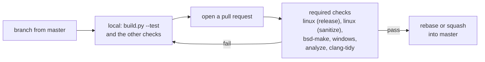

# Contributing to Klin

Thank you for helping. Bug reports, fixes, tests and documentation are all
welcome, and this page says how to get a change from your machine into
master.

**Security problems:** do not open an issue. Report them privately as
[SECURITY.md](SECURITY.md) describes.

## Before you start

For anything larger than a small fix, open an issue first and describe
what you want to change and why. That way we can agree on the approach
before you write the code, and you don't spend a weekend on something I
would have steered differently.

Klin runs on small devices. A change should not add a dependency, a thread
or a large amount of memory without a good reason.

Behaviour that makes a deployment less safe (a weaker default, a check
removed) needs a setting to turn it on, documentation, and a ChangeLog
entry.

## The path to master

The figure below shows the route a change takes. master only accepts
changes through a pull request, and only once the required checks pass on
a branch that is up to date with master.



The required checks come from three workflows. `linux (release)`,
`linux (sanitize)`, `bsd-make` and `windows` are jobs in Build and test,
`analyze` is CodeQL, and `clang-tidy` is Static analysis. ClusterFuzzLite
also fuzzes every pull request that changes code, but it is not a required
check. Review conversations must be resolved before the merge. See
[doc/RELEASES.md](doc/RELEASES.md#workflows) for what each workflow runs.

## Building and testing

The [README](README.md#quick-start-linux-wsl-macos) lists what to
install. Then, from the repository:

```sh
python3 build/build.py --test               # release build, all tests
python3 build/build.py --sanitize --test    # ASan, LSan and UBSan
python3 test/run_build_checks.py            # the CMake build itself
python3 test/run_fuzz.py --runs 20000       # every fuzz target (Linux, clang)
```

The simple rule is that a change is ready when these pass with no new
compiler warnings. Continuous integration runs them, and more (BSD make,
Windows, CodeQL, clang-tidy, fuzzing), on every pull request.

## Writing the change

- Follow [doc/CONVENTIONS.md](doc/CONVENTIONS.md): C99, the style of the
  file you edit, its return values, ownership and error macros, and
  `klin/crypto.h` for all cryptography.
- Add a test for every fix and feature: `test/run_server_tests.py` for
  anything a client can see, `test/regressions.c` for a function on its
  own, `fuzz/` for a new parser.
- Update the documentation the change touches: `doc/*.md`, the manual
  pages in `doc/man`, and the README for anything user-visible.
- Add a ChangeLog entry for anything a user of Klin would notice.

## Pull requests

Keep to one change per pull request, with a description of what it
changes, why, and how you tested it. Keep commits focused, with a commit
message that says what changed and why.

If you touch a workflow, pin actions to commit SHAs and give jobs only the
permissions they need. `test/run_release_checks.py` checks this (see
[doc/RELEASES.md](doc/RELEASES.md)).

By contributing, you agree that your contribution is licensed under the
project's [BSD 3-Clause License](https://github.com/DanielTillett/klin/blob/master/LICENSE).
