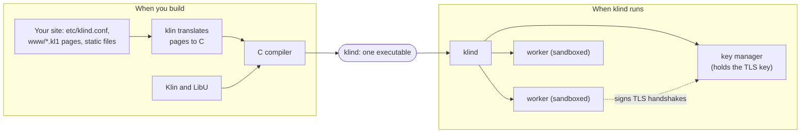

# Klin

**A web framework for embedded devices: the web server, its configuration
and your pages, compiled into one small program.**

[](https://github.com/DanielTillett/klin/actions/workflows/build.yml)
[](https://github.com/DanielTillett/klin/actions/workflows/codeql.yml)
[](https://scorecard.dev/viewer/?uri=github.com/DanielTillett/klin)
[](https://github.com/DanielTillett/klin/blob/master/LICENSE)

Klin builds a device's web interface into a single executable, `klind`:
an HTTP and HTTPS server, its configuration, and the site's static files
and pages, where a page is HTML with C code in it. It is about 0.7 MB
(stripped, x86-64 Linux), needs only libc, OpenSSL 3 and zlib, and comes
with secure defaults for a device on a network.

```html
<%! #include <time.h> %>
<html><body>
  <h1>Device status</h1>
  <p>Time on the device: <% time_t t = time(NULL); io_printf(out, "%s", ctime(&t)); %></p>
</body></html>
```

Klin is derived from [KLone](https://github.com/koanlogic/klone) by
KoanLogic s.r.l. (no longer maintained) and was called KLone until 4.0.0,
which brings it up to date: a CMake build that needs no GNU make, OpenSSL 3
with TLS 1.2 or newer, hardened HTTP parsing and sessions, a sandbox, and
automated regression, full-server and fuzz tests. Upgrading from KLone?
Read [Upgrading from KLone](doc/UPGRADING.md) first.

**Try it** (Linux or WSL, with the tools in [Quick start](#quick-start-linux-wsl-macos)):

```sh
git clone https://github.com/DanielTillett/klin.git && cd klin
python3 build/build.py                       # fetches the pinned LibU, builds
cmake -S . -B out -G Ninja -DKLIN_SITE_DIR=doc/example-site
cmake --build out
out/bin/klind -F                             # then open http://localhost:8080/
```

**Contents:** [Why Klin](#why-klin) · [How it works](#how-it-works) ·
[Documentation](#documentation) ·
[Quick start](#quick-start-linux-wsl-macos) ·
[Building with CMake](#building-with-cmake) ·
[Build-and-test runner](#build-and-test-runner) ·
[Writing and running a site](#writing-and-running-a-site) ·
[Testing](#testing) ·
[Upgrading from KLone](#upgrading-from-klone) ·
[Known limitations](#known-limitations) ·
[Contributing](CONTRIBUTING.md) · [Security policy](SECURITY.md)


## Why Klin

Many devices need a web interface but cannot carry a general-purpose web
stack: a router, an industrial controller, a laboratory or test
instrument, a camera or a sensor gateway. Klin is built for that case.

- **One self-contained program.** The server, its configuration and the
  whole site (pages, images, scripts, style sheets) are compiled into a
  single executable, `klind`. There is no interpreter, no separate web
  server and nothing to unpack at install time, and the embedded site
  cannot be changed on the device. It runs from a read-only file system.
- **Small.** A stripped `klind` for x86-64 Linux is about 0.7 MB, and it needs
  only libc, OpenSSL 3 and zlib (both optional at build time). Pages are
  compiled C, so a request costs no interpreter start-up or garbage
  collection.
- **Pages in C.** A page is HTML with C code in it (`<% ... %>`), so it can
  call a device's own libraries, drivers and ioctls directly, with no
  bindings or IPC layer between the web interface and the hardware.
- **Secure defaults** for a device exposed to a network: TLS 1.2 and 1.3
  with forward-secret ciphers only; the TLS private key held by a separate
  process; workers under a seccomp sandbox with resource limits; a
  strict, fuzzed HTTP parser; hardened sessions with CSRF tokens; access
  rules and HTTP authentication; reproducible, signed releases with an
  SBOM. Each protection is documented with the setting that changes it.
- **Current web features:** REST routes and JSON, request validation,
  Server-Sent Events and WebSockets, keep-alive, ETags and ranges.
- **Portable C** (C99) with a CMake build that needs no GNU make: Linux,
  macOS, and Windows (MinGW, single process); BSD-licensed.
- **KLone's successor.** Klin keeps KLone's page format and configuration and
  accepts its old names throughout 4.x, so a KLone 3.x site moves over
  with few changes ([Upgrading from KLone](doc/UPGRADING.md)).

It is less suited to sites whose content changes at run time (a CMS or a
blog), to teams that want a scripting language for their pages, or to
large-scale web serving, where a general-purpose server behind a load
balancer is the usual choice.


## How it works



The site is translated and compiled into `klind` when you build it. When
it runs, klind starts worker processes that serve the requests, each
under a sandbox and resource limits, and a key manager process that holds
the TLS private key, which the workers never see. On Windows, klind
serves in a single process.


## Documentation

This README covers building, running, testing and what changed from
KLone. The manual pages are in [doc/man](https://github.com/DanielTillett/klin/tree/master/doc/man): `klind(8)` the daemon,
`klind.conf(5)` its configuration, `klin(1)` the page translator and site
tool. The other topics are in [doc/](https://github.com/DanielTillett/klin/tree/master/doc):

| Building a site | Security | Running and project |
| --- | --- | --- |
| [Routes](doc/ROUTES.md): REST routes | [TLS](doc/TLS.md): protocols, ciphers, tickets | [Limits](doc/LIMITS.md): request and worker limits |
| [JSON](doc/JSON.md): reader and writer | [Key manager](doc/KEYMGR.md): the TLS private key | [systemd](doc/SYSTEMD.md): the hardened unit |
| [Validation](doc/VALIDATE.md): request parameters | [Sandbox](doc/SANDBOX.md): seccomp for workers | [Hardening](doc/HARDENING.md): compiler flags |
| [Sessions](doc/SESSIONS.md): sessions and CSRF | [Access](doc/ACCESS.md): IP access rules | [Fuzzing](doc/FUZZING.md): fuzzing, static analysis |
| [SSE](doc/SSE.md): Server-Sent Events | [Authentication](doc/AUTH.md): Basic and Digest | [Releases](doc/RELEASES.md): signing, SBOM, CI rules |
| [WebSocket](doc/WEBSOCKET.md): WebSockets | [Headers](doc/HEADERS.md): security headers | [Conventions](doc/CONVENTIONS.md): code conventions |
| [Files](doc/FILES.md): files from the disk | [CGI](doc/CGI.md): CGI scripts and their limits | [Crypto](doc/CRYPTO.md): the encryption API |
| **[Writing a site](doc/PAGES.md): start here** | | [Upgrading from KLone](doc/UPGRADING.md) |

[doc/example-site](https://github.com/DanielTillett/klin/tree/master/doc/example-site) is a small site to start from.
[SECURITY.md](SECURITY.md) says how to report a vulnerability,
[ChangeLog](https://github.com/DanielTillett/klin/blob/master/ChangeLog) lists every change and [TODO](https://github.com/DanielTillett/klin/blob/master/TODO) what is
planned.


## Quick start (Linux, WSL, macOS)

Requirements: CMake 3.24 or newer, a build tool (Ninja, BSD make or GNU
make), GCC or Clang, OpenSSL 3, zlib, Git, and Python 3.9 or newer for the
build-and-test runner. On Ubuntu:

```sh
sudo apt-get update
sudo apt-get install build-essential clang libclang-rt-dev libssl-dev \
    zlib1g-dev python3 git cmake ninja-build
python3 build/build.py --test
```

On Windows, run the same commands inside WSL, for example from PowerShell
in this repository:

```sh
wsl -d Ubuntu -- python3 build/build.py --test
```

On macOS, with Homebrew:

```sh
brew install cmake ninja openssl@3
export OPENSSL_ROOT_DIR=$(brew --prefix openssl@3)
python3 build/build.py --test
```

`build/build.py` fetches the pinned LibU, builds Klin without a site and
runs the tests: `klind` is in `.build/release/cmake/bin`, with the page
translator `klin`, and the build logs and `build-info.json` are in
`.build/release`. To build a klind with a site in it, see
[Writing and running a site](#writing-and-running-a-site).


## Building with CMake

`build/build.py` (below) wraps CMake with pinned dependencies and tests.
To use CMake directly, fetch the pinned LibU once (`python3 build/build.py`
does this, or pass `-DLIBU_SOURCE_DIR=<checkout>`), then:

```sh
cmake -S . -B out -G Ninja -DKLIN_SITE_DIR=doc/example-site
cmake --build out
cmake --install out           # optional; honors CMAKE_INSTALL_PREFIX
```

Options (KLone 3.x configure equivalents in brackets):

| Option | Default | What it does |
| --- | --- | --- |
| `KLIN_SITE_DIR=<dir>` | none | the site to embed in klind ([PAGES](doc/PAGES.md)) |
| `KLIN_IMPORT_ARGS=<list>` | none | extra `klin -c import` options, e.g. `"-z;-x;*.bak"`: compression, exclusions, encryption patterns and key file |
| `KLIN_ENABLE_SUP_FS=ON` | `OFF` | serve files from the file system [`--enable_sup_fs`] ([FILES](doc/FILES.md)) |
| `KLIN_ENABLE_SUP_CGI=ON` | `OFF` | run CGI scripts [`--enable_sup_cgi`] ([CGI](doc/CGI.md)) |
| `KLIN_ENABLE_HOOKS=ON` | `OFF` | call your `hooks_setup()` [`--enable_hooks`] |
| `KLIN_WEBAPP_SOURCES=<list>` | `webapp/webapp.c` | your C sources linked into klind [`WEBAPP_SRCS`] |
| `KLIN_WITH_OPENSSL=OFF` | `ON` | build without TLS and encryption |
| `KLIN_WITH_ZLIB=OFF` | `ON` | build without compression |
| `KLIN_HARDENING=OFF` | `ON` | compiler and linker hardening ([HARDENING](doc/HARDENING.md)) |
| `KLIN_STACK_PROTECTOR=OFF` | `ON` | `-fstack-protector-all` where the compiler has it |
| `KLIN_DEBUG=ON` | `OFF` | debug logging and symbols [`--enable_debug`] |
| `KLIN_ENABLE_WARNINGS=ON` | `OFF` | extra warnings [`--enable_warns`] |
| `KLIN_DAEMON_NAME=<name>` | `klind` | the daemon's file name [`--daemon_name`] |
| `KLIN_INSTALL_DAEMON_ONLY=ON` | `OFF` | install only klind [`--install_daemon_only`] |
| `KLIN_BUILD_TESTS=ON` | `OFF` | build the unit tests (run them with ctest) |
| `KLIN_FUZZ=ON` | `OFF` | build the fuzz targets ([FUZZING](doc/FUZZING.md)) |
| `LIBU_ENABLE_SCTP=ON` | `OFF` | SCTP in LibU (`sctp4://`, `sctp6://` addresses) |

Multi-configuration generators (Visual Studio, Xcode, Ninja Multi-Config)
are not supported; choose the configuration with `CMAKE_BUILD_TYPE`
(`Release`, the default, builds with `-O2`). GNU make is not required.
With BSD make, use the Makefile generator (BSD make cannot handle spaces
in site paths; use Ninja for those):

```sh
cmake -S . -B out -G "Unix Makefiles" -DCMAKE_MAKE_PROGRAM=bmake
cd out && bmake
```

With Doxygen installed, `cmake --build out --target doc` writes the API
reference to `out/doc`.

### Using an installed Klin

The install has the libraries, the headers (Klin's, LibU's and the
generated configuration headers), a CMake package and a pkg-config file.
The server itself (with the embedded site and `emb_init()`) is linked by
the CMake build; the installed libraries do not contain klind's own
sources, as in KLone 3.x.

```cmake
find_package(Klin 4 REQUIRED)
target_link_libraries(myprogram PRIVATE Klin::klin)
```

```sh
cc myprogram.c $(pkg-config --cflags --libs klin)
```

### How the build works

CMake runs the platform checks that KLone 3.x's configure ran and
generates `klin_conf.h` and LibU's `libu_conf.h` in the build directory.
It builds LibU from the pinned checkout without modifying it, then the
`klin` tool, then the site. The site is a small separate CMake project
(`cmake/site`) because the `klin` tool must exist before the site can be
imported: `klin -c import` writes `autogen.cmake`, a list of pages, and
each page is translated to C and compiled into `libsite`. Editing a page
retranslates only that page; adding or removing files re-runs the import.


## Build-and-test runner

```
python3 build/build.py [--sanitize] [--test] [--offline] [--incremental]
                       [--jobs N] [--generator G] [--make-program P]
```

| Option | What it does |
| --- | --- |
| `--sanitize` | build with AddressSanitizer and UndefinedBehaviorSanitizer into `.build/sanitize` instead of `.build/release` |
| `--test` | run the unit tests, the regression suite and the full-server tests after building (see [Testing](#testing)) |
| `--offline` | use dependencies already downloaded; fail if one is missing |
| `--incremental` | reuse the previous build directory during development; omit it for clean, release-quality checks |
| `--jobs N` | parallel build jobs (default 2) |
| `--generator G` | CMake generator (default Ninja if installed, otherwise `"Unix Makefiles"`) |
| `--make-program P` | build tool for the generator, e.g. `bmake` |

How the runner works:

- LibU is cloned at the exact commit pinned in `build/dependencies.json`.
  An existing checkout must match that commit and have no tracked
  modifications (CRLF-only differences are tolerated).
- Sources are copied as they are (`.gitattributes` checks text out with
  LF on every platform) into `.build/<mode>/source` and built out of tree
  in `.build/<mode>/cmake`. Your checkout is never configured or compiled
  in place, and nothing is installed on the system.
- Only one build may use a given `.build/<mode>` directory at a time; a
  second concurrent build of the same mode is refused.
- `build-info.json` records the dependency commits, a normalized source
  fingerprint, the compiler, CMake, generator and OpenSSL versions, and
  the C flags. This reproduces the source inputs; identical binaries
  across different compilers or distributions are not guaranteed.
- The build fails, rather than silently disabling TLS, if OpenSSL 3 is
  not found.


## Writing and running a site

[Writing a site](doc/PAGES.md) shows the layout of a site, how a page is
written (the `<% %>` tags and the variables a page has), a page that
reads a request argument safely, and how to build and run it. In short:

```sh
cmake -S . -B out -G Ninja -DKLIN_SITE_DIR=/path/to/mysite
cmake --build out
out/bin/klind -F               # the site's own etc/klind.conf
out/bin/klind -F -f my.conf    # another configuration file instead
```

`-F` keeps klind in the foreground with its configured server model; `-d`
adds debug logging and serves requests one at a time in a single process.
`-f` uses another configuration file instead of the embedded one (they
are not merged). See klind(8) and klind.conf(5) in
[doc/man](https://github.com/DanielTillett/klin/tree/master/doc/man);
the files in [etc/](https://github.com/DanielTillett/klin/tree/master/etc)
are sample configurations (virtual hosts, HTTPS, CGI, IPv6, access logs,
sessions without a disk).

**HTTPS:** the certificate in `doc/example-site/etc/klind.pem` is a
1024-bit RSA key with an MD5 signature that expired in 2006. OpenSSL 3 at
the default security level of common distributions refuses it, so an
HTTPS server using it does not start. Generate your own and point
`cert_file` and `key_file` at it (use a certificate from a trusted CA in
production):

```sh
openssl req -x509 -newkey rsa:3072 -nodes -keyout key.pem \
    -out cert.pem -days 365 -subj /CN=localhost
```


## Testing

```sh
python3 build/build.py --test
python3 build/build.py --sanitize --test
```

`--test` runs, in order:

1. The unit tests (ctest).
2. The regression suite (about a hundred checks), which compiles selected
   production functions verbatim as C99, with warnings treated as errors,
   and runs them under the sanitizers. LibU and network collaborators are
   test doubles; production MD5 is linked directly.
3. The full-server tests (about 500 checks), run twice: once in the
   single-process model and once in the prefork model. They embed the
   test site in `test/site` and start klind on temporary localhost ports
   (IPv4, and IPv6 where the host has it). Among others, they check:
   - HTTP: static files, pages, HEAD, ranges and ETags; malformed headers
     and URIs, request smuggling and limits; keep-alive;
   - TLS: versions, ciphers, renegotiation, client certificates and
     session tickets;
   - applications: sessions and CSRF, access rules, authentication,
     routes, validation, SSE and WebSockets, files, symbolic links and
     CGI scripts;
   - isolation: the sandbox, the key manager (whose memory no worker may
     read) and worker limits, and the configurations klind must refuse at
     startup; as root, dropping root, `blind_chroot` and the key manager
     run as `nobody`.

   Under `--sanitize`, any AddressSanitizer, LeakSanitizer or UBSan report
   fails the run.

The security topics in `doc/` end with a "Tested" section saying what their
tests check. Test certificates and listeners are temporary. The other test
runners:

| Command | What it checks |
| --- | --- |
| `python test/run_regressions.py --sanitize` | the regression suite alone, without a full build (Windows or Linux, Python 3 and Clang) |
| `python3 test/run_fuzz.py --runs 10000` | every fuzz target, built with libFuzzer, ASan and UBSan in `.build/fuzz` (Linux: it uses GNU linker options) |
| `python3 test/run_build_checks.py` | the CMake build: awkward file names, includes, flags, import options, incremental rebuilds, building against the install tree |
| `python3 test/run_release_checks.py` | release files built twice and compared, the SBOM, an offline build of the tarball, and every workflow's pins and permissions (needs PyYAML) |
| `sudo python3 test/run_systemd_test.py --build .build/release/cmake` | klind under the hardened systemd unit (Linux, as root) |

Continuous integration (GitHub Actions) runs on every push and pull
request: the release and sanitizer builds and tests on Linux, the fuzz,
build-system, release and systemd checks, BSD make (with GNU make made to
fail), native Windows (MinGW: build, HTTP and HTTPS, regressions),
clang-tidy, CodeQL and ClusterFuzzLite on the code a pull request
changes; macOS weekly and by hand. On a schedule: ClusterFuzzLite batch
fuzzing with corpus pruning and coverage (daily), CodeQL and OpenSSF
Scorecard (weekly), Coverity Scan (weekly, once its token is set), and
Dependabot for the actions. Release drafts come from a pushed tag
([RELEASES](doc/RELEASES.md)).


## Upgrading from KLone

Klin 4.0.0 builds KLone sites with few changes and accepts KLone's names
throughout 4.x, but it is stricter by default: TLS ciphers, the key
manager, the sandbox, worker and request limits, symbolic links, CGI and
root credentials all have new defaults, each with a setting.
[Upgrading from KLone](doc/UPGRADING.md) lists them, with the renamed
names and everything else that changed or was removed.


## Known limitations

- Built and tested on Linux (including WSL), with Ninja and with BSD
  make, and on macOS 15 (Apple Silicon, Apple Clang, Homebrew OpenSSL 3).
  The BSDs are untested. On macOS, LeakSanitizer is unavailable, so the
  sanitizer build checks memory errors and undefined behavior only.
- Native Windows builds with MinGW-w64 (MSYS2 UCRT64: gcc, cmake, ninja,
  openssl, zlib, libsystre) and runs the single-process server model: no
  prefork or fork models, no TLS key manager (`key_manager` defaults to
  `no`), no sandbox. CI builds it, serves HTTP and HTTPS and runs the
  regression suite; the full server tests need `fork(2)` and run on Linux
  and macOS. MSVC is not supported: LibU needs POSIX headers. WSL remains
  the way to run everything on Windows.
- Cross-compiling is not tested, and a site cannot be built in a cross
  build yet: the site step runs the `klin` translator the same build made,
  which is then a binary for the target, not the build machine.
- C++ pages (`.klx`) are not supported; the import stops with an error.
- The pinned LibU dependency still has some compiler warnings; Klin's own
  code builds without warnings (GCC, Clang, Apple Clang).
- "Expect: 100-continue" is not answered; clients send the body after
  their own timeout.
- Fuzzing runs for half an hour a day per sanitizer (ClusterFuzzLite); the
  project is not in OSS-Fuzz, whose campaigns are much longer.
- Under the sandbox, a CGI script cannot signal its own process group
  with `kill 0` ([SANDBOX](doc/SANDBOX.md)).
