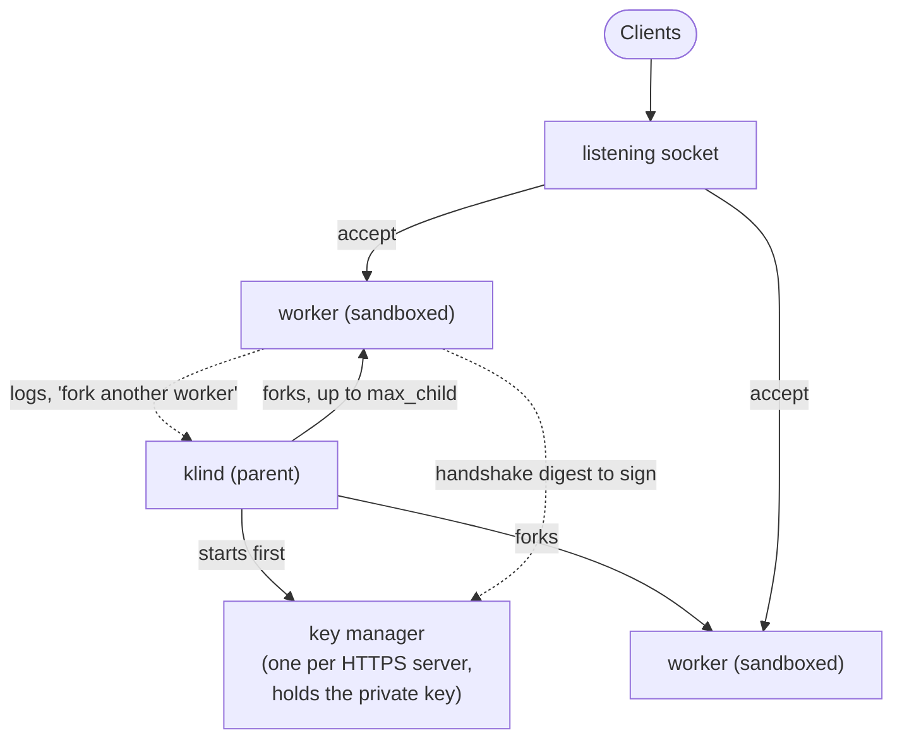
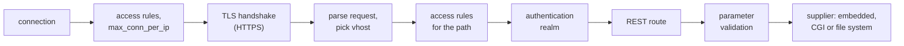

# Klin

**A web framework for embedded devices: the web server, its configuration
and your pages, compiled into one small program.**

[](https://github.com/DanielTillett/klin/actions/workflows/build.yml)
[](https://github.com/DanielTillett/klin/actions/workflows/codeql.yml)
[](https://scorecard.dev/viewer/?uri=github.com/DanielTillett/klin)
[](https://www.bestpractices.dev/projects/16970)
[](https://github.com/DanielTillett/klin/blob/master/LICENSE)

Klin turns a device's web interface into a single executable, `klind`. It
holds an HTTP and HTTPS server, its configuration and the whole site,
where a page is HTML with C code in it. Stripped, with the example site
embedded, `klind` is 290 KB on x86-64 Linux. It needs only libc, OpenSSL 3
and zlib, and its defaults assume the device sits on a hostile network.

```html
<%! #include <time.h> %>
<html><body>
  <h1>Device status</h1>
  <p>Time on the device: <% time_t t = time(NULL); io_printf(out, "%s", ctime(&t)); %></p>
</body></html>
```

Klin started life as [KLone](https://github.com/koanlogic/klone), written
by KoanLogic s.r.l., and was called KLone until 4.0.0. KoanLogic stopped
maintaining it, and it had fallen behind: it was built with MaKL and GNU
make, accepted TLS 1.0, was written for older OpenSSL releases and had
little in the way of tests. I forked it because the idea is still the
right one for a small device, and the code needed bringing up to date
before I would put it on a network. Version 4.0.0 is the result: a CMake
build that needs no GNU make, OpenSSL 3 with TLS 1.2 or newer, hardened
HTTP parsing and sessions, a sandbox, and automated regression,
full-server and fuzz tests. If you are coming from KLone, read
[Upgrading from KLone](doc/UPGRADING.md) first.

**Try it** (Linux or WSL, with the tools in [Quick start](#quick-start-linux-wsl-macos)):

```sh
git clone https://github.com/DanielTillett/klin.git && cd klin
python3 build/build.py                       # fetches the pinned LibU, builds
cmake -S . -B out -G Ninja -DKLIN_SITE_DIR=doc/example-site
cmake --build out
out/bin/klind -F                             # then open http://localhost:8080/
```

**Contents:** [Why Klin](#why-klin) · [How it works](#how-it-works) ·
[Documentation](#documentation) ·
[Quick start](#quick-start-linux-wsl-macos) ·
[Building with CMake](#building-with-cmake) ·
[Build-and-test runner](#build-and-test-runner) ·
[Writing and running a site](#writing-and-running-a-site) ·
[Testing](#testing) ·
[Upgrading from KLone](#upgrading-from-klone) ·
[Known limitations](#known-limitations) ·
[Contributing](CONTRIBUTING.md) · [Security policy](SECURITY.md)


## Why Klin

Plenty of devices need a web interface but cannot carry a general-purpose
web stack: a router, an industrial controller, a laboratory or test
instrument, a camera, a sensor gateway. Klin is built for that case.

**One program, nothing to unpack.** The server, its configuration and the
whole site (pages, images, scripts, style sheets) are compiled into
`klind`. There is no interpreter, no separate web server and nothing to
install alongside it. The embedded site cannot be changed on the device,
and `klind` runs happily from a read-only file system.

It is small. The 290 KB figure above is with link-time optimisation and
unused-section removal, both on by default (408,864 bytes without them);
the `klin` tool is 88 KB. An idle prefork worker is about 2.6 MB resident,
only about 66 KB of it private, and after a mixed load about 4.2 MB
resident and 430 KB private (x86-64 Linux, GCC 15, measured 22 Nov
2026). OpenSSL and zlib are both optional at build time. Pages are compiled C, so a request
pays for no interpreter start-up and no garbage collection.

Pages are written in C. Code inside `<% ... %>` can call the device's own
libraries, drivers and ioctls directly, with no bindings or IPC layer
between the web interface and the hardware.

The defaults are the ones I would want on any device exposed to a
network. TLS 1.2 and 1.3 with forward-secret ciphers only. The TLS
private key lives in a separate process that the workers cannot read.
Workers run under a seccomp sandbox with resource limits. The HTTP parser
is strict and fuzzed, sessions are hardened and carry CSRF tokens, and
there are access rules and HTTP authentication. Releases are reproducible
and signed, with an SBOM. Every protection is documented together with
the setting that changes it.

The rest is what you would expect from a current server: REST routes and
JSON, request validation, Server-Sent Events and WebSockets, keep-alive,
ETags and ranges. The code is portable C99 under the BSD licence, and
builds with CMake on Linux, macOS and Windows (MinGW, single process).

Klin keeps KLone's page format and configuration, and accepts KLone's old
names throughout 4.x, so a KLone 3.x site moves over with few changes.

### When not to use it

Klin is a poor fit for a site whose content changes at run time (a CMS or
a blog), for a team that wants a scripting language for its pages, and
for large-scale web serving, where a general-purpose server behind a load
balancer is the usual answer.


## How it works

Everything happens at build time. The figure below shows the pipeline:
the `klin` tool imports your site directory, turning each `.kl1` page
into C code and each static file into embedded data, and the compiler
links the result with the Klin libraries into one executable.


Editing a page retranslates only that page; adding or removing a file
re-runs the import. [How the build works](#how-the-build-works) has the
detail.

When `klind` runs with the default prefork model, the parent process
starts a key manager for each HTTPS server, then forks a pool of workers
(`prefork.start_child`, default 2). The workers themselves call
`accept(2)` on the shared listening socket; the parent never touches a
connection. The figure below shows who talks to whom.



Each worker applies its resource limits and seccomp sandbox before it
takes its first client. When a request runs for more than a second, or
clients are waiting in the accept queue, a worker asks the parent for
another, so the pool can double every second up to `prefork.max_child`
(default 150). Workers beyond `start_child` exit after
`prefork.idle_timeout` seconds (default 10) without a client, and every
worker is replaced after `prefork.max_requests_per_child` connections
(default 10000). A worker never holds the TLS private key: it sends the
handshake digest to the key manager and gets back a signature
([Key manager](doc/KEYMGR.md), [Sandbox](doc/SANDBOX.md),
[Limits](doc/LIMITS.md)). The `fork` model forks one child per connection
instead, and `iterative` serves one client at a time in one process. On
Windows, `klind` serves in a single process.

Inside a worker, a request passes a fixed series of checks before any
page code runs, as the figure below shows. A connection from an address
the access rules refuse everywhere, or one over `max_conn_per_ip`, is
dropped before the TLS handshake.



Realms match the path the client asked for, before routing replaces it;
validation then decides which parameters the page gets to see. The
embedded supplier is tried first, then CGI and the file system if you
enabled them.


## Documentation

This README covers building, running, testing and what changed from
KLone. The manual pages are in
[doc/man](https://github.com/DanielTillett/klin/tree/master/doc/man):
`klind(8)` for the daemon, `klind.conf(5)` for its configuration and
`klin(1)` for the page translator and site tool. Everything else is in
[doc/](https://github.com/DanielTillett/klin/tree/master/doc). If you are
new, start with [Writing a site](doc/PAGES.md).

| Building a site | Security | Running and project |
| --- | --- | --- |
| [Routes](doc/ROUTES.md): REST routes | [TLS](doc/TLS.md): protocols, ciphers, tickets | [Limits](doc/LIMITS.md): request and worker limits |
| [JSON](doc/JSON.md): reader and writer | [Key manager](doc/KEYMGR.md): the TLS private key | [systemd](doc/SYSTEMD.md): the hardened unit |
| [Validation](doc/VALIDATE.md): request parameters | [Sandbox](doc/SANDBOX.md): seccomp for workers | [Hardening](doc/HARDENING.md): compiler flags |
| [Sessions](doc/SESSIONS.md): sessions and CSRF | [Access](doc/ACCESS.md): IP access rules | [Fuzzing](doc/FUZZING.md): fuzzing, static analysis |
| [SSE](doc/SSE.md): Server-Sent Events | [Authentication](doc/AUTH.md): Basic and Digest | [Releases](doc/RELEASES.md): signing, SBOM, CI rules |
| [WebSocket](doc/WEBSOCKET.md): WebSockets | [Headers](doc/HEADERS.md): security headers | [Conventions](doc/CONVENTIONS.md): code conventions |
| [Files](doc/FILES.md): files from the disk | [CGI](doc/CGI.md): CGI scripts and their limits | [Crypto](doc/CRYPTO.md): the encryption API |
| **[Writing a site](doc/PAGES.md): start here** | | [Upgrading from KLone](doc/UPGRADING.md) |

[doc/example-site](https://github.com/DanielTillett/klin/tree/master/doc/example-site)
is a small site to start from. [SECURITY.md](SECURITY.md) says how to
report a vulnerability, the
[ChangeLog](https://github.com/DanielTillett/klin/blob/master/ChangeLog)
lists every change and [TODO](https://github.com/DanielTillett/klin/blob/master/TODO)
says what is planned.


## Quick start (Linux, WSL, macOS)

You need CMake 3.24 or newer, a build tool (Ninja, BSD make or GNU make),
GCC or Clang, OpenSSL 3, zlib, Git, and Python 3.9 or newer for the
build-and-test runner. On Ubuntu:

```sh
sudo apt-get update
sudo apt-get install build-essential clang libclang-rt-dev libssl-dev \
    zlib1g-dev python3 git cmake ninja-build
python3 build/build.py --test
```

On Windows, run the same commands inside WSL, for example from PowerShell
in this repository:

```sh
wsl -d Ubuntu -- python3 build/build.py --test
```

On macOS, with Homebrew:

```sh
brew install cmake ninja openssl@3
export OPENSSL_ROOT_DIR=$(brew --prefix openssl@3)
python3 build/build.py --test
```

`build/build.py` fetches the pinned LibU, builds Klin without a site and
runs the tests. You will find `klind` and the page translator `klin` in
`.build/release/cmake/bin`, and the build logs and `build-info.json` in
`.build/release`. To build a `klind` with a site in it, see
[Writing and running a site](#writing-and-running-a-site).


## Building with CMake

`build/build.py` (below) wraps CMake with pinned dependencies and tests.
To use CMake directly, fetch the pinned LibU once (`python3 build/build.py`
does this, or pass `-DLIBU_SOURCE_DIR=<checkout>`), then:

```sh
cmake -S . -B out -G Ninja -DKLIN_SITE_DIR=doc/example-site
cmake --build out
cmake --install out           # optional; honours CMAKE_INSTALL_PREFIX
```

`cmake --install out --strip` installs the programs without their symbol
tables, which makes them about 15% smaller.

The options are below, with the KLone 3.x configure equivalent in
brackets where there is one.

| Option | Default | What it does |
| --- | --- | --- |
| `KLIN_SITE_DIR=<dir>` | none | the site to embed in klind ([PAGES](doc/PAGES.md)) |
| `KLIN_IMPORT_ARGS=<list>` | none | extra `klin -c import` options, e.g. `"-z;-x;*.bak"`: compression, exclusions, encryption patterns and key file |
| `KLIN_ENABLE_SUP_FS=ON` | `OFF` | serve files from the file system [`--enable_sup_fs`] ([FILES](doc/FILES.md)) |
| `KLIN_ENABLE_SUP_CGI=ON` | `OFF` | run CGI scripts [`--enable_sup_cgi`] ([CGI](doc/CGI.md)) |
| `KLIN_ENABLE_HOOKS=ON` | `OFF` | call your `hooks_setup()` [`--enable_hooks`] |
| `KLIN_WEBAPP_SOURCES=<list>` | `webapp/webapp.c` | your C sources linked into klind [`WEBAPP_SRCS`] |
| `KLIN_WITH_OPENSSL=OFF` | `ON` | build without TLS and encryption |
| `KLIN_WITH_ZLIB=OFF` | `ON` | build without compression |
| `KLIN_HARDENING=OFF` | `ON` | compiler and linker hardening ([HARDENING](doc/HARDENING.md)) |
| `KLIN_STACK_PROTECTOR=OFF` | `ON` | `-fstack-protector-all` where the compiler has it |
| `KLIN_LTO=OFF` | `ON` | link-time optimisation in Release builds (a smaller klind), where the toolchain has it |
| `KLIN_GC_SECTIONS=OFF` | `ON` | leave unused functions and data out of the programs |
| `KLIN_DEBUG=ON` | `OFF` | debug logging and symbols [`--enable_debug`] |
| `KLIN_ENABLE_WARNINGS=ON` | `OFF` | extra warnings [`--enable_warns`] |
| `KLIN_DAEMON_NAME=<name>` | `klind` | the daemon's file name [`--daemon_name`] |
| `KLIN_INSTALL_DAEMON_ONLY=ON` | `OFF` | install only klind [`--install_daemon_only`] |
| `KLIN_BUILD_TESTS=ON` | `OFF` | build the unit tests (run them with ctest) |
| `KLIN_FUZZ=ON` | `OFF` | build the fuzz targets ([FUZZING](doc/FUZZING.md)) |
| `LIBU_ENABLE_SCTP=ON` | `OFF` | SCTP in LibU (`sctp4://`, `sctp6://` addresses) |

Choose the configuration with `CMAKE_BUILD_TYPE`; `Release`, the default,
builds with `-O2`. Multi-configuration generators (Visual Studio, Xcode,
Ninja Multi-Config) are not supported. GNU make is not required. With BSD
make, use the Makefile generator:

```sh
cmake -S . -B out -G "Unix Makefiles" -DCMAKE_MAKE_PROGRAM=bmake
cd out && bmake
```

The catch with BSD make is that it cannot handle spaces in site paths, so
use Ninja for those.

With Doxygen installed, `cmake --build out --target doc` writes the API
reference to `out/doc`.

### Using an installed Klin

The install has the libraries, the headers (Klin's, LibU's and the
generated configuration headers), a CMake package and a pkg-config file.
The server itself, with the embedded site and `emb_init()`, is linked by
the CMake build; as in KLone 3.x, the installed libraries do not contain
klind's own sources.

```cmake
find_package(Klin 4 REQUIRED)
target_link_libraries(myprogram PRIVATE Klin::klin)
```

```sh
cc myprogram.c $(pkg-config --cflags --libs klin)
```

### How the build works

CMake runs the platform checks that KLone 3.x's configure ran and
generates `klin_conf.h` and LibU's `libu_conf.h` in the build directory.
It builds LibU from the pinned checkout without modifying it, then the
`klin` tool, then the site.

The site is a small separate CMake project (`cmake/site`), because the
`klin` tool has to exist before the site can be imported. `klin -c import`
writes `autogen.cmake`, a list of the site's files, and each one is
translated to C by `klin -c translate` and compiled into `libsite`, which
is linked whole into `klind`. Editing a page retranslates only that page;
adding or removing files re-runs the import.


## Build-and-test runner

```text
python3 build/build.py [--sanitize] [--test] [--offline] [--incremental]
                       [--jobs N] [--generator G] [--make-program P]
```

| Option | What it does |
| --- | --- |
| `--sanitize` | build with AddressSanitizer and UndefinedBehaviorSanitizer into `.build/sanitize` instead of `.build/release` |
| `--test` | run the unit tests, the regression suite and the full-server tests after building (see [Testing](#testing)) |
| `--offline` | use dependencies already downloaded; fail if one is missing |
| `--incremental` | reuse the previous build directory during development; omit it for clean, release-quality checks |
| `--jobs N` | parallel build jobs (default 2) |
| `--generator G` | CMake generator (default Ninja if installed, otherwise `"Unix Makefiles"`) |
| `--make-program P` | build tool for the generator, e.g. `bmake` |

The runner clones LibU at the exact commit pinned in
`build/dependencies.json`. An existing checkout must match that commit and
have no tracked modifications, although CRLF-only differences are
tolerated.

It never configures or compiles your checkout in place, and installs
nothing on the system. Sources are copied as they are into
`.build/<mode>/source` (`.gitattributes` checks text out with LF on every
platform) and built out of tree in `.build/<mode>/cmake`. Only one build
may use a given `.build/<mode>` directory at a time, so a second
concurrent build of the same mode is refused.

`build-info.json` records the dependency commits, a normalised source
fingerprint, the compiler, CMake, generator and OpenSSL versions, and the
C flags. That reproduces the source inputs; it does not promise identical
binaries across different compilers or distributions.

If OpenSSL 3 is not found, the build fails rather than quietly building
without TLS.


## Writing and running a site

[Writing a site](doc/PAGES.md) shows how a site is laid out, how a page
is written (the `<% %>` tags and the variables a page has), a page that
reads a request argument safely, and how to build and run it. The short
version:

```sh
cmake -S . -B out -G Ninja -DKLIN_SITE_DIR=/path/to/mysite
cmake --build out
out/bin/klind -F               # the site's own etc/klind.conf
out/bin/klind -F -f my.conf    # another configuration file instead
```

`-F` keeps klind in the foreground with its configured server model. `-d`
adds debug logging and serves requests one at a time in a single process.
`-f` uses another configuration file instead of the embedded one; the two
are not merged. See klind(8) and klind.conf(5) in
[doc/man](https://github.com/DanielTillett/klin/tree/master/doc/man). The
files in [etc/](https://github.com/DanielTillett/klin/tree/master/etc)
are sample configurations for virtual hosts, HTTPS, CGI, IPv6, access
logs and sessions without a disk.

**Do not use the example certificate.** `doc/example-site/etc/klind.pem`
is a 1024-bit RSA key with an MD5 signature that expired in 2006. OpenSSL
3 at the default security level of common distributions refuses it, so an
HTTPS server using it will not start. Generate your own and point
`cert_file` and `key_file` at it, and use a certificate from a trusted CA
in production:

```sh
openssl req -x509 -newkey rsa:3072 -nodes -keyout key.pem \
    -out cert.pem -days 365 -subj /CN=localhost
```


## Testing

```sh
python3 build/build.py --test
python3 build/build.py --sanitize --test
```

`--test` runs three suites in order.

1. The unit tests (ctest).
2. The regression suite, about a hundred checks. It compiles selected
   production functions verbatim as C99, with warnings treated as errors,
   and runs them under the sanitizers. LibU and network collaborators are
   test doubles; production MD5 is linked directly.
3. The full-server tests, about 500 checks, run twice: once in the
   single-process model and once in the prefork model. They embed the test
   site in `test/site` and start klind on temporary localhost ports (IPv4,
   and IPv6 where the host has it). Among other things they cover:
   - HTTP: static files, pages, HEAD, ranges and ETags; malformed headers
     and URIs, request smuggling and limits; keep-alive.
   - TLS: versions, ciphers, renegotiation, client certificates and
     session tickets.
   - Applications: sessions and CSRF, access rules, authentication,
     routes, validation, SSE and WebSockets, files, symbolic links and CGI
     scripts.
   - Isolation: the sandbox, the key manager (whose memory no worker may
     read), worker limits and the configurations klind must refuse at
     startup; as root, dropping root, `blind_chroot` and the key manager
     running as `nobody`.

   Under `--sanitize`, any AddressSanitizer, LeakSanitizer or UBSan report
   fails the run.

Each security topic in `doc/` ends with a "Tested" section saying what its
tests check. Test certificates and listeners are temporary. The other test
runners are these:

| Command | What it checks |
| --- | --- |
| `python test/run_regressions.py --sanitize` | the regression suite alone, without a full build (Windows or Linux, Python 3 and Clang) |
| `python3 test/run_fuzz.py --runs 10000` | every fuzz target, built with libFuzzer, ASan and UBSan in `.build/fuzz` (Linux: it uses GNU linker options) |
| `python3 test/run_build_checks.py` | the CMake build: awkward file names, includes, flags, import options, incremental rebuilds, building against the install tree |
| `python3 test/run_release_checks.py` | release files built twice and compared, the SBOM, an offline build of the tarball, and every workflow's pins and permissions (needs PyYAML) |
| `sudo python3 test/run_systemd_test.py --build .build/release/cmake` | klind under the hardened systemd unit (Linux, as root) |

Continuous integration (GitHub Actions) runs on every push and pull
request. It covers the release and sanitizer builds and tests on Linux;
the fuzz, build-system, release and systemd checks; BSD make, with GNU
make made to fail; native Windows (MinGW: build, HTTP and HTTPS,
regressions); clang-tidy; and CodeQL and ClusterFuzzLite on the code a
pull request changes. macOS runs weekly and by hand. On a schedule,
ClusterFuzzLite does batch fuzzing with corpus pruning and coverage
(daily), CodeQL and OpenSSF Scorecard run weekly, Coverity Scan runs
weekly once its token is set, and Dependabot watches the actions. Release
drafts come from a pushed tag ([RELEASES](doc/RELEASES.md)).


## Upgrading from KLone

Klin 4.0.0 builds KLone sites with few changes and accepts KLone's names
throughout 4.x. The trade-off is that it is stricter by default: TLS
ciphers, the key manager, the sandbox, worker and request limits, symbolic
links, CGI and root credentials all have new defaults, each with a
setting. [Upgrading from KLone](doc/UPGRADING.md) lists them, along with
the renamed names and everything else that changed or was removed.


## Known limitations

- Klin is built and tested on Linux (including WSL), with Ninja and with
  BSD make, and on macOS 15 (Apple Silicon, Apple Clang, Homebrew OpenSSL
  3). The BSDs are untested. macOS has no LeakSanitizer, so the sanitizer
  build there checks memory errors and undefined behaviour only.
- Native Windows builds with MinGW-w64 (MSYS2 UCRT64: gcc, cmake, ninja,
  openssl, zlib, libsystre) and runs only the single-process server model.
  There are no prefork or fork models, no TLS key manager (`key_manager`
  defaults to `no`) and no sandbox. CI builds it, serves HTTP and HTTPS
  and runs the regression suite; the full-server tests need `fork(2)` and
  run on Linux and macOS. MSVC is not supported, because LibU needs POSIX
  headers. WSL is still the way to run everything on Windows.
- Cross-compiling is not tested, and a site cannot yet be built in a cross
  build: the site step runs the `klin` translator that the same build
  made, which is then a binary for the target, not the build machine.
- C++ pages (`.klx`) are not supported; the import stops with an error.
- The pinned LibU dependency still has some compiler warnings. Klin's own
  code builds without warnings on GCC, Clang and Apple Clang.
- "Expect: 100-continue" is not answered, so clients send the body after
  their own timeout.
- Fuzzing runs for half an hour a day per sanitizer (ClusterFuzzLite). The
  project is not in OSS-Fuzz, whose campaigns are much longer.
- Under the sandbox, a CGI script cannot signal its own process group with
  `kill 0` ([SANDBOX](doc/SANDBOX.md)).
