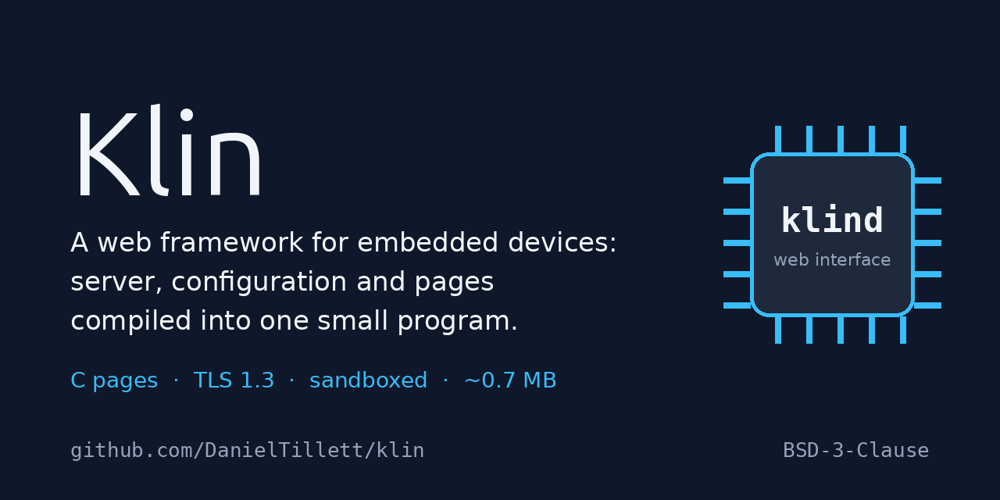
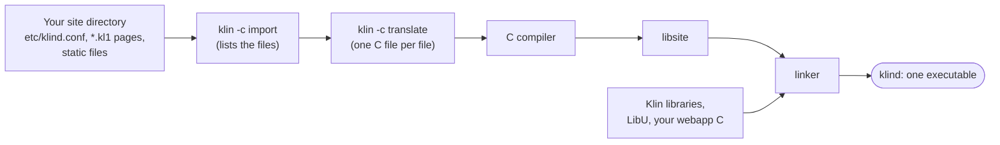
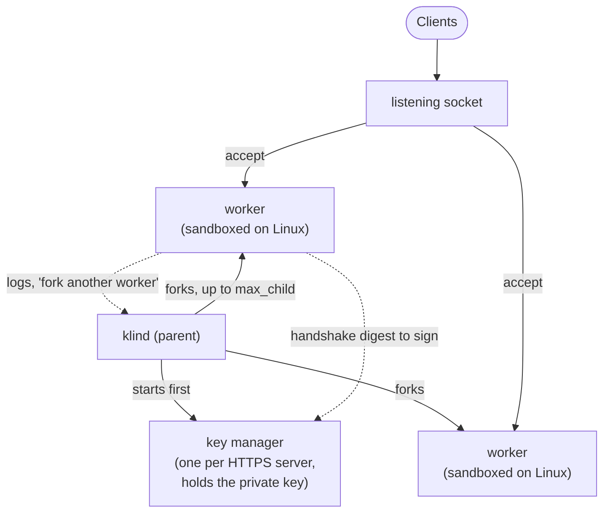
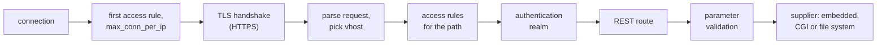

# Klin

**A web framework for embedded devices: the web server, its configuration
and your pages, compiled into one small program.**

[](https://github.com/DanielTillett/klin/actions/workflows/build.yml)
[](https://github.com/DanielTillett/klin/actions/workflows/codeql.yml)
[](https://scorecard.dev/viewer/?uri=github.com/DanielTillett/klin)
[](https://www.bestpractices.dev/projects/16970)
[](LICENSE)

Klin turns a device's web interface into a single executable, `klind`. It
holds an HTTP and HTTPS server, its configuration and the whole site,
where a page is HTML with C code in it. Stripped, with the example site
embedded, `klind` is 290 KB on x86-64 Linux. With TLS and compression
built in, it needs only libc, OpenSSL 3 and zlib on Linux (both optional
at build time), and its defaults assume a hostile network.

```html
<%! #include <time.h> %>
<html><body>
  <h1>Device status</h1>
  <p>Time on the device: <% time_t t = time(NULL); io_printf(out, "%s", ctime(&t)); %></p>
</body></html>
```

Klin started life as [KLone](https://github.com/koanlogic/klone), written
by KoanLogic s.r.l., and kept that name until 4.0.0. KoanLogic stopped
maintaining it, and it had fallen behind: a MaKL and GNU make build, TLS
1.0, older OpenSSL releases and few tests. I forked it because the idea is
still the right one for a small device, but the code needed bringing up to
date before I would put it on a network. Version 4.0.0 is the result: a
CMake build without GNU make, OpenSSL 3 with TLS 1.2 or newer, hardened
HTTP parsing and sessions, a sandbox, and regression, full-server and fuzz
tests. Coming from KLone? Read [Upgrading](doc/UPGRADING.md) first.

**Contents:** [Why Klin](#why-klin) ·
[Quick start](#quick-start-linux-wsl-macos) ·
[How it works](#how-it-works) · [Documentation](#documentation) ·
[Building with CMake](#building-with-cmake) ·
[Build-and-test runner](#build-and-test-runner) ·
[Running a site](#running-a-site) · [Testing](#testing) ·
[Upgrading from KLone](#upgrading-from-klone) ·
[Known limitations](#known-limitations) · [Contributing](CONTRIBUTING.md) ·
[Security policy](SECURITY.md)


## Why Klin

Plenty of devices need a web interface but cannot carry a general-purpose
web stack: a router, an industrial controller, a laboratory or test
instrument, a camera, a sensor gateway.

**One program, nothing to unpack.** The server, its configuration and the
whole site (pages, images, scripts, style sheets) are compiled into
`klind`, with no interpreter or separate web server beside it. The
embedded site cannot be changed on the device, and `klind` runs happily
from a read-only file system.

It is small. The 290 KB figure is with link-time optimisation and
unused-section removal, both on by default (408,864 bytes without them);
the `klin` tool is 88 KB. An idle prefork worker is about 2.6 MB resident,
only about 66 KB of it private, and after a mixed load about 4.2 MB
resident and 430 KB private (x86-64 Linux, GCC 15, measured 22 Nov 2026).
Pages are compiled C, so a request pays for no interpreter start-up and no
garbage collection.

Code inside `<% ... %>` calls the device's own libraries, drivers and
ioctls directly, with no bindings or IPC layer in between.

The defaults are the ones I would want on any device exposed to a network.
By default, TLS is 1.2 or 1.3 with forward-secret ciphers only. The TLS
private key can live in a separate process, out of the workers
([when](doc/KEYMGR.md)). Workers run with resource limits and, on Linux, a
seccomp sandbox. The HTTP parser is strict and fuzzed, sessions are
hardened and carry tokens against cross-site request forgery (CSRF), and
there are access rules and HTTP authentication. Releases are reproducible
and signed, with an SBOM. The security pages give each protection with the
setting that changes it.

It also has [REST routes](doc/ROUTES.md), [JSON](doc/JSON.md), request
[validation](doc/VALIDATE.md), [Server-Sent Events](doc/SSE.md),
[WebSockets](doc/WEBSOCKET.md), keep-alive, ETags and ranges. The code is
portable C99 under the BSD licence and builds with CMake on Linux, macOS
and Windows (MinGW, single process).

### When not to use it

Klin is a poor fit for a site whose content changes at run time (a CMS or
a blog), for a team that wants a scripting language for its pages, and
for large-scale web serving, where a general-purpose server behind a load
balancer is the usual answer.


## Quick start (Linux, WSL, macOS)

You need CMake 3.24 or newer, a build tool (Ninja, BSD make or GNU make),
GCC or Clang, OpenSSL 3, zlib, Git, and Python 3.9 or newer for
`build/build.py`. Ubuntu 24.04 has them all; 22.04 ships CMake 3.22,
which is too old. On Windows, follow the Ubuntu steps in an Ubuntu 24.04
WSL shell. On macOS, `python3` comes with the Xcode command line tools
(check that `python3 --version` says 3.9 or newer); install the rest with
Homebrew and tell CMake where OpenSSL is:

```sh
brew install cmake ninja openssl@3
export OPENSSL_ROOT_DIR=$(brew --prefix openssl@3)
```

On Ubuntu 24.04:

```sh
sudo apt-get update
sudo apt-get install build-essential clang libclang-rt-dev libssl-dev \
    zlib1g-dev python3 git cmake ninja-build
cmake --version            # must say 3.24 or newer
```

Then build and run the example site:

```sh
git clone https://github.com/DanielTillett/klin.git && cd klin
python3 build/build.py     # fetches the pinned LibU into libu/ (and builds a site-less klind in .build/)
cmake -S . -B out -G Ninja -DKLIN_SITE_DIR=doc/example-site
cmake --build out
out/bin/klind -F           # stays in the foreground; open http://localhost:8080/
```

`klind -F` prints nothing while it runs, because the example site logs to
syslog (facility `LOG_LOCAL0`). Watch your system log in another
terminal: `journalctl -f` where systemd's journal runs,
`tail -f /var/log/syslog` with plain rsyslog, or
`log stream --predicate 'process == "klind"'` on macOS. The example's
HTTPS server on port 4443 is off; to try it, add `my_https` to
`server_list` and point `cert_file` and `key_file` at your own
certificate and key ([below](#running-a-site)).

The example configuration sets `allow_root yes` so that you can try it as
root, in a container for instance. Do not ship that: on a device, set
`uid` and `gid` and use the hardened [systemd](doc/SYSTEMD.md) unit.

`python3 build/build.py --test` builds Klin without a site and runs the
three suites in [Testing](#testing) (from PowerShell, run
`wsl -- python3 build/build.py --test` in the repository). Its `klind` and
`klin` are in `.build/release/cmake/bin`, with its logs and
`build-info.json` in `.build/release`.


## How it works

The `klin` tool imports your site directory, turning each `.kl1` page
into C code and each static file into embedded data, and the compiler
links the result with the Klin libraries into one executable:



CMake runs the platform checks KLone 3.x's configure ran, writes
`klin_conf.h` and LibU's `libu_conf.h` into the build directory, and
builds LibU from the pinned checkout (unmodified), then the `klin` tool,
then the site: a separate CMake project (`cmake/site`), because the tool
must exist before the site can be imported. `klin -c import` writes
`autogen.cmake`, the list of the site's files; each is translated and
compiled into `libsite`, linked whole into `klind`. Editing a page
retranslates only that page; adding or removing a file re-runs the import.

With the default prefork model, the parent process starts a key manager
for each HTTPS server that uses one, then forks a pool of workers
(`prefork.start_child`, default 2). The workers themselves call
`accept(2)` on the shared listening socket; the parent never touches a
connection. With prefork, the key manager on and an external `key_file`,
the processes talk to each other like this:



Each worker applies its resource limits and, on Linux, its seccomp sandbox
before it takes its first client. When a request runs for more than a
second, or clients are waiting in the accept queue, a worker asks the
parent for another, so the pool can double every second up to
`prefork.max_child` (default 150). Workers beyond `start_child` exit after
`prefork.idle_timeout` seconds (default 10) without a client, and every
worker is replaced after `prefork.max_requests_per_child` connections
(default 10000). A worker sends the handshake digest to the key manager
and gets back a signature. With a key file separate from the certificate
that the workers' user cannot read, and no other server loading it with
`key_manager no` ([all the conditions](doc/KEYMGR.md#why-it-exists)),
that is all a worker gets: the TLS private key stays out of its memory
(on Linux, the key manager's memory is closed to it as well). A key embedded in
`klind` is in every process's memory anyway; with the key manager on,
`klind` warns about it ([Key manager](doc/KEYMGR.md),
[Sandbox](doc/SANDBOX.md), [Limits](doc/LIMITS.md)). The `fork` model
forks one child per connection instead, and `iterative` serves one client
at a time in one process. On Windows, `klind` serves in a single process.

Inside a worker, a request passes a fixed series of checks before any
page code runs:



A connection over `max_conn_per_ip` is dropped before the TLS handshake.
So is one the access rules refuse outright, which happens only when the
first rule has no `path` (it covers every path) and denies the client;
every other decision waits until the request is parsed and the virtual
host (vhost) is known. Access rules and realms match the requested file
name after index selection, without PATH_INFO, before a route can rewrite
it. Validation then checks the parameters you name. The embedded
supplier is tried first, then CGI and the file system if enabled.


## Documentation

Start with [Writing a site](doc/PAGES.md). The manual pages are in
[doc/man](doc/man): [klind(8)](doc/man/klind.8) for the daemon,
[klind.conf(5)](doc/man/klind.conf.5) for its configuration and
[klin(1)](doc/man/klin.1) for the page translator and site tool.

**Building a site:** [Writing a site](doc/PAGES.md),
[Routes](doc/ROUTES.md) (REST), [JSON](doc/JSON.md),
[Validation](doc/VALIDATE.md) of request parameters, [SSE](doc/SSE.md)
(Server-Sent Events), [WebSocket](doc/WEBSOCKET.md),
[Sessions](doc/SESSIONS.md) and CSRF tokens, [Authentication](doc/AUTH.md)
(Basic and Digest), [Files](doc/FILES.md) from the disk, [CGI](doc/CGI.md)
scripts and [Crypto](doc/CRYPTO.md), the encryption API.

**Running and securing:** [TLS](doc/TLS.md) protocols, ciphers and
tickets, the [Key manager](doc/KEYMGR.md) for the TLS private key, the
seccomp [Sandbox](doc/SANDBOX.md) for workers, IP [Access](doc/ACCESS.md)
rules, security [Headers](doc/HEADERS.md), request and worker
[Limits](doc/LIMITS.md), compiler [Hardening](doc/HARDENING.md) and the
hardened [systemd](doc/SYSTEMD.md) unit.

**Contributing:** [Contributing](CONTRIBUTING.md),
[Conventions](doc/CONVENTIONS.md), [Fuzzing](doc/FUZZING.md) and static
analysis, [Releases](doc/RELEASES.md) (signing, SBOM, CI rules) and the
[Security policy](SECURITY.md) for reporting a vulnerability.

[doc/example-site](doc/example-site) is a small site to start from,
[ChangeLog](ChangeLog) lists the changes and [TODO](TODO) what is planned.


## Building with CMake

`build/build.py` ([below](#build-and-test-runner)) wraps CMake with pinned
dependencies and tests. To use CMake directly, fetch the pinned LibU once
(`python3 build/build.py` does this, or pass
`-DLIBU_SOURCE_DIR=<checkout>`), then:

```sh
cmake -S . -B out -G Ninja -DKLIN_SITE_DIR=doc/example-site
cmake --build out
cmake --install out           # optional; honours CMAKE_INSTALL_PREFIX
```

`cmake --install out --strip` installs the programs without their symbol
tables, which makes them about 15% smaller.

The options are below, with the KLone 3.x configure equivalent in
brackets where there is one.

| Option | Default | What it does |
| --- | --- | --- |
| `KLIN_SITE_DIR=<dir>` | none | the site to embed in klind ([PAGES](doc/PAGES.md)) |
| `KLIN_IMPORT_ARGS=<list>` | none | extra `klin -c import` options, e.g. `"-z;-x;*.bak"`: compression, exclusions, encryption patterns and key file |
| `KLIN_ENABLE_SUP_FS=ON` | `OFF` | serve files from the file system [`--enable_sup_fs`] ([FILES](doc/FILES.md)) |
| `KLIN_ENABLE_SUP_CGI=ON` | `OFF` | run CGI scripts [`--enable_sup_cgi`] ([CGI](doc/CGI.md)) |
| `KLIN_ENABLE_HOOKS=ON` | `OFF` | call your `hooks_setup()` [`--enable_hooks`] |
| `KLIN_WEBAPP_SOURCES=<list>` | `webapp/webapp.c` | your C sources linked into klind [`WEBAPP_SRCS`] |
| `KLIN_WITH_OPENSSL=OFF` | `ON` | build without TLS and encryption |
| `KLIN_WITH_ZLIB=OFF` | `ON` | build without compression |
| `KLIN_HARDENING=OFF` | `ON` | compiler and linker hardening ([HARDENING](doc/HARDENING.md)) |
| `KLIN_STACK_PROTECTOR=OFF` | `ON` | `-fstack-protector-all` where the compiler has it |
| `KLIN_LTO=OFF` | `ON` | link-time optimisation in Release builds (a smaller klind), where the toolchain has it |
| `KLIN_GC_SECTIONS=OFF` | `ON` | leave unused functions and data out of the programs |
| `KLIN_DEBUG=ON` | `OFF` | debug logging and symbols [`--enable_debug`] |
| `KLIN_ENABLE_WARNINGS=ON` | `OFF` | extra warnings [`--enable_warns`] |
| `KLIN_DAEMON_NAME=<name>` | `klind` | the daemon's file name [`--daemon_name`] |
| `KLIN_INSTALL_DAEMON_ONLY=ON` | `OFF` | install only klind [`--install_daemon_only`] |
| `KLIN_BUILD_TESTS=ON` | `OFF` | build the unit tests (run them with ctest) |
| `KLIN_FUZZ=ON` | `OFF` | build the fuzz targets ([FUZZING](doc/FUZZING.md)) |
| `LIBU_ENABLE_SCTP=ON` | `OFF` | SCTP in LibU (`sctp4://`, `sctp6://` addresses) |

Choose the configuration with `CMAKE_BUILD_TYPE`; `Release`, the default,
builds with `-O2`. Multi-configuration generators (Visual Studio, Xcode,
Ninja Multi-Config) are not supported. GNU make is not required. With BSD
make, use the Makefile generator, and keep spaces out of site paths,
because BSD make cannot handle them (Ninja can):

```sh
cmake -S . -B out -G "Unix Makefiles" -DCMAKE_MAKE_PROGRAM=bmake
cd out && bmake
```

With Doxygen installed, `cmake --build out --target doc` writes the API
reference to `out/doc`.

### Using an installed Klin

The install has the libraries, the headers (Klin's, LibU's and the
generated configuration headers), a CMake package and a pkg-config file.
The server itself, with the embedded site and `emb_init()`, is linked by
the CMake build; as in KLone 3.x, the installed libraries do not contain
klind's own sources.

```cmake
find_package(Klin 4 REQUIRED)
target_link_libraries(myprogram PRIVATE Klin::klin)
```

```sh
cc myprogram.c $(pkg-config --cflags --libs klin)
```


## Build-and-test runner

```text
python3 build/build.py [--sanitize] [--test] [--offline] [--incremental]
                       [--jobs N] [--generator G] [--make-program P]
```

| Option | What it does |
| --- | --- |
| `--sanitize` | build with AddressSanitizer and UndefinedBehaviorSanitizer (and LeakSanitizer on Linux) into `.build/sanitize` instead of `.build/release` |
| `--test` | run the unit tests, the regression suite and the full-server tests after building (see [Testing](#testing)) |
| `--offline` | use dependencies already downloaded; fail if one is missing |
| `--incremental` | reuse the previous build directory during development; omit it for clean, release-quality checks |
| `--jobs N` | parallel build jobs (default 2) |
| `--generator G` | CMake generator (default Ninja if installed, otherwise `"Unix Makefiles"`) |
| `--make-program P` | build tool for the generator, e.g. `bmake` |

The runner clones LibU at the commit pinned in `build/dependencies.json`;
an existing checkout must match it and have no tracked modifications
(CRLF-only differences are tolerated). Without OpenSSL 3 the build fails
rather than quietly building without TLS.

It installs nothing and never builds in your checkout: sources are copied
as they are into `.build/<mode>/source` (`.gitattributes` checks text out
with LF on every platform) and built out of tree in `.build/<mode>/cmake`.
A second concurrent build of the same mode is refused.

`build-info.json` records the dependency commits, a normalised source
fingerprint, the compiler, CMake, generator and OpenSSL versions, and the
C flags. That reproduces the source inputs, not identical binaries across
compilers or distributions.


## Running a site

To build and run your own site ([Writing a site](doc/PAGES.md) explains
how to write one):

```sh
cmake -S . -B out -G Ninja -DKLIN_SITE_DIR=/path/to/mysite
cmake --build out
out/bin/klind -F               # the site's own etc/klind.conf
out/bin/klind -F -f my.conf    # another configuration file instead
```

`-F` keeps klind in the foreground with its configured server model. `-d`
adds debug logging (still to syslog), prints the loaded configuration and
serves requests one at a time in a single process. `-f` uses another
configuration file instead of the embedded one; the two are not merged.
See [klind(8)](doc/man/klind.8) and [klind.conf(5)](doc/man/klind.conf.5).
The files in [etc/](etc) are sample configurations for virtual hosts,
HTTPS, CGI, IPv6, access logs and sessions without a disk.

**Do not use the example certificate.** `doc/example-site/etc/klind.pem`
is a 1024-bit RSA key with an MD5 signature that expired in 2006. OpenSSL
3 at the default security level of common distributions refuses it, so an
HTTPS server using it will not start. Generate your own and point
`cert_file` and `key_file` at it, and use a certificate from a trusted CA
in production:

```sh
openssl req -x509 -newkey rsa:3072 -nodes -keyout key.pem \
    -out cert.pem -days 365 -subj /CN=localhost
```


## Testing

```sh
python3 build/build.py --test
python3 build/build.py --sanitize --test
```

`--test` runs three suites in order.

1. The unit tests (ctest).
2. The regression suite, about a hundred checks. It compiles selected
   production functions verbatim as C99, with warnings treated as errors,
   and runs them under the sanitisers. LibU and network collaborators are
   test doubles; production MD5 is linked directly.
3. The full-server tests, about 500 checks, run twice: once in the
   single-process model and once in the prefork model. They embed the test
   site in `test/site` and start klind on temporary localhost ports (IPv4,
   and IPv6 where the host has it). They cover HTTP parsing (malformed
   input, request smuggling, limits, keep-alive, ranges and ETags), TLS
   (versions, ciphers, renegotiation, client certificates, tickets), the
   application features from sessions to CGI, and isolation: the sandbox,
   the key manager (whose memory no worker may read), worker limits,
   configurations klind must refuse and, as root, dropping root,
   `blind_chroot` and the key manager running as `nobody`. Under
   `--sanitize`, any AddressSanitizer, LeakSanitizer or UBSan report
   fails the run.

The security pages say what these tests check for each protection. Test
certificates and listeners are temporary. The other test runners:

| Command | What it checks |
| --- | --- |
| `python test/run_regressions.py --sanitize` | the regression suite alone, without a full build (Windows or Linux, Python 3 and Clang) |
| `python3 test/run_fuzz.py --runs 10000` | every fuzz target, built with libFuzzer, ASan and UBSan in `.build/fuzz` (Linux: it uses GNU linker options) |
| `python3 test/run_build_checks.py` | the CMake build: awkward file names, includes, flags, import options, incremental rebuilds, building against the install tree |
| `python3 test/run_release_checks.py` | release files built twice and compared, the SBOM, an offline build of the tarball, and every workflow's pins and permissions (needs PyYAML) |
| `sudo python3 test/run_systemd_test.py --build .build/release/cmake` | klind under the hardened systemd unit (Linux, as root) |

GitHub Actions runs these on Linux for pushes and pull requests, with BSD
make (GNU make made to fail), native Windows (MinGW), clang-tidy, CodeQL
and ClusterFuzzLite. macOS runs weekly and by hand; batch fuzzing (daily),
Scorecard, Coverity Scan and Dependabot run on a schedule
([Workflows](doc/RELEASES.md#workflows) has the details).


## Upgrading from KLone

Klin keeps KLone's page format and configuration and accepts KLone's old
names throughout 4.x, so a KLone 3.x site builds with few changes. It is
stricter by default (TLS ciphers, the key manager, the sandbox, limits,
symbolic links, CGI, root): [Upgrading from KLone](doc/UPGRADING.md) lists
each new default with its setting, the renamed names and everything else
that changed or was removed.


## Known limitations

- Klin is built and tested on Linux (including WSL), with Ninja and with
  BSD make, and on macOS 15 (Apple Silicon, Apple Clang, Homebrew OpenSSL
  3). The BSDs are untested. macOS has no LeakSanitizer, so the sanitiser
  build there checks memory errors and undefined behaviour only.
- Native Windows builds with MinGW-w64 (MSYS2 UCRT64: gcc, cmake, ninja,
  openssl, zlib, libsystre) and runs only the single-process model: no
  prefork or fork, no TLS key manager (`key_manager` defaults to `no`) and
  no sandbox. CI builds it, serves HTTP and HTTPS and runs the regression
  suite; the full-server tests need `fork(2)` and run on Linux and macOS.
  MSVC is not supported, because LibU needs POSIX headers.
- Cross-compiling is not tested, and a site cannot yet be built in a cross
  build: the site step runs the `klin` translator that the same build
  made, which is then a binary for the target, not the build machine.
- C++ pages (`.klx`) are not supported: `klin -c import` accepts them,
  but the site's CMake configure step stops with an error.
- The pinned LibU dependency still has some compiler warnings. Klin's own
  code builds without warnings on GCC, Clang and Apple Clang.
- "Expect: 100-continue" is not answered, so clients send the body after
  their own timeout.
- Fuzzing runs for half an hour a day per sanitiser (ClusterFuzzLite). The
  project is not in OSS-Fuzz, whose campaigns are much longer.
- Under the sandbox, a CGI script cannot signal its own process group with
  `kill 0` ([SANDBOX](doc/SANDBOX.md)).

**Next:** [Writing a site](doc/PAGES.md) ·
[Upgrading from KLone](doc/UPGRADING.md) · [Contributing](CONTRIBUTING.md)
