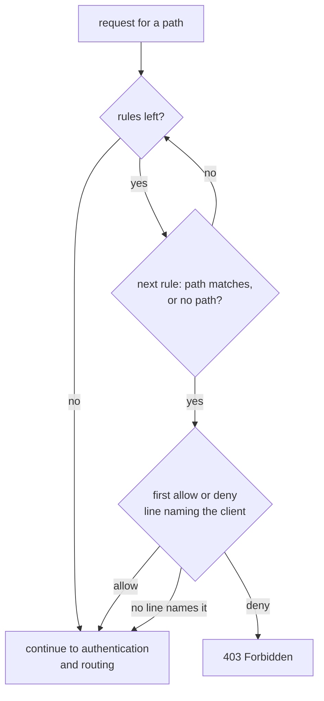
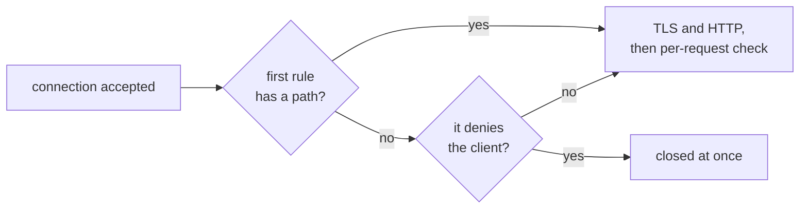

# IP access control

An `access` block in a server or virtual host (vhost) lets clients in, or
refuses them, by their IP address. Use it to keep an admin page or a
status page to your own network.

```conf
access
{
    rule
    {
        path   /admin/*             # fnmatch(3) patterns, may repeat
        allow  10.0.0.0/8, 2001:db8::/32
        deny   all
    }
    rule
    {
        path   /status.kl1
        allow  127.0.0.1 ::1
        deny   all
    }
    rule                            # no path: every path
    {
        deny   192.0.2.0/24
    }
}
```

Entries are IPv4 or IPv6 addresses, networks (address/prefix bits) or
`all`, separated by blanks or commas. IPv4 clients of a dual-stack socket
(`::ffff:a.b.c.d`) are matched as IPv4.

## The rule

For a request, the first rule whose path matches decides. A rule without
a path matches every path. Within that rule, the first `allow` or `deny`
line naming the client's address wins, and a client that no line names is
allowed. A refused request gets 403 Forbidden.



Only the first matching rule is consulted. In the example above, a client
in 192.0.2.0/24 asking for `/admin/` is decided by the first rule, not the
third: it is refused there only because `deny all` names it. If you want
a network kept out everywhere, put its rule first.

## What the path is

Rules match the request's file name, without any path info and before
routing, as authentication realms do; the figure in
[Which path each check sees](ROUTES.md#which-path-each-check-sees) shows
how that name is worked out. Patterns use fnmatch(3) with no flags, so `*`
also matches `/`. IP rules are checked before authentication.

## At connection time

When a connection is accepted, klind looks at the first rule of the
server's access block. If that rule is for every path and it denies the
client, the connection is closed at once, before the TLS handshake or any
HTTP. If the first rule has a path, nothing is dropped at this stage,
because that rule may let the client in somewhere.



## Behind a proxy

The address is the socket's peer. Behind a proxy or load balancer it is
the proxy's, and `X-Forwarded-For` is not used. A client that is not on
an IP socket (a UNIX socket, or klin run as a CGI) is not checked.

A bad entry, an unknown key or a rule with no `allow` or `deny` line stops
klind at startup.

## Tested

The server tests check rules per path, networks, the first match, and
connections dropped at accept over IPv4. On a `tcp6://[::1]` listener
(where the host has IPv6) they check that `::1` is matched as an IPv6
address: allowed by `allow ::1`, refused by a rule for other networks.
HTTP and HTTPS are served over IPv6, and an IPv4 client does not reach
that listener.

See also: [AUTH](AUTH.md) for the next check a request meets,
[ROUTES](ROUTES.md), [HARDENING](HARDENING.md).
