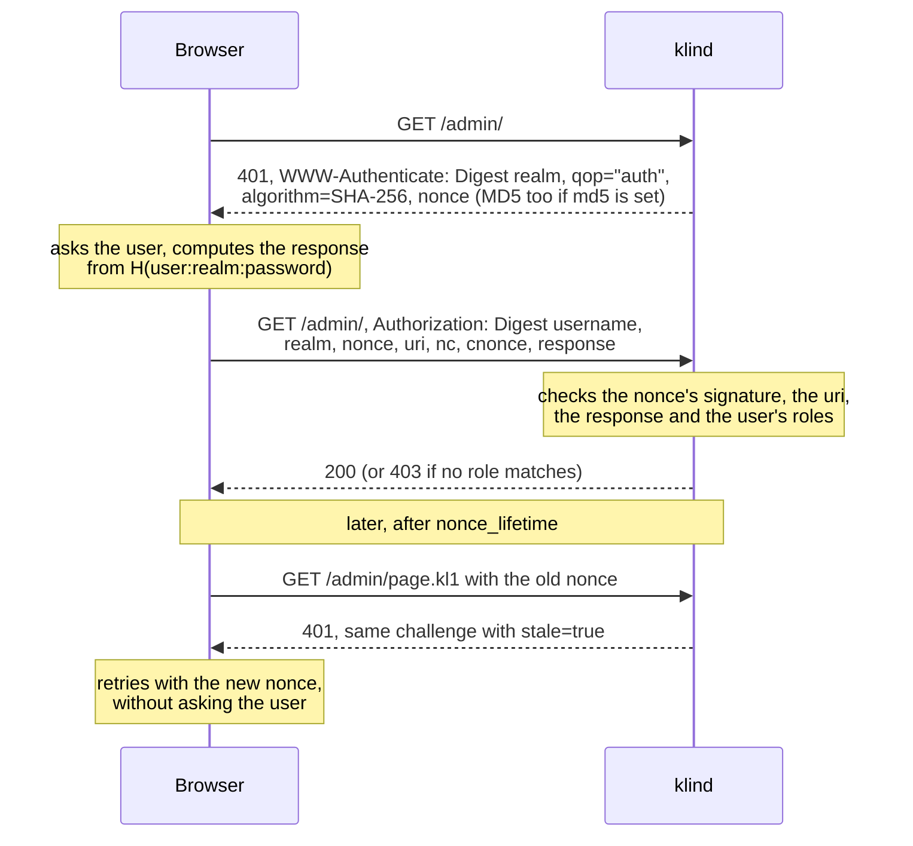

# HTTP authentication

A page in an authentication realm is served only to a user who logs in
and, if the realm lists roles, has one of them. Klin does this with HTTP
authentication, Basic (RFC 7617) or Digest (RFC 7616), set up per server
or virtual host (vhost) in an `auth` block. Authentication needs a build
with OpenSSL.

## Users

Passwords are stored as hashes, and the klin tool makes them. It reads
the password from the first line of stdin:

```sh
$ echo 'wonder land' | klin -c passwd -r "Private Area" alice
user
{
    name alice
    roles
    password pbkdf2-sha256$100000$...$...
    digest SHA-256 6f1c...e0 Private Area
}
```

- **password** is a salted PBKDF2-SHA256 hash (100000 iterations, `-n` to
  change), checked by Basic authentication.
- **digest** is what Digest authentication needs, H(user:realm:password),
  one line per realm (`-r`, repeatable) and algorithm (`-m` adds MD5 lines
  for old clients). Like Apache's htdigest file, it is
  password-equivalent for that realm, so keep the configuration readable
  by klind only.
- **roles** is left empty for you to fill in, separated by blanks or
  commas.

Users go in the `auth` block, or in a separate file (same syntax) named by
`users_file` and read at startup.

At startup klind looks only at the start of each `password`: a value
that does not begin with `pbkdf2-sha256$` is taken for a plaintext
password, and klind stops. The rest of the hash is checked only when a
Basic login is verified, so a hash with the right prefix but a broken
body starts cleanly and then fails every Basic login for that user. A
hash made by another tool works if it has exactly the layout the klin
tool writes: `pbkdf2-sha256$`, the iteration count (1 to 100,000,000),
`$`, a 16-byte salt, `$` and a 32-byte PBKDF2-SHA256 key, salt and key
both in standard Base64 with padding. A hash that differs in any of
these, for example one using unpadded Base64 or `.` in place of `+`,
fails every login.

## Configuration

```conf
auth
{
    users_file      /etc/klin/users     # optional
    nonce_lifetime  300                 # seconds a Digest nonce lasts
    basic_over_http no                  # see below

    user
    {
        ...                             # as printed by klin -c passwd
    }

    realm
    {
        name    Private Area            # shown to the user
        path    /admin                  # fnmatch(3) patterns of the
        path    /admin/*                # request path; may repeat
        path    /report.kl1
        scheme  digest                  # digest (default), basic or any
        roles   admin                   # any of these; none: any user
        md5     no                      # also offer MD5 Digest
    }
}
```

The realms of the vhost that serves the request are tried in order, and
the first with a matching path applies. They match the FILENAME, after
index selection, without the PATH_INFO and before routing, as the access
rules ([ACCESS](ACCESS.md)) do;
[Which path each check sees](ROUTES.md#which-path-each-check-sees)
defines those terms.

Patterns use fnmatch(3) with no flags, so `*` also matches `/`.
`/admin/*` covers `/admin/` and everything below it, but not `/admin`
itself, which is why the example lists both. Don't shorten them to
`/admin*`: that also matches `/administrator` and `/admin-old.kl1`.

The answer is 401 with the challenges when the credentials are missing or
wrong, and 403 when they are right but the user has none of the realm's
roles. Pages read the user with `request_get_auth_user()`; CGI scripts get
it in `REMOTE_USER`.

## A Digest exchange

Here is a browser's first request for a page in a Digest realm, then the
retry after the nonce has expired:



Nonces carry their own time and an HMAC-SHA256 over the time and realm,
so klind keeps no nonce table. The `uri` in the Authorization field must
be the request's own target, so a response computed for one page cannot
be used for another. A client that names no algorithm is taken to mean
MD5, as RFC 7616 says, and is refused unless the realm sets `md5`.

## Security notes

**Basic sends the password with every request**, readable on plain HTTP.
klind offers Basic only over HTTPS unless `basic_over_http` is set. A
realm that is Basic-only on a plain HTTP server stops klind at startup,
unless `basic_over_http` is set.

Digest uses SHA-256. MD5 is offered only in realms that set `md5`, for
clients that lack SHA-256.

Digest nonces are signed with a key drawn when klind starts (before the
prefork workers fork, so every worker accepts the others' nonces), and
expire after `nonce_lifetime`. The client is then told `stale=true` and
retries without asking the user. The trade-off is replay. Klin does not
track nonce counts at all, in any process model, so a captured Digest
request can be replayed until its nonce expires. Over plain HTTP the page
content is also readable. Use HTTPS for anything that matters.

PBKDF2 is slow on purpose. Each klind process remembers the last 8 Basic
credentials it verified for 5 minutes, so a kept-alive client is not
slowed down on every request. Under prefork that is each worker; under the
fork model a child lives for one connection, so its cache does too.

A configuration error in a realm or user (a plaintext password, a realm
without a path, an unknown scheme, a `users_file` that cannot be read)
stops klind at startup rather than leaving pages unprotected. I would
rather a device refuse to start than serve its admin pages to anyone.

See also: [ACCESS](ACCESS.md) for IP rules, checked first,
[SESSIONS](SESSIONS.md) for logins kept in a session, [TLS](TLS.md).
