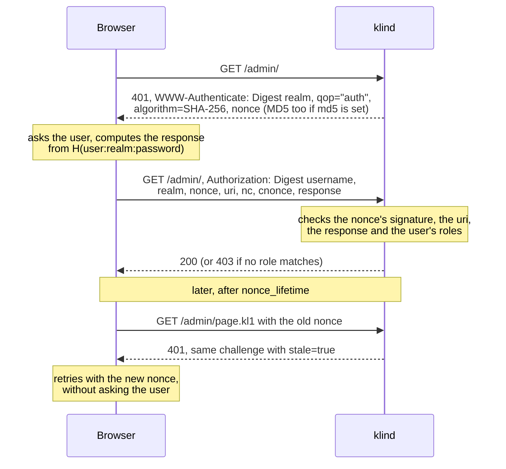

# HTTP authentication

Pages can be protected with HTTP authentication, Basic (RFC 7617) or
Digest (RFC 7616), set up per server or vhost in an `auth` block. A path
in a realm is served only to a user of the realm who has one of its
roles. Authentication needs a build with OpenSSL.

## Users

Passwords are never written in the configuration, only hashes made by the
klin tool. The password is read from the first line of stdin:

```sh
$ echo 'wonder land' | klin -c passwd -r "Private Area" alice
user
{
    name alice
    roles
    password pbkdf2-sha256$100000$...$...
    digest SHA-256 6f1c...e0 Private Area
}
```

- **password** is a salted PBKDF2-SHA256 hash (100000 iterations, `-n` to
  change), checked by Basic authentication.
- **digest** is what Digest authentication needs, H(user:realm:password),
  one line per realm (`-r`, repeatable) and algorithm (`-m` adds MD5 lines
  for old clients). Like Apache's htdigest file, it is
  password-equivalent for that realm, so keep the configuration readable
  by klind only.
- **roles** is left empty for you to fill in, separated by blanks or
  commas.

Users go in the `auth` block, or in a separate file (same syntax) named by
`users_file` and read at startup.

## Configuration

```conf
auth
{
    users_file      /etc/klin/users     # optional
    nonce_lifetime  300                 # seconds a Digest nonce lasts
    basic_over_http no                  # see below

    user
    {
        ...                             # as printed by klin -c passwd
    }

    realm
    {
        name    Private Area            # shown to the user
        path    /admin/*                # fnmatch(3) patterns of the
        path    /report.kl1             # request path; may repeat
        scheme  digest                  # digest (default), basic or any
        roles   admin                   # any of these; none: any user
        md5     no                      # also offer MD5 Digest
    }
}
```

The request path is matched against the realms in order, and the first
realm with a matching path applies. The path is decoded and normalised
and taken before aliases and routes. A path ending in `/` that has an
index page is matched with the index page's name appended (`/admin/` as
`/admin/index.kl1`).

The catch is the trailing slash. `"/admin/*"` covers `/admin/` and
everything below it, but not `/admin`. Use `"/admin*"` for both.

The answer is 401 with the challenges when the credentials are missing or
wrong, and 403 when they are right but the user has none of the realm's
roles. Pages read the user with `request_get_auth_user()`; CGI scripts get
it in `REMOTE_USER`.

## A Digest exchange

The figure below shows a browser's first request for a page in a Digest
realm, then the retry after the nonce has expired.



Nonces carry their own time and an HMAC-SHA256 over the time and realm,
so klind keeps no nonce table. The `uri` in the Authorization field must
be the request's own target, so a response computed for one page cannot
be used for another. A client that names no algorithm is taken to mean
MD5, as RFC 7616 says, and is refused unless the realm sets `md5`.

## Security notes

**Basic sends the password with every request**, readable on plain HTTP.
klind offers Basic only over HTTPS. A realm that is Basic-only on a plain
HTTP server stops klind at startup, unless `basic_over_http` is set.

Digest uses SHA-256. MD5 is offered only in realms that set `md5`, for
clients that lack SHA-256.

Digest nonces are signed with a key drawn when klind starts (before the
prefork workers fork, so every worker accepts the others' nonces), and
expire after `nonce_lifetime`. The client is then told `stale=true` and
retries without asking the user. The trade-off is replay: nonce counts are
not tracked across prefork workers, so a captured Digest request can be
replayed until its nonce expires. Over plain HTTP the page content is also
readable. Use HTTPS for anything that matters.

PBKDF2 is slow on purpose. Each worker remembers the last 8 Basic
credentials it verified for 5 minutes, so a kept-alive client is not
slowed down on every request.

A configuration error in a realm or user (a plaintext password, a realm
without a path, an unknown scheme, a `users_file` that cannot be read)
stops klind at startup rather than leaving pages unprotected. I would
rather a device refuse to start than serve its admin pages to anyone.
