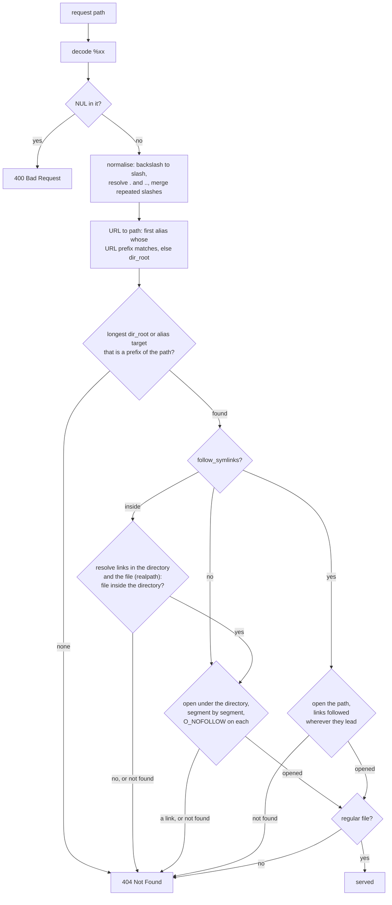

# Files from the file system

Pages built into klind (the embedded site) need no build option. Anything
on the file system needs one of two optional suppliers: the file system
one (static files) or the CGI one ([CGI](CGI.md)). Both are left out of a
build unless you ask for them:

```sh
cmake -S . -B out -DKLIN_ENABLE_SUP_FS=ON -DKLIN_ENABLE_SUP_CGI=ON
```

**A build without them cannot serve or run anything from the file
system**, whatever the configuration says (your own page code can still
open files). That is the way to turn them off entirely, and on a device
that only serves its embedded pages it is what I would do. A build with
them can still turn them off for a server or a virtual host:

```conf
serve_files     no      # no static files from the file system
run_cgi         no      # no CGI scripts
```

Both default to yes when built in.

## Where files come from

A request path is decoded (`%xx`), then normalised: backslashes become
slashes, `.` and `..` segments are resolved and repeated slashes are
reduced, all before the path is used. A NUL (`%00`) is refused with 400.

Two separate steps then decide where the file is. First the URL is
mapped to a file-system path: the aliases are tried in order (each
`dir_alias`, then each `script_alias`), and the first whose URL prefix
matches the path, at a segment boundary, has its target put in place of
that prefix. If none matches, the path is appended to `dir_root`. Second,
klind picks the directory the file must stay inside: the longest of
`dir_root` and all the alias targets that is a file-system prefix of the
resulting path. That is usually the target of the alias that matched,
but not always. If you alias `/docs` to /srv/www and also have
/srv/www/private as another alias's target, a request for
`/docs/private/x` is contained by /srv/www/private. A path under none of
them is not opened. The file is then opened under that directory with the
`follow_symlinks` policy. This is the POSIX path; Windows differs at the
open, as described [below](#windows).



A request path is looked up only under `dir_root` or an alias target,
not from the file system's root (unless you set one of those to `/`).
Before 4.0 it was, when the request arrived, so `If-Modified-Since` could tell
whether any file on the host existed, and when it changed.

The path info (`/page/extra`) is split against the files of the virtual
host the Host field names.

## Symbolic links

```conf
follow_symlinks     inside      # the default
                    no
                    yes
```

With `inside`, a link is followed if its target is inside the containing
directory chosen above (the longest of `dir_root` and the `dir_alias` and
`script_alias` targets that holds the path). A link that leads out of it
(to /etc, or to ../secret.txt) is not found (404). The directory itself
may be reached through links.

With `no`, no link is followed below that directory.

With `yes`, links are followed wherever they lead. That was the behaviour
before 4.0.

On POSIX systems, with `inside` and `no`, the file is opened one path
segment at a time from the directory, with `O_NOFOLLOW` for each segment,
after the links are resolved (for `inside`). A link swapped in between the
check and the open is not followed, so the file opened is under the
directory. With `yes` the path is opened as it is. Under every policy only
regular files are served; a FIFO, a device or a directory is not found.
CGI scripts are checked the same way when the request comes in, and the
script is then run by its path.

The setting goes in a server block or a virtual host's block, and a
virtual host inherits it from its server.

## Windows

On Windows, unless `follow_symlinks` is `yes`, no segment below the
directory may be a symbolic link, junction or other reparse point
(`inside` acts as `no`). Klin checks each segment's attributes first and
then opens the whole path, so there is no segment-by-segment open as on
POSIX, and a link swapped in between the check and the open would be
followed. These names are refused whatever the setting:

- a segment ending in a dot or a blank (Windows drops them, so
  `page.kl1.` would name page.kl1);
- one with a colon (an NTFS stream, `file::$DATA`);
- one with a tilde followed by a digit (`SECRET~1.TXT`), the pattern of
  the short 8.3 names Windows generates, which give a file a second name a
  rule written for its long name would miss. Only that pattern is
  checked, so a short name without it is not refused, and a long name
  that happens to contain it (`v~2.txt`) is;
- device names (CON, NUL, COM1, ...).

**This code is not tested.** The Windows continuous integration (CI) job
builds klind and serves embedded pages, but does not build the file-system
supplier or run these path checks.

## Paths the tests try

test/run_server_tests.py, on both server models, requests a file next to
a `dir_alias` target through `../`, `%2e%2e`, `%2f`, `%5c`, backslashes,
double encoding, overlong UTF-8, absolute paths and Windows names, and
none is served. It also checks a raw /etc/passwd with `If-Modified-Since`
(404, not 304), the three policies on links inside and outside the
directory, a FIFO, the path info of a virtual host's own file, and
`serve_files no` and `run_cgi no`.

See also: [CGI](CGI.md) for scripts, [LIMITS](LIMITS.md),
[SANDBOX](SANDBOX.md).
