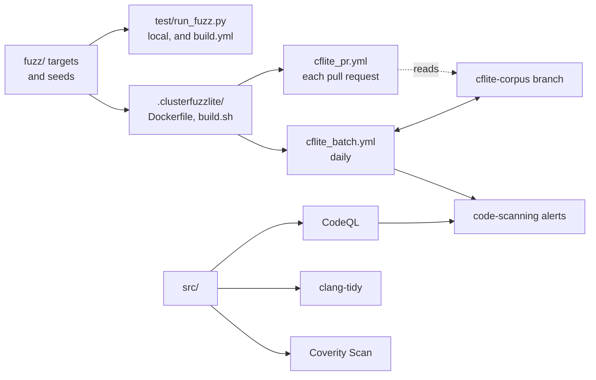

# Fuzzing and static analysis

This page lists Klin's fuzz targets, how to run them on your own machine,
how ClusterFuzzLite runs them in CI, and the static analysers that check
the code. You need it when you add a parser, chase a fuzzer crash or read a
code-scanning alert.

The figure below shows how the pieces fit together. The same targets in
`fuzz/` are built two ways: by `test/run_fuzz.py` for a short smoke run
(locally and in the Build and test workflow), and by ClusterFuzzLite for
longer runs. The static analysers work on the source directly.



## Fuzz targets

`fuzz/` has one libFuzzer target per parser that reads what a client
sends. The list lives in `fuzz/targets.txt`, and the table below says what
each target exercises.

| Target | What it feeds and checks |
| --- | --- |
| `request` | a whole request: request line, header (limits, smuggling checks), Content-Length, cookies, If-Modified-Since, the query string and a urlencoded or multipart body |
| `multipart` | multipart/form-data bodies: parts, their headers, uploads |
| `header` | header fields alone, both strict (requests) and lenient (multipart parts, CGI output) |
| `url` | URL, hex, HTML and SQL escapes, and URI path normalisation (aborts if a normalised path leaves the root) |
| `json` | the JSON reader and writer: parse, write, parse, write must give the same bytes |
| `ws` | WebSocket frames after the handshake: fragments, control frames, close, masking, UTF-8 |
| `digest` | Authorization (Digest) parameters, users blocks, stored password hashes |
| `session` | session data as it is loaded: decryption, decompression, variables (cookies are parsed by `request`) |
| `translate` | the .kl1 page translator |

Some targets include the .c file they test, so they can reach its static
functions (`fuzz_request.c` includes `src/libpage/request.c`, for example).
They link klind's objects without its `main()`, which `fuzz/fuzz_stubs.c`
stands in for. `fuzz/seeds/<target>/` holds seed inputs for every target,
and `fuzz/fuzz_<target>.dict` is a dictionary for the HTTP targets
(`request`, `multipart` and `header`).

When you add a parser that reads client input, add a target for it, with
seeds, and put its name in `fuzz/targets.txt`.

## Running them

```sh
python3 test/run_fuzz.py [--runs N] [--target NAME ...]
```

This builds every target with clang, libFuzzer, ASan and UBSan into
`.build/fuzz` and runs each one N times (default 10000) from its seeds. CI
runs it with `--runs 20000` on every push and pull request. A crash is left
as `.build/fuzz/<target>-crash-*`, and you can reproduce it with:

```sh
.build/fuzz/fuzz/fuzz_<target> .build/fuzz/<target>-crash-...
```

To do the same build by hand, configure with `-DKLIN_FUZZ=ON`, `CC=clang`
and the sanitizers in `CFLAGS` (for example
`-fsanitize=address,undefined,fuzzer-no-link`). `KLIN_FUZZ_ENGINE` is the
engine's link flag (`-fsanitize=fuzzer`).

## ClusterFuzzLite

`.clusterfuzzlite/` (Dockerfile, build.sh, project.yaml) builds the targets
for ClusterFuzzLite, which runs them from GitHub Actions on two schedules:

| Workflow | When | What runs |
| --- | --- | --- |
| `cflite_pr.yml` | every pull request that changes more than documentation | ASan and UBSan, 5 minutes each, in code-change mode (only the targets the change reaches) |
| `cflite_batch.yml` | daily | ASan and UBSan, 30 minutes each, then corpus pruning and a coverage report |

A crash shows up as a failed job, with the crash input and stack trace as
artifacts. Batch runs also raise it as a code-scanning alert.

The corpus is kept the way ClusterFuzzLite recommends, in a git "storage
repo". Here that is the `cflite-corpus` branch of this repository, with
coverage reports in `cflite-coverage`. The scheduled jobs create and update
both with the workflow's own token (`contents: write`), so no personal
access token or other secret is needed. Coverage reports are not published
(ClusterFuzzLite's default branch for them, gh-pages, is not used), so
download them from the `cflite-coverage` branch.

The Dockerfile builds OpenSSL 3 (a pinned tag, checked against its commit)
because OSS-Fuzz's base-builder image has 1.1. It links it statically,
because the fuzzers run in a different image. I wrote the Dockerfile and
build.sh so that they could later serve as an OSS-Fuzz project's (OSS-Fuzz
keeps them in its own repository and clones the source instead of using
`COPY`). Nothing has been prepared or submitted for OSS-Fuzz.

## Static analysis

Three analysers check the C code. CodeQL and clang-tidy are required
checks on pull requests to master; Coverity is not.

CodeQL (`.github/workflows/codeql.yml`) runs the security-extended
queries on every push to master, on pull requests and weekly. Its results
are code-scanning alerts.

clang-tidy (`analysis.yml`, `.clang-tidy`) runs the clang static
analyser, the bugprone checks and some CERT checks over `src/`. Findings
are listed in the job summary and kept as an artifact. The analyser's core,
unix, security and valist checks fail the job; the rest are reported only.
To run the same thing locally:

```sh
CC=clang cmake -S . -B .build/tidy -G Ninja \
    -DCMAKE_EXPORT_COMPILE_COMMANDS=ON -DKLIN_BUILD_TESTS=ON
cmake --build .build/tidy --target klin_utils
run-clang-tidy -p .build/tidy -quiet "$PWD/src/"
```

Coverity Scan (`coverity.yml`) runs weekly once the repository has a
`COVERITY_SCAN_TOKEN` secret and a `COVERITY_EMAIL` variable (and,
optionally, `COVERITY_PROJECT` if the project is not named owner/repo).
Until then the job only notes that it was skipped.

## What fuzzing found

These are the real bugs the fuzzers have turned up so far:

- A WebSocket worker crashed on an empty first message (a NULL write).
- LibU's base64 decoder read outside its table on bytes over 0x7f, and
  wrote up to 2 bytes past the output for a padded last group. Basic
  credentials, WebSocket keys and password hashes now go through
  `klin_b64_decode()`, which checks the input and gives LibU a buffer of
  its own. LibU is pinned and was not changed.
- Session loading leaked a variable whose key did not decrypt.
- The io drivers were called through a pointer of another function type.
  That is undefined behaviour, and UBSan's `-fsanitize=function` stops on
  it.
- A JSON `-0` did not round-trip.
