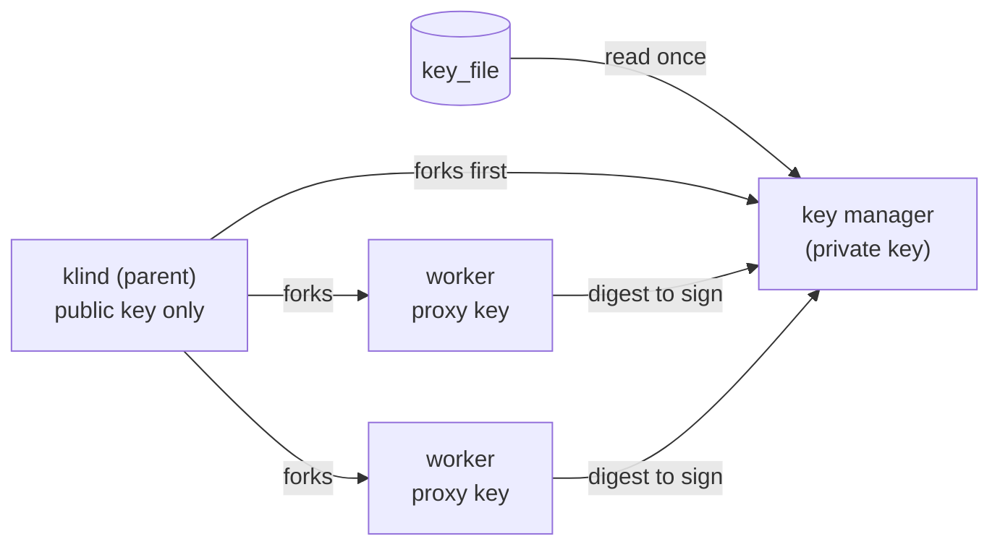
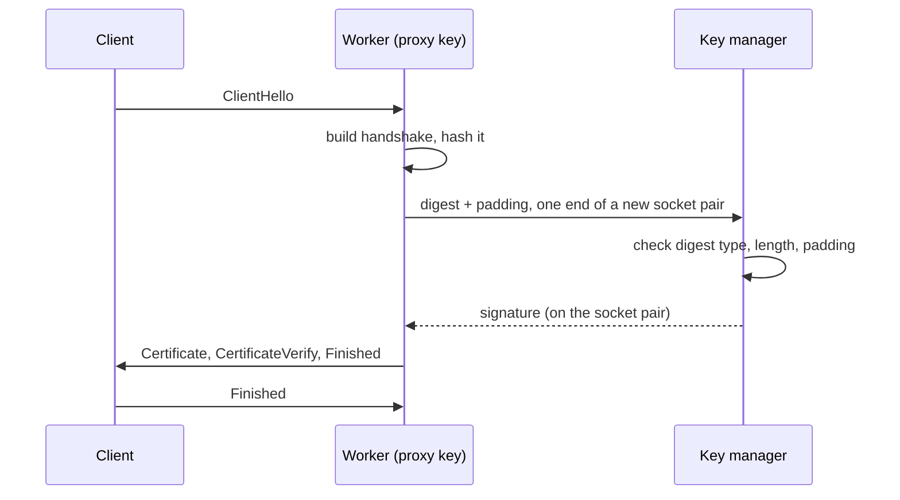

# TLS key manager

The key manager keeps an HTTPS server's private key out of the processes
that serve requests, under the four conditions in
[Why it exists](#why-it-exists). It is on by default everywhere except
native Windows, which has no key manager. What you have to do is put the key in
a file of its own and keep that file from the workers' user; turn the
key manager off only if your key type is unsupported or you want the old
behaviour back.

## Why it exists

A worker parses whatever the network sends it. If a bug in a page or a
library lets an attacker run code in a worker, everything in that
worker's memory is theirs. Before 4.0 that included the TLS private key,
and a stolen key outlives any fix: the attacker can impersonate the
device until the certificate expires or is revoked.

I wrote the key manager so that a compromised worker has no private key to
steal. **The key stays out of the workers only with all four of these:**

1. A separate `key_file` outside the site. Separate means not a PEM file
   that also holds the certificate: klind reads the certificate in the
   parent process, and with a combined file the key's bytes pass through
   memory that the workers inherit.
2. The key manager on (the default, except on native Windows).
3. File permissions that keep the key file from the workers' user, since
   a worker that can read the file can simply open it. klind and the key
   manager read their files before dropping to `uid` and `gid`, so a key
   file only root can read works when klind starts as root.
4. No other server in the same klind loading that key with
   `key_manager no`. Such a server has klind decode its key in the
   parent, and every worker of every server is forked from the parent.

The rules apply to every copy of the key: if two servers use it, both
need it in a separate file. Even with all four, the protection of the
key manager's memory from other processes of the same user is Linux
only (see [Limits](#limits)).

With all four, a worker can ask for signatures while it runs, but the
key is not in its memory, so it does not leave with a memory dump or a
core file of a worker. On Linux the key manager's own memory is also
closed to other processes of the same user; elsewhere a compromised
worker running as that user could still read it. A key embedded in klind, or a server with
`key_manager no`, is in every process (see [Limits](#limits)).

At startup, before any worker is forked, klind starts one key manager per
HTTPS server that has `key_manager` on. With the key in an external
`key_file`, the key manager is a small process of its own that reads the
file itself and tells klind only the public key, so klind never decodes
the private key, and workers and klind itself hold only a proxy key. A key
embedded in the site is different: klind decodes it first and then forks
the key manager with that copy, so the key stays in klind's memory and
every worker inherits it. With an external `key_file` (prefork, key
manager on, the file unreadable by the workers' user and loaded by no
`key_manager no` server), the key stays on one side of a socket:



When a TLS handshake needs a signature, the worker sends the digest to
the key manager, which signs it and sends the signature back. In TLS 1.3
that signature goes into the server's CertificateVerify message; in TLS
1.2 it signs the ECDHE or DHE parameters. Here is one TLS 1.3
handshake, simplified, with the same four conditions met (in TLS 1.2
the signature travels in ServerKeyExchange instead):



To keep the key in klind's processes, as before 4.0.0, turn it off for a
server:

```conf
secure
{
    type        https
    cert_file   /etc/klin/cert.pem
    key_file    /etc/klin/key.pem
    key_manager no
}
```

## How it works

### Startup

Each key manager closes every descriptor except its control socket,
ignores HUP and ALRM, and, when klind runs as root with `uid` and `gid`
set, drops to them as klind does (it stops rather than carry on as root
when klind would not). It signs once to warm OpenSSL up, then
turns on its sandbox ([SANDBOX](SANDBOX.md)) unless the server has
`sandbox no`. Only then does it tell klind it is ready. A key manager
that is not ready within 10 s is killed, and klind does not start.

Servers sharing a key file still get one key manager each.

### Its memory is private

On Linux, other processes of the same user, the workers included, cannot
read a key manager's memory (root still can). Before it reads the key, and
again after dropping to `uid` and `gid` (which resets it), it makes itself
undumpable. On Linux that is `PR_SET_DUMPABLE 0`, so `/proc/<pid>/mem` and
ptrace are refused. It also sets `RLIMIT_CORE` to 0, so it does not write
a core file. This matters most when klind runs as its own user from the
start (systemd `User=`), because nothing else would make it undumpable.
Other systems get the core limit only.

Key and certificate files are read into OpenSSL secure memory, which is
wiped when freed, not through stdio.

### What it will sign

It signs requests shaped like what a TLS handshake asks for, and nothing
else:

- a SHA-1, SHA-224, SHA-256, SHA-384 or SHA-512 digest of the right length;
- for RSA, PKCS #1 v1.5 or PSS (probabilistic signature scheme) padding,
  with a PSS salt length and MGF1 (mask generation function) digest that
  TLS uses.

Raw RSA, other paddings and digests, and data of the wrong length are
refused. It checks the form of a request only: it cannot tell whether the
digest really came from a handshake, so a compromised worker can still
have any digest of the right length signed (see [Limits](#limits)).

A request carries exactly one descriptor, for the answer. A request with
more is not answered, and the extra descriptors are closed.

### The proxy key

The proxy key is an OpenSSL 3 provider built into klind,
`klin-keyproxy`. Its key management answers with the public key
(certificate checks, sizes, curve). Its signature operation forwards the
digest together with the RSA padding, PSS salt length and MGF1 digest.
RSA keys (PKCS #1 v1.5 and PSS, TLS 1.2 and 1.3) and EC keys (ECDSA) are
supported. Any other key type stops klind at startup; set
`key_manager no` for those.

For each signature the worker creates a socket pair, sends the request
and one end of the pair over the control socket that every klind process
inherited, and waits up to 5 s for the answer on the other end. The
control socket is closed on exec, so CGI scripts do not inherit it.

### TLS 1.2 RSA key exchange is off

With the key manager, `:!kRSA` is added to the TLS 1.2 cipher list,
whether that is `tls_ciphers` or the default in [TLS](TLS.md). RSA key
exchange decrypts with the private key, which the key manager does not
do, and it has no forward secrecy anyway. Current browsers and TLS
libraries all offer ECDHE, so in practice this costs nothing.

### When a key manager dies

If a key manager exits, klind stops. With an external `key_file`
nothing else holds the key, so no handshake could succeed, and klind
treats an embedded key the same way. klind exits with a failure status
in this case (status 0 is kept for a stop by SIGTERM or SIGINT), so the
shipped systemd unit (`Restart=on-failure`) starts it again, with a new
key manager ([SYSTEMD](SYSTEMD.md)). A key manager also exits within a
second of klind exiting: it checks for its parent once a second.

### The leak that settled it

During 4.0 development, klind decoded the key itself and handed it over.
OpenSSL's decoder leaves copies of the key in ordinary freed memory, and
every worker inherited that memory. I saw it with two servers sharing a
key file, the second with a `ca_file`. Now the key manager reads an
external key file itself, so klind's memory does not contain that key.

## Limits

- A key in the same PEM file as the certificate (no `key_file`) still
  goes to the key manager, but klind reads that file in the parent to load
  the certificate, so the key's bytes pass through memory the workers
  inherit. Give the key a file of its own.
- A key file the workers' user can read is open to a compromised worker,
  whatever the key manager does.
- A key embedded in klind (a `key_file` inside the site, picked up by the
  import) is part of the program, so it is in every process's memory.
  With the key manager on, klind warns about this at startup; with
  `key_manager no` there is no warning, since the key is in every process
  by design. Keep keys in files outside the site.
- The key manager signs digests for the workers while they run, and it
  checks only that a request is shaped like a handshake signature. A
  compromised worker can have digests of its choosing signed for as long
  as it runs. The key manager protects the key itself, not the TLS
  sessions of a compromised worker.
- Protection of its memory from processes of the same user is Linux only.
  Elsewhere it gets no core file, nothing more.
- Another server in the same klind that loads the same key with
  `key_manager no` decodes it in the parent, and every worker inherits
  that copy.
- Native Windows has no key manager, because it needs fork(2) and UNIX
  sockets.

## How the isolation is tested

`test/run_server_tests.py` scans, after TLS requests, the memory of klind
and every process it started (Linux, /proc) for the private key, and
expects to find it in the key managers only. The setup is two servers
sharing the key, one of them with client certificates, which is the case
that leaked. Run as an ordinary user, the tests also check that they
cannot open the key managers' memory at all. Run as root, they can read
every process, so they check where the key is and then, separately, start
klind as `nobody` and confirm that `nobody` can open a worker's memory but
not the key manager's.

A test page also asks the key manager, as a compromised worker could,
for MD5, no digest, raw RSA, a digest of the wrong length and X9.31
padding, all of which are refused, and sends two extra descriptors,
which are closed. klind is also started with its standard output closed.

See also: [TLS](TLS.md) for protocols and ciphers, and [SANDBOX](SANDBOX.md)
for the key manager's seccomp filter.
