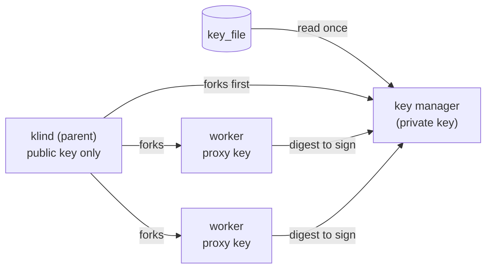
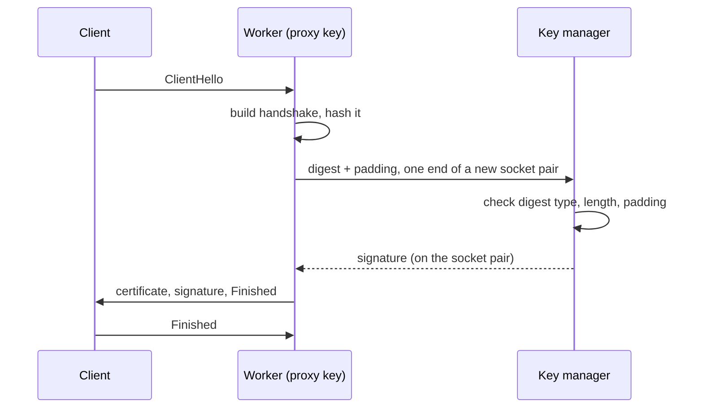

# TLS key manager

The key manager keeps an HTTPS server's private key out of the processes
that serve requests. This page explains how it works, what it protects
and what it does not. It is on by default, so you only need to act if
your key type is unsupported or you want the old behaviour back.

## Why it exists

A worker parses whatever the network sends it. If a bug in a page or a
library lets an attacker run code in a worker, everything in that
worker's memory is theirs. Before 4.0 that included the TLS private key,
and a stolen key outlives any fix: the attacker can impersonate the
device until the certificate expires or is revoked.

I wrote the key manager so that a compromised worker has nothing to
steal. **The worker never holds the key.** It can ask for signatures
while it runs, but it cannot read the key, and the key does not leave
with a memory dump or a core file of a worker.

At startup, before any worker is forked, klind starts one key manager
per HTTPS server. The key manager is a small process of its own that
reads the key file itself and tells klind only the public key, so klind
never decodes the private key. Workers, and klind itself, hold only a
proxy key. The figure below shows who holds what.



When a TLS handshake needs a signature, the worker sends the digest to
the key manager, which signs it and sends the signature back. In TLS 1.3
that signature goes into the server's CertificateVerify message; in TLS
1.2 it signs the ECDHE or DHE parameters. The sequence below shows one
handshake.



To keep the key in klind's processes, as before 4.0.0, turn it off for a
server:

```conf
secure
{
    type        https
    cert_file   /etc/klin/cert.pem
    key_file    /etc/klin/key.pem
    key_manager no
}
```

## How it works

### Startup

Each key manager closes every descriptor except its control socket,
ignores HUP and ALRM, and, when klind runs as root with `uid` and `gid`
set, drops to them as klind does. It signs once to warm OpenSSL up, then
turns on its sandbox ([SANDBOX](SANDBOX.md)) unless the server has
`sandbox no`. Only then does it tell klind it is ready. A key manager
that is not ready within 10 s is killed, and klind does not start.

Servers sharing a key file still get one key manager each.

### Its memory is private

Other processes of the same user, the workers included, cannot read a
key manager's memory. Before it reads the key, and again after dropping
to `uid` and `gid` (which resets it), it makes itself undumpable. On Linux
that is `PR_SET_DUMPABLE 0`, so `/proc/<pid>/mem` and ptrace are refused.
It also sets `RLIMIT_CORE` to 0, so it never writes a core file. This
matters most when klind runs as its own user from the start (systemd
`User=`), because nothing else would make it undumpable. Other systems
get the core limit only.

Key and certificate files are read into OpenSSL secure memory, which is
wiped when freed, not through stdio.

### What it will sign

It signs only what a TLS handshake asks for:

- a SHA-1, SHA-224, SHA-256, SHA-384 or SHA-512 digest of the right length;
- for RSA, PKCS #1 v1.5 or PSS padding, with a PSS salt length and MGF1
  digest that TLS uses.

Raw RSA, other paddings and digests, and data that is not a digest are
refused. A request carries exactly one descriptor, for the answer. A
request with more is not answered, and the extra descriptors are closed.

### The proxy key

The proxy key is an OpenSSL 3 provider built into klind,
`klin-keyproxy`. Its key management answers with the public key
(certificate checks, sizes, curve). Its signature operation forwards the
digest together with the RSA padding, PSS salt length and MGF1 digest.
RSA keys (PKCS #1 v1.5 and PSS, TLS 1.2 and 1.3) and EC keys (ECDSA) are
supported. Any other key type stops klind at startup; set
`key_manager no` for those.

For each signature the worker creates a socket pair, sends the request
and one end of the pair over the control socket that every klind process
inherited, and waits up to 5 s for the answer on the other end. The
control socket is closed on exec, so CGI scripts do not inherit it.

### TLS 1.2 RSA key exchange is off

With the key manager, `:!kRSA` is added to the TLS 1.2 cipher list,
whether that is `tls_ciphers` or the default in [TLS](TLS.md). RSA key
exchange decrypts with the private key, which the key manager does not
do, and it has no forward secrecy anyway. Every current client uses
ECDHE.

### When a key manager dies

If a key manager exits, klind stops: nothing else holds the key, so no
handshake could succeed. A key manager also exits when klind does.

### The leak that settled it

Until the last changes in 4.0, klind decoded the key itself and handed it
over. The catch was that OpenSSL's decoder leaves copies of the key in
ordinary freed memory, and every worker inherited that memory. I saw it
with two servers sharing a key file, the second with a `ca_file`. Now the
key manager reads the file, so klind's memory never contains the key.

## Limits

- A key embedded in klind (a `key_file` inside the site, picked up by the
  import) is part of the program, so it is in every process's memory.
  klind warns about this at startup. Keep keys in files outside the site.
- The key manager signs handshake digests for the workers while they run.
  It protects the key, not the TLS sessions of a compromised worker.
- Native Windows has no key manager, because it needs fork(2) and UNIX
  sockets.

## Tested

The server tests scan, after TLS requests, the memory of klind and every
process it started (Linux, /proc) for the private key, and expect to
find it in the key managers only. The setup is two servers sharing the
key, one of them with client certificates, which is the case that
leaked. Running as klind's user, the tests cannot read the key managers'
memory at all. (As root, klind is started as nobody and nobody tries.)

A test page also asks the key manager, as a compromised worker could,
for MD5, no digest, raw RSA, a digest of the wrong length and X9.31
padding, all of which are refused, and sends two extra descriptors,
which are closed. klind is also started with its standard output closed.
