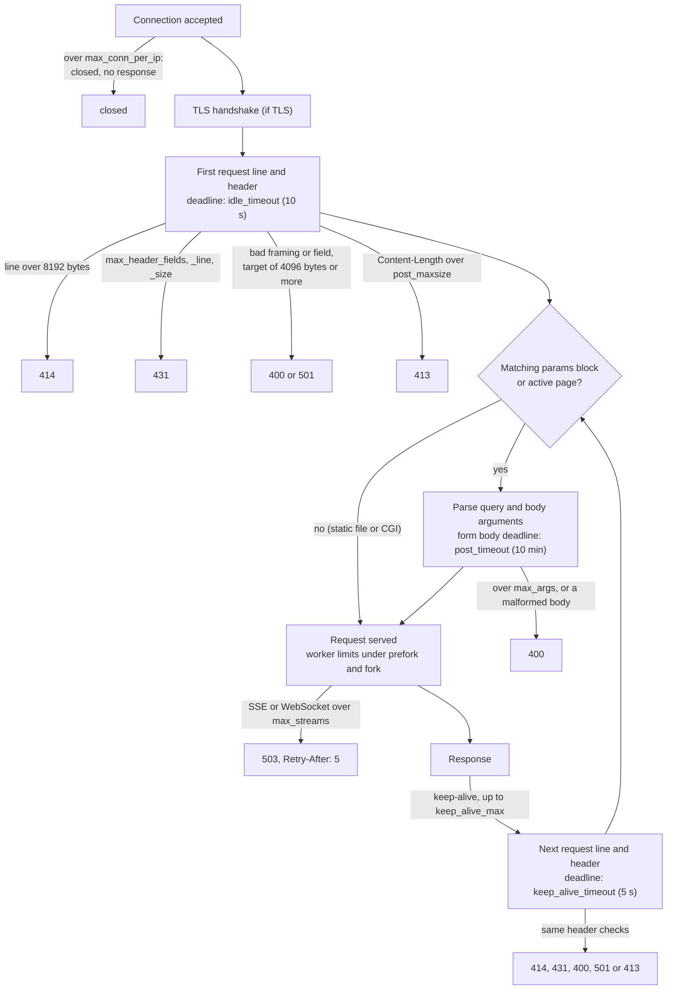

# Request limits

klind refuses requests that are too big, too slow or ambiguous, and each
refusal has a status code and a setting that moves the line. When a
client reports a 400, 413, 414 or 431 you didn't expect, the limit
behind it is here, and so are the worker limits that apply under prefork
and fork.

Every setting here goes in a server block of klind.conf
([klind.conf(5)](man/klind.conf.5)).

## Where each limit applies

A request passes through a series of stages, each with its own cap. The
chart follows them in order, with the setting at each step and what a
client gets for going past it. Arguments are parsed, and `max_args` and
the form-body deadline apply, only when something needs them: a `params`
block ([VALIDATE](VALIDATE.md)) that matches the request, or an active
page. A static file, or a CGI script with no matching `params` block,
skips that stage.

A refusal at the header stage (the 414, 431, 400 or 501 and 413 boxes)
ends the connection. One of those 400s catches clients out: a request
target (path and query) of 4,096 bytes or more is refused with 400 even
when the whole line is under the 8,192-byte limit, so a long URL gets
400, and 414 only once the line itself is over 8,192 bytes. A later
error, such as the 400 for too many arguments or a form body the parser
cannot read, gets an error page and the connection can stay open for the
next request. A deadline that runs
out closes the connection without a response.

## The request

| Setting | Default | Minimum | Beyond it |
| --- | --- | --- | --- |
| `max_header_fields` | 100 | 8 | 431 Request Header Fields Too Large |
| `max_header_line` | 8192 | 256 (maximum 65534) | 431 (the bytes of one field line, with its CRLF) |
| `max_header_size` | 32768 | 1024 | 431 (the bytes of the whole header) |
| (the request line) | 8192 | not configurable | 414 URI Too Long; a target of 4096 bytes or more gets 400 first |
| `max_args` | 1000 | 1 | 400 (query and form arguments, multipart fields and uploads, counted together, where arguments are parsed) |
| `post_maxsize` | 5 MB | 1024 | 413 (the body, whatever the method) |
| `idle_timeout` | 10 s | 1 s | the connection is closed |
| `post_timeout` | 10 min | 5 s | the connection is closed |

The 5 MB of `post_maxsize` is 5,120,000 bytes (5 × 1,024,000), not 5 MiB.
The check uses the Content-Length the client sends, so an oversized body is
refused before klind reads a byte of it.

**`idle_timeout` is a deadline for the whole request line and header, not
for each read.** A client that sends one byte a second ("slowloris") is
closed when the deadline runs out, however steadily it trickles. On a
kept-alive connection the next request's line and header get
`keep_alive_timeout` (5 s) instead, and after `keep_alive_max` requests
(100) klind closes the connection.

`post_timeout` bounds the body only where klind reads it for you: when it
parses a POSTed form (URL-encoded or multipart) for a matching `params`
block or an active page, and when a page calls `request_read_body()`. A
POST with no Content-Type is parsed as URL-encoded; one with any other
media type is left for the page to read. A page that reads the raw request stream (`in`)
itself has no blanket deadline, so set your own if the client is not
trusted.

These are the server block's settings, not a vhost's. klind reads them when
the request object is created, before the Host field has arrived, so a
vhost block cannot change them.

### Three different idle_timeouts

The name `idle_timeout` turns up in three places, with three meanings:

| Setting | Where | Default | What it does |
| --- | --- | --- | --- |
| `idle_timeout` | server block | 10 s | deadline for a request's line and header |
| `prefork.idle_timeout` | server block | 10 s | a spare worker started beyond `prefork.start_child` exits after this long without a client (0: never) |
| `idle_timeout` (or `max_age`) | `session` block | 20 min | a session not used for this long ends ([SESSIONS](SESSIONS.md)) |

## Request smuggling

A proxy in front of klind and klind itself must agree on where one request
ends and the next begins. If they don't, a client can hide a second request
inside the body of the first. I took the simple route: klind refuses
anything that two HTTP implementations might read differently.

| Request | Status |
| --- | --- |
| Transfer-Encoding together with Content-Length | 400 |
| two Content-Length fields (even with equal values) | 400 |
| a Content-Length that is not just digits | 400 |
| any Transfer-Encoding (chunked request bodies are not implemented; unknown or repeated codings too) | 501 |
| obsolete line folding (a line starting with a space or a tab) | 400 |
| a field name that is not a token, or a blank before the colon | 400 |
| a control character other than tab in a field, a bare CR, or a NUL | 400 |
| a line over the limits above | 431 |

All of these are header-stage refusals, so the connection is closed and a
request pipelined behind the bad one is never read. klind sends the
response first, then stops writing and keeps reading for about a second
(at most 1 MB) whatever the client is still sending. Without that pause
the client's kernel could reset the connection and throw the response
away. This lingering happens on plain HTTP only.

## Connections

| Setting | Default | Beyond it |
| --- | --- | --- |
| `max_conn_per_ip` | 32 | a new connection from the same address is closed as soon as it is accepted, before TLS |
| `max_streams` | 100 | `sse_start()` and `ws_accept()` answer 503 with `Retry-After: 5` |

Both count the connections being served by all of a server's workers,
using memory the workers share. Set either to 0 to turn it off.

`max_streams` keeps long-lived server-sent event (SSE) and WebSocket
connections from taking every worker. With `prefork.max_child` at its
default of 150, 100 streams leave 50 of that server's workers for
ordinary requests. That is arithmetic against the server's own ceiling:
the server reaches 150 workers only if klind's global `max_child`
(default 300, shared by every server) leaves room for them.

Behind a proxy, every client has the proxy's address. Raise
`max_conn_per_ip`, or set it to 0 and limit clients at the proxy instead.

In the iterative model (`klind -d`) there is one connection at a time, and
neither cap applies.

## Workers

Each worker process (in the prefork or fork model) gets resource limits
when it starts, before it enters its sandbox:

| Setting | Default | Limit |
| --- | --- | --- |
| `worker_max_memory` | 1024 | MB of address space (`RLIMIT_AS`) |
| `worker_max_files` | 1024 | open files (`RLIMIT_NOFILE`) |
| `worker_max_procs` | the model's maximum workers + 64: `prefork.max_child` (or `fork.max_child`) + 64, so 214 by default | processes of its user (`RLIMIT_NPROC`), so the CGIs it starts are bounded too |
| `prefork.max_child` | 150 | workers at once (`fork.max_child` for the fork model) |
| `max_child` | 300 | workers for the whole of klind, from 1 to 896 on Linux |

The ceiling of 896 comes from `select()`: klind watches one channel per
worker, and the total has to stay below `FD_SETSIZE` (1024) less 128.

A worker limit of 0 leaves the inherited system limit unchanged. klind
never sets a limit above the hard limit it inherited. Past a limit,
`malloc()` returns NULL, `open()` fails with EMFILE and `fork()` with
EAGAIN. The page sees the error, and if it handles it, the worker
carries on.

klind sets both the soft and the hard limit, so a worker running as an
ordinary user (with `uid` and `gid` set, see [SYSTEMD](SYSTEMD.md)) cannot
raise them. One running as root could. `RLIMIT_NPROC` counts every process
of the user, not just klind's, so give klind a user of its own.

A few exceptions: sanitizer builds set no memory limit, because
AddressSanitizer reserves terabytes of address space. klind itself and the
key manager keep their own limits. The iterative model (`-d`) has no
workers at all.

On macOS, `worker_max_memory` cannot be applied: the system refuses an
`RLIMIT_AS` limit, so every worker logs `worker: cannot set
worker_max_memory: Invalid argument` and carries on without a memory
limit. I saw this on macOS 15.8.1 (Apple silicon) on 22 Nov 2026. Set
`worker_max_memory 0` there to skip the attempt and the warning.

## In-memory sessions

The memory session store has its own caps (`memory.limit` and
`memory.max_count`, unbounded by default) and, under fork and prefork, a
per-session size limit set by the size of one message to the parent;
[SESSIONS](SESSIONS.md) gives both.

## How the limits are tested

`test/run_server_tests.py` checks each of these. It sends every request
refused at the header stage with a valid request pipelined behind it, and checks both the
status and that the second request is never answered. It sends valid
requests sitting exactly at each limit. It trickles a header in 6-byte
lines every 250 ms and checks that klind closes it within the deadline. In
the prefork model it opens a fourth connection against `max_conn_per_ip 3`
and a third stream against `max_streams 2`; with either cap set to 0 those
checks fail, as they should.

For the worker limits, a page reports the limits it runs under (the
defaults, and 256 MB / 64 files on a second server). It finds that 20 files
can be opened and 200 cannot, that 16 MB can be allocated and 512 MB
cannot, and that the worker still serves afterwards.

See also: [SANDBOX](SANDBOX.md) for what a worker may do once running,
[HARDENING](HARDENING.md) for the build side, and [SYSTEMD](SYSTEMD.md)
for running klind as a service.
