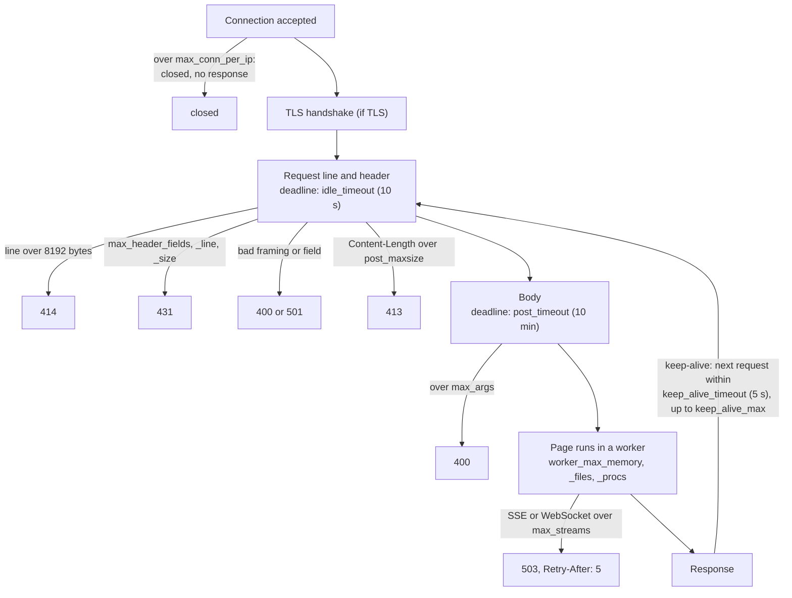

# Request limits

This page lists what klind refuses, the status code each refusal gets and
the setting that moves the line. Read it before you put klind on a network
you don't control, or when a client reports a 413, 414 or 431 you didn't
expect.

Every setting here goes in a server block of klind.conf.

## Where each limit applies

A connection passes through the same stages every time, and each stage has
its own cap. The figure below shows the order, with the setting that
applies at each step and what happens when a client goes past it.

A refused request (the 4xx and 501 boxes) always ends the connection. A
deadline that runs out closes it without a response.

## The request

| Setting | Default | Minimum | Beyond it |
| --- | --- | --- | --- |
| `max_header_fields` | 100 | 8 | 431 Request Header Fields Too Large |
| `max_header_line` | 8192 | 256 (maximum 65534) | 431 (the bytes of one field line, with its CRLF) |
| `max_header_size` | 32768 | 1024 | 431 (the bytes of the whole header) |
| (the request line) | 8192 | not configurable | 414 URI Too Long |
| `max_args` | 1000 | 1 | 400 (query tokens and multipart fields or uploads, counted together) |
| `post_maxsize` | 5 MB | 1024 | 413 (the body, whatever the method) |
| `idle_timeout` | 10 s | 1 s | the connection is closed |
| `post_timeout` | 10 min | 5 s | the connection is closed |

The 5 MB of `post_maxsize` is 5,120,000 bytes (5 × 1,024,000), not 5 MiB.
The check uses the Content-Length the client sends, so an oversized body is
refused before klind reads a byte of it.

**`idle_timeout` is a deadline for the whole request line and header, not
for each read.** A client that sends one byte a second ("slowloris") is
closed when the deadline runs out, however steadily it trickles.
`post_timeout` bounds the body the same way. On a kept-alive connection the
next request's line and header get `keep_alive_timeout` (5 s) instead of
`idle_timeout`, and after `keep_alive_max` requests (100) klind closes the
connection.

The catch is that these are the server block's settings, not a vhost's.
klind reads them when the request object is created, before the Host field
has arrived, so a vhost block cannot change them.

## Request smuggling

A proxy in front of klind and klind itself must agree on where one request
ends and the next begins. If they don't, a client can hide a second request
inside the body of the first. I took the simple route: klind refuses
anything that two HTTP implementations might read differently.

| Request | Status |
| --- | --- |
| Transfer-Encoding together with Content-Length | 400 |
| two Content-Length fields (even with equal values) | 400 |
| a Content-Length that is not just digits | 400 |
| any Transfer-Encoding (chunked request bodies are not implemented; unknown or repeated codings too) | 501 |
| obsolete line folding (a line starting with a space or a tab) | 400 |
| a field name that is not a token, or a blank before the colon | 400 |
| a control character other than tab in a field, a bare CR, or a NUL | 400 |
| a line over the limits above | 431 |

After any of these the connection is closed, so a request pipelined behind
the bad one is never read. klind sends the response first, then stops
writing and keeps reading for about a second (at most 1 MB) whatever the
client is still sending. Without that pause the client's kernel could
reset the connection and throw the response away. This lingering happens
on plain HTTP only.

## Connections

| Setting | Default | Beyond it |
| --- | --- | --- |
| `max_conn_per_ip` | 32 | a new connection from the same address is closed as soon as it is accepted, before TLS |
| `max_streams` | 100 | `sse_start()` and `ws_accept()` answer 503 with `Retry-After: 5` |

Both count the connections being served by all of a server's workers,
using memory the workers share. Set either to 0 to turn it off.

`max_streams` keeps long-lived SSE and WebSocket connections from taking
every worker. With `prefork.max_child` at its default of 150, at least 50
workers are left for ordinary requests.

Behind a proxy, every client has the proxy's address. Raise
`max_conn_per_ip`, or set it to 0 and limit clients at the proxy instead.

In the iterative model (`klind -d`) there is one connection at a time, and
neither cap applies.

## Workers

Each worker process (in the prefork or fork model) gets resource limits
when it starts, before it enters its sandbox:

| Setting | Default | Limit |
| --- | --- | --- |
| `worker_max_memory` | 1024 | MB of address space (`RLIMIT_AS`) |
| `worker_max_files` | 1024 | open files (`RLIMIT_NOFILE`) |
| `worker_max_procs` | `max_child` + 64 | processes of its user (`RLIMIT_NPROC`), so the CGIs it starts are bounded too |
| `prefork.max_child` | 150 | workers at once (`fork.max_child` for the fork model) |
| `max_child` | 300 | workers for the whole of klind, from 1 to 896 on Linux |

The ceiling of 896 comes from `select()`: klind watches one channel per
worker, and the total has to stay below `FD_SETSIZE` (1024) less 128.

Set a worker limit to 0 to leave it as klind has it. Past a limit,
`malloc()` returns NULL, `open()` fails with EMFILE and `fork()` with
EAGAIN. The page sees the error and the worker carries on.

klind sets both the soft and the hard limit, so a worker running as an
ordinary user (with `uid` and `gid` set, see [SYSTEMD](SYSTEMD.md)) cannot
raise them. One running as root could. `RLIMIT_NPROC` counts every process
of the user, not just klind's, so give klind a user of its own.

A few exceptions: sanitizer builds set no memory limit, because
AddressSanitizer reserves terabytes of address space. klind itself and the
key manager keep their own limits. The iterative model (`-d`) has no
workers at all.

## In-memory sessions

`memory.max_count` and `memory.limit` default to 0, which means unbounded.
The store sweeps out idle sessions when a session is saved, at most once a
minute, using the session idle timeout you configured. In the prefork model
the parent process owns the store.

Fork and prefork workers send serialised memory sessions to the parent in
PPC frames, which carry at most 8 KiB. After the session header that leaves
7,928 bytes of serialised data on 64-bit Linux. A save over that limit
fails and logs the largest size allowed. The iterative model stores
sessions directly.

## Tested

`test/run_server_tests.py` checks each of these. It sends every refused
request with a valid request pipelined behind it, and checks both the
status and that the second request is never answered. It sends valid
requests sitting exactly at each limit. It trickles a header in 6-byte
lines every 250 ms and checks that klind closes it within the deadline. In
the prefork model it opens a fourth connection against `max_conn_per_ip 3`
and a third stream against `max_streams 2`; with either cap set to 0 those
checks fail, as they should.

For the worker limits, a page reports the limits it runs under (the
defaults, and 256 MB / 64 files on a second server). It finds that 20 files
can be opened and 200 cannot, that 16 MB can be allocated and 512 MB
cannot, and that the worker still serves afterwards.
