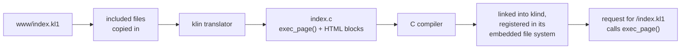

# Writing a site

A Klin site is a directory that gets compiled into `klind`. This page shows
how to lay one out, how to write a page and how to build and run the
result. The example site in `doc/example-site` uses the same layout, so
start there if you want something that already works.

## The layout

```text
mysite/
  etc/klind.conf      the configuration klind uses (klind.conf(5))
  www/index.kl1       a page: HTML with C code in it
  www/style.css       static files: served as they are
  www/images/...
```

Everything under the site directory becomes klind's embedded file system.
With `dir_root /www` in a server block (as in the example site), the URL
`/index.kl1` is served from `www/index.kl1`, `/style.css` from
`www/style.css`, and `/` from the index page (`index` in klind.conf(5)).

Files ending in `.kl1` are pages, and so are `.klin`, `.klc` and the
`.klone` files left over from KLone. Every other file is static: Klin
serves it with a content type taken from its extension and an ETag. Build
with `-DKLIN_IMPORT_ARGS=-z` and static files are stored compressed and
sent compressed to clients that accept it.

## What a page becomes

There is no interpreter in klind. Each page is translated into C at build
time and compiled into the server like any other source file, so a page runs as
native code with nothing to parse at request time. The figure below
shows the path from a `.kl1` file to a running page.



The HTML between the tags is stored in the generated file as constant
byte arrays and written out with `io_write()`. The C you wrote goes into a
`static void exec_page()` function in the order it appears in the page.
Because it is a `void` function, a plain `return;` ends the page early,
and the SSE and WebSocket examples rely on that.

## A page

A page is HTML with C in it. Four tags hold the C, and the translator
(`src/libtrans`) recognises the character straight after `<%` to tell
them apart:

| Tag | What it holds | Where it goes |
| --- | --- | --- |
| `<%! ... %>` | declarations: `#include` lines, helper functions, file-scope variables | outside the page's function |
| `<% ... %>` | statements | in the page's function, in order with the HTML |
| `<%= expr %>` | an expression giving a string (`const char *`), printed as it is | `io_printf(out, "%s", expr)` |
| `<%@ include "file" %>` | another file of the site, included before translation | in its place |

Any other character after `<%` stops the build with "bad command char
after <%". The HTML around the tags is written out as it is, in order,
including any line breaks between a `%>` and the next `<%`.

Every page sees the same set of variables, set up by `exec_page()` before
your first statement runs:

| Variable | Type | What it is |
| --- | --- | --- |
| `request` | `request_t *` | the request: arguments, fields, cookies, uploads (`klin/request.h`) |
| `response` | `response_t *` | the response: status, header fields, cookies (`klin/response.h`) |
| `session` | `session_t *` | the client's session ([SESSIONS.md](SESSIONS.md)) |
| `out` | `io_t *` | the response body: write to it with `io_printf()`, `io_write()` |
| `in` | `io_t *` | the request body, for a page that reads it raw |
| `SCRIPT_NAME` | `const char *` | the page's file name |

## Hello, world

```html
<%!
    #include <string.h>
%>
<%
    /* ?name=...: escape it before it goes into HTML */
    const char *name = request_get_arg(request, "name");
    char safe[256];

    if (name == NULL || u_htmlncpy_s(safe, sizeof safe, name, strlen(name),
                HTMLCPY_ENCODE) < 0)
        (void) u_strlcpy(safe, "world", sizeof safe);
%>
<!DOCTYPE html>
<html>
  <body>
    <p>Hello, <%= safe %>!</p>
  </body>
</html>
```

**`<%= %>` and `io_printf()` print exactly what they are given.** Anything
that came from the client (arguments, header fields, cookies, uploaded
data) has to be escaped before it goes into HTML, as above, or the page is
open to cross-site scripting. Klin does not escape for you yet; an
escaping output tag is on the TODO list. I left `<%= %>` alone rather than
make it escape, because changing it would silently break every existing
page that prints HTML through it.

For values that should only ever be numbers, names or another known
shape, declare them in a `validators` block and Klin refuses anything else
before the page runs ([VALIDATE.md](VALIDATE.md)).

## Includes

`<%@ include "header.inc" %>` copies `header.inc` (a path relative to the
page) into the page before it is translated, so shared HTML and C can live
in one place. Editing an included file rebuilds the pages that include it.

## The response

A page sets the status and header fields before it writes its body:

```c
response_set_status(response, HTTP_STATUS_NOT_FOUND);
response_set_content_type(response, "application/json");
response_set_field(response, "Cache-Control", "no-store");
```

For JSON, routes such as `/api/users/{id}`, Server-Sent Events and
WebSockets, see [JSON.md](JSON.md), [ROUTES.md](ROUTES.md), [SSE.md](SSE.md)
and [WEBSOCKET.md](WEBSOCKET.md).

## Building and running

```sh
cmake -S . -B out -G Ninja -DKLIN_SITE_DIR=/path/to/mysite
cmake --build out
out/bin/klind -F
```

`-F` keeps klind in the foreground. `-d` also logs for debugging and
serves requests one at a time in a single process. Without `-f`, klind
uses the `etc/klind.conf` embedded with the site; `-f file` uses that file
instead (see klind(8)). Edit a page and run `cmake --build out` again, and
only that page is retranslated.

You can encrypt pages in the build. Give the import the pages to encrypt
and a key file with an absolute path, for example
`-DKLIN_IMPORT_ARGS="-e;*.kl1;-k;/path/to/key"`. Pages are re-encrypted
when the key file changes. The catch is a key given in the
`KLIN_CIPHER_KEY` environment variable: the build does not track it, so
rebuild from clean after changing it (klin(1)).

## Application code and hooks

C code shared by many pages, such as a device's own library, can be
compiled into klind with `-DKLIN_WEBAPP_SOURCES="a.c;b.c"`. A page then
declares and calls its functions; `webapp/webapp.c` is a small example.

With `-DKLIN_ENABLE_HOOKS=ON`, klind calls a `hooks_setup()` function you
provide. It registers functions to run when the server starts and stops,
when each worker starts and stops, and for every request once its page
has run (`klin/hook.h`: `hook_server_init()`, `hook_child_init()`,
`hook_request()` and others). A worker's `child_init` hook runs before its
sandbox ([SANDBOX.md](SANDBOX.md)), so use it to open whatever the pages
will need.
