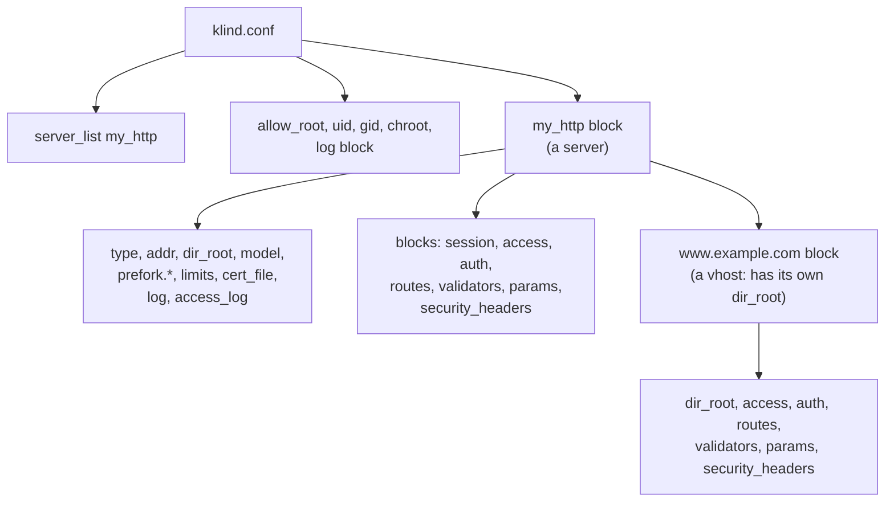
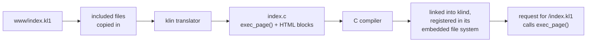

# Writing a site

A Klin site is a directory of pages, static files and one configuration
file, compiled into `klind`. Start here: lay the directory out as below,
or copy `doc/example-site`, which already works.

## The layout

```text
mysite/
  etc/klind.conf      the configuration klind uses (klind.conf(5))
  www/index.kl1       a page: HTML with C code in it
  www/style.css       static files: served as they are
  www/images/...
```

Everything under the site directory becomes klind's embedded file system.
With `dir_root /www` in a server block (as in the example site), the URL
`/index.kl1` is served from `www/index.kl1`, `/style.css` from
`www/style.css`, and `/` from the index page (`index` in
[klind.conf(5)](man/klind.conf.5)). Keep anything secret out of `www/`:
whatever is under `dir_root` can be fetched.

Files ending in `.kl1` are pages, and so are `.klin`, `.klc` and the
`.klone` files left over from KLone. KLone's C++ pages, `.klx`, are the
exception: the import accepts them, but the site's CMake configure step
then stops with "C++ page ... is not supported by this build". Every
other file is static: Klin serves it with a content type taken from its
extension and, unless it is encrypted, an ETag.

## The configuration

`etc/klind.conf` is embedded with the site and read when klind starts.
This is the example site's, unchanged:

```conf
# Server List 
#   append "my_https" to enable HTTP/S server
#
server_list     my_http # my_https

# allow_root yes lets klind run as root without dropping privileges: a
# convenience for trying the example (e.g. in a container), not for a
# device. On a device, set uid and gid instead (doc/SYSTEMD.md).
allow_root      yes

# use syslogd for logging
log
{
    type syslog
    syslog.facility         LOG_LOCAL0
}

my_http
{
    type            http
    addr            tcp4://*:8080

    dir_root        /www            # store your pages in /www into embfs

    # CGI scripts (build with -DKLIN_ENABLE_SUP_CGI=ON; doc/CGI.md)
    # cgi
    # {
    #     script_alias    /cgi-bin        /path/to/cgi-bin
    # }
}

my_https
{
    type            https
    addr            tcp4://*:4443

    dir_root        /www

    # certificate file (embfs or file system)
    # NOTE: the bundled klind.pem (1024-bit RSA, MD5, expired 2006) is
    # refused by OpenSSL 3 on common distributions; generate your own
    # certificate (see README)
    cert_file       /etc/klind.pem
}
```

`server_list` names the servers to run, and each name has a block of its
own. Settings for the whole process (`allow_root`, `uid`, `gid`, `chroot`
and a `log` block) sit at the top level, and a server block can have a
`log` block of its own. Inside a server block, any block that has its
own `dir_root` is a virtual host (vhost), chosen by the `Host` header the
client sends. A vhost inherits the server's settings except `addr`,
`model`, `type`, `dir_root`, `dir_alias`, `script_alias` and the
limits, which it cannot change at all. `access_log`
works differently: a vhost without one uses the server's access log, and
`access_log no` turns it off for that vhost. As a tree:



The limits ([LIMITS.md](LIMITS.md)) are read before the `Host` header is,
which is why they belong to the server block.
[klind.conf(5)](man/klind.conf.5) lists the main settings (it leaves out
`script_alias` and `access_log`), and `etc/` in the source tree has sample
configurations for vhosts, HTTPS and the other cases.

## Your first page, then a login in front of it

This builds a two-page site, then puts the second page behind a password.
It assumes a Klin checkout with LibU fetched, as in
[Building with CMake](../README.md#building-with-cmake), and a build with
OpenSSL (the default), which authentication needs. Run the commands from
the checkout.

Make the site:

```sh
mkdir -p "$HOME/mysite/etc" "$HOME/mysite/www/admin"
```

`~/mysite/etc/klind.conf` holds one plain HTTP server, listening on the
loopback address only, so nothing else on the network can reach it while
you try it out. With no `log` block klind logs nothing, which is fine for
now:

```conf
server_list     my_http

my_http
{
    type            http
    addr            tcp4://127.0.0.1:8080
    dir_root        /www
}
```

`~/mysite/www/index.kl1`:

```html
<%!
    #include <time.h>
%>
<!DOCTYPE html>
<html>
  <body>
    <h1>My device</h1>
    <p>The device clock reads <% io_printf(out, "%ld", (long) time(NULL)); %>
      seconds since 1970.</p>
    <p>The settings page is <a href="/admin/">here</a>.</p>
  </body>
</html>
```

`~/mysite/www/admin/index.kl1`:

```html
<!DOCTYPE html>
<html>
  <body>
    <h1>Settings</h1>
    <p>Hello, <%= request_get_auth_user(request) ? request_get_auth_user(request) : "nobody" %>.</p>
  </body>
</html>
```

Build it and start klind in the foreground, as yourself rather than root
(without `allow_root yes`, klind refuses to run as root unless `uid` and
`gid` are set):

```sh
cmake -S . -B out -G Ninja -DKLIN_SITE_DIR="$HOME/mysite"
cmake --build out
out/bin/klind -F
```

In another terminal, `curl http://127.0.0.1:8080/` shows the first page,
and `curl -i http://127.0.0.1:8080/admin/` answers 200 with the settings
page, open to anyone. Stop klind with Ctrl-C.

Now the login. Make a user with the `klin` tool, which the build put next
to klind. It reads the password from the first line of stdin and prints a
`user` block with a PBKDF2 hash and a Digest line for the realm named by
`-r`. Keep the file outside the site directory, or it would be compiled
into klind:

```sh
echo 'wonder land' | out/bin/klin -c passwd -r "Private Area" alice > "$HOME/mysite-users.conf"
chmod 600 "$HOME/mysite-users.conf"
```

Add an `auth` block to the server in `~/mysite/etc/klind.conf`, giving
the users file by its full path (the configuration does not expand `~`):

```conf
server_list     my_http

my_http
{
    type            http
    addr            tcp4://127.0.0.1:8080
    dir_root        /www

    auth
    {
        users_file  /home/you/mysite-users.conf    # your $HOME, written out

        realm
        {
            name    Private Area
            path    /admin
            path    /admin/*
        }
    }
}
```

The realm's `name` must match the `-r` you gave the tool. The two `path`
lines cover `/admin` and everything under `/admin/` without also catching
`/administrator`, which a single `/admin*` would. With no `roles`, any
user of the realm gets in, and with no `scheme` the realm uses Digest.
Use HTTPS when you deploy this ([TLS.md](TLS.md)).

The configuration is embedded, so rebuild, then start klind again:

```sh
cmake --build out
out/bin/klind -F
```

```text
$ curl -s -o /dev/null -w '%{http_code}\n' http://127.0.0.1:8080/admin/
401
$ curl -s --digest -u 'alice:wonder land' http://127.0.0.1:8080/admin/
<!DOCTYPE html>
<html>
  <body>
    <h1>Settings</h1>
    <p>Hello, alice.</p>
  </body>
</html>
```

The front page still answers without a password. The users file is read
when klind starts, so adding a user needs a restart but not a rebuild.
[AUTH.md](AUTH.md) has the rest: roles, Basic over HTTPS and the security
trade-offs.

## What a page becomes

There is no interpreter in klind. Each page is translated into C at build
time and compiled into the server like any other source file, so a page
runs as native code with nothing to parse at request time:



The HTML between the tags is stored in the generated file as constant
byte arrays and written out with `io_write()`. The C you wrote goes into a
`static void exec_page()` function in the order it appears in the page.
Because it is a `void` function, a plain `return;` ends the page early,
and the Server-Sent Events (SSE) and WebSocket examples rely on that.

## A page

A page is HTML with C in it. Four tags hold the C, and the translator
(`src/libtrans`) reads the character straight after `<%` to tell them
apart:

| Tag | What it holds | Where it goes |
| --- | --- | --- |
| `<%! ... %>` | declarations: `#include` lines, helper functions, file-scope variables | outside the page's function |
| `<% ... %>` | statements | in the page's function, in order with the HTML |
| `<%= expr %>` | an expression giving a string (`const char *`), printed as it is | `io_printf(out, "%s", expr)` |
| `<%@ include "file" %>` | another file of the site, included before translation | in its place |

Two mistakes come straight from that table. First, a plain code block
needs a space or a line break after `<%`. The translator takes whatever
character follows `<%` as the tag type, so `<%x = 1; %>` stops the build
with "bad command char after <%". Write `<% x = 1; %>`.

Second, `<%= %>` takes a `const char *` and nothing else, because it
becomes `io_printf(out, "%s", expr)`. `<%= count %>` with an `int`
compiles without a warning (`io_printf()` carries no format attribute)
and then prints garbage or crashes the worker. Print numbers with
`<% io_printf(out, "%d", count); %>`.

The HTML around the tags is written out as it is, in order, including any
line breaks between a `%>` and the next `<%`.

Every page sees the same set of variables, set up by `exec_page()` before
your first statement runs:

| Variable | Type | What it is |
| --- | --- | --- |
| `request` | `request_t *` | the request: arguments, fields, cookies, uploads (`klin/request.h`) |
| `response` | `response_t *` | the response: status, header fields, cookies (`klin/response.h`) |
| `session` | `session_t *` | the client's session ([SESSIONS.md](SESSIONS.md)) |
| `out` | `io_t *` | the response body: write to it with `io_printf()`, `io_write()` |
| `in` | `io_t *` | the request body, for a page that reads it raw |
| `SCRIPT_NAME` | `const char *` | the page's file name |

## Hello, world

```html
<%!
    #include <string.h>
%>
<%
    /* ?name=...: escape it before it goes into HTML */
    const char *name = request_get_arg(request, "name");
    char safe[256];

    if (name == NULL || u_htmlncpy_s(safe, sizeof safe, name, strlen(name),
                HTMLCPY_ENCODE) < 0)
        (void) u_strlcpy(safe, "world", sizeof safe);
%>
<!DOCTYPE html>
<html>
  <body>
    <p>Hello, <%= safe %>!</p>
  </body>
</html>
```

**`<%= %>` and `io_printf()` print exactly what they are given.** Anything
that came from the client (arguments, header fields, cookies, uploaded
data) has to be escaped before it goes into HTML, as above, or the page is
open to cross-site scripting. Klin does not escape for you yet; an
escaping output tag is on the TODO list. I left `<%= %>` alone rather than
make it escape, because changing it would silently break every existing
page that prints HTML through it.

For values that should only ever be numbers, names or another known
shape, let Klin refuse anything else before the page runs
([VALIDATE.md](VALIDATE.md)). It takes two blocks in the server block: a
`validators` block defines the check, and a `params` block applies it to
a page. A validator that no `params` block uses checks nothing.

```conf
validators
{
    validator
    {
        name    name
        regex   [A-Za-z ]{1,40}
    }
}

params
{
    path        /index.kl1          # the page, after index selection
    param
    {
        name        name
        source      query
        validator   name
    }
}
```

A request for `/` is matched as `/index.kl1`, so the block above covers
both.

## Includes

`<%@ include "header.inc" %>` copies `header.inc` (a path relative to the
page) into the page before it is translated, so shared HTML and C can live
in one place. Editing an included file rebuilds the pages that include it.

## The response

A page sets the status and header fields before it writes its body:

```c
response_set_status(response, HTTP_STATUS_NOT_FOUND);
response_set_content_type(response, "application/json");
response_set_field(response, "Cache-Control", "no-store");
```

For JSON, routes such as `/api/users/{id}`, Server-Sent Events and
WebSockets, see [JSON.md](JSON.md), [ROUTES.md](ROUTES.md), [SSE.md](SSE.md)
and [WEBSOCKET.md](WEBSOCKET.md).

## Building and running

```sh
cmake -S . -B out -G Ninja -DKLIN_SITE_DIR=/path/to/mysite
cmake --build out
out/bin/klind -F
```

`-F` keeps klind in the foreground. `-d` also turns on debug logging and
serves requests one at a time in a single process. Without `-f`, klind
uses the `etc/klind.conf` embedded with the site; `-f file` uses that file
instead (see [klind(8)](man/klind.8)).

Build with `-DKLIN_IMPORT_ARGS=-z` and files of compressible MIME types
are compressed in the build, in two different ways. A static file is
stored deflated, and klind inflates it as it sends it. The exception is
a server block or vhost that sets `send_enc_deflate yes`: a client that
accepts `deflate` then gets the stored form as it is, with
`Content-Encoding: deflate`. For a page, the HTML blocks are stored
compressed in the generated C and inflated as the page runs, so the
saving is in the size of klind, not on the wire.

You can encrypt pages in the build. Give the import the pages to encrypt
and a key file with an absolute path, for example
`-DKLIN_IMPORT_ARGS="-e;*.kl1;-k;/path/to/key"`. Pages are re-encrypted
when the key file changes. A key given in the `KLIN_CIPHER_KEY`
environment variable is different: the build does not track it, so
rebuild from clean after changing it ([klin(1)](man/klin.1)).

## Application code and hooks

C code shared by many pages, such as a device's own library, can be
compiled into klind with `-DKLIN_WEBAPP_SOURCES="a.c;b.c"`. A page then
declares and calls its functions; [webapp/webapp.c](../webapp/webapp.c)
is a small example.

With `-DKLIN_ENABLE_HOOKS=ON`, klind calls a `hooks_setup()` function you
provide. It registers functions to run when the server starts and stops,
when each worker starts and stops, and once for each request
(`klin/hook.h`: `hook_server_init()`, `hook_child_init()`,
`hook_request()` and others). A worker's `child_init` hook runs before its
sandbox ([SANDBOX.md](SANDBOX.md)), so use it to open whatever the pages
will need.

The request hook does not always run at the same point:

| The request | When the hook runs |
|---|---|
| reaches its page or file | after the supplier, whether it worked or failed, and before the response is finished; an error page comes after the hook unless the page had already sent its header |
| is refused first (malformed, an access rule, a realm, a 405 from routing, failed validation) | just before the error page |
| never starts (the connection closes or times out before any byte of a request) | not at all |

## Where next

[ROUTES.md](ROUTES.md) for REST-style URLs, [SESSIONS.md](SESSIONS.md)
for logins and per-client state, [VALIDATE.md](VALIDATE.md) for checking
input, and [SYSTEMD.md](SYSTEMD.md) for running klind properly on a
device. For working code, read [doc/example-site](example-site) and
[webapp/webapp.c](../webapp/webapp.c).
