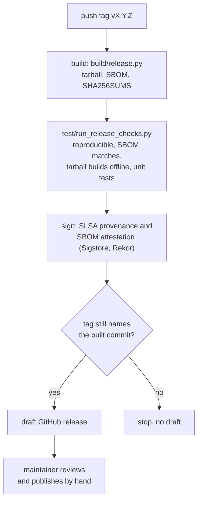

# Releases and workflows

A Klin release is built, checked and signed by a GitHub Actions workflow,
with no signing key for anyone to keep, and published by hand. Read this
before you cut a release or edit a workflow, or when you want to check a
release you have downloaded.

## Release files

A release is three files and two signature bundles:

```text
klin-<version>.tar.gz          the tag's tracked files, and the pinned
                               LibU (build/dependencies.json) under
                               klin-<version>/libu
klin-<version>.spdx.json       SBOM (SPDX 2.3): Klin, LibU (contained),
                               and OpenSSL and zlib, which the build
                               links from the system and which are not
                               in the tarball
SHA256SUMS                     the two files' SHA-256 digests
klin-<version>.provenance.sigstore.json
klin-<version>.sbom.sigstore.json
                               the attestations (signatures) described
                               below, as Sigstore bundles for offline
                               checking
```

The SBOM (software bill of materials) lists what the release is made of,
in the SPDX format. The tarball builds with CMake alone, without git or
network access:

```sh
tar xzf klin-4.0.0.tar.gz && cd klin-4.0.0
cmake -S . -B out -G Ninja && cmake --build out
```

`build/build.py` needs a git checkout, so it is not used from a tarball.

`build/release.py` writes the three files, into `.build/dist` by default.
They depend only on the commit and the pinned LibU. Every owner, time and
mode in the tarball is fixed, so anyone can rebuild the files from the tag
and compare the digests with `SHA256SUMS`:

```sh
python3 build/release.py --ref v4.0.0 --out /tmp/check
diff /tmp/check/SHA256SUMS SHA256SUMS
```

Run it from a checkout whose `build/dependencies.json` matches the tag's,
as `release.py` refuses otherwise. You also need the same zlib as the
release build, because gzip output can differ between zlib versions.

## Making a release

1. Set `VERSION` and add the release's section to the ChangeLog
   (`Klin <version>:`). That section becomes the release notes.
2. Push a tag `v<VERSION>` on that commit. The tag must match `VERSION`.
3. The release workflow (`.github/workflows/release.yml`) runs three jobs,
   one after the other. **build** runs `build/release.py` and then
   `test/run_release_checks.py`, which checks that the files are
   reproducible, that the SBOM matches them, and that the tarball builds
   on its own and passes its unit tests. **sign** makes the GitHub
   artifact attestations: SLSA (Supply-chain Levels for Software
   Artifacts) build provenance for the tarball and the SBOM, and an SBOM
   attestation for the tarball. **draft** creates a draft GitHub release
   with the files and the bundles.
4. Review the draft (notes and files) and publish it by hand. Until then
   only people with write access to the repository can see it.

From the tag to the published release:



You can also start the workflow by hand from the Actions tab, choosing an
existing tag as the ref ("Use workflow from"). Started from a branch, it
stops at once. Every job works on the commit the tag named when the run
started, and the draft is made only if the tag still names it.

## Signing

The attestations are signed without a long-lived key. The workflow gets a
short-lived certificate from Sigstore for its GitHub OIDC (OpenID Connect)
identity, which names this repository, this workflow and the tag, and the
signature is recorded in Sigstore's public transparency log (Rekor). I
chose this because there is no private key to keep, rotate or lose, and a
signature made anywhere other than this repository's release workflow does
not verify. The trade-off is that the log entry is public as soon as the
workflow runs, before the draft is published.

To check a downloaded release:

```sh
sha256sum -c SHA256SUMS
gh attestation verify klin-4.0.0.tar.gz --repo DanielTillett/klin \
    --signer-workflow DanielTillett/klin/.github/workflows/release.yml \
    --source-ref refs/tags/v4.0.0
gh attestation verify klin-4.0.0.tar.gz --repo DanielTillett/klin \
    --signer-workflow DanielTillett/klin/.github/workflows/release.yml \
    --source-ref refs/tags/v4.0.0 \
    --predicate-type https://spdx.dev/Document/v2.3
```

`--signer-workflow` and `--source-ref` check that it was the release
workflow that signed the file, and for that tag, not another workflow in
the repository or a branch. To check offline with the bundle, add
`--bundle klin-4.0.0.provenance.sigstore.json` to the first command.

Tags and commits are not GPG- or SSH-signed, as that needs a maintainer's
key.

## Workflows

Each workflow in `.github/workflows`, what starts it and what it checks.
Pushes to `wip/**` and `cflite-*` branches do not start the build and
static analysis workflows.

| Workflow (file) | Runs on | What it does |
| --- | --- | --- |
| Build and test (`build.yml`) | push, pull request, weekly, by hand | Linux release and sanitiser builds with all tests; on the release build also the fuzz smoke test, build-system checks, release and workflow checks, and klind under the hardened systemd unit. BSD make, and Windows (MinGW). macOS only weekly and by hand |
| Static analysis (`analysis.yml`) | push, pull request, by hand | clang-tidy over `src/` (see [FUZZING](FUZZING.md#static-analysis)) |
| CodeQL (`codeql.yml`) | push to master, pull request, weekly, by hand | security-extended queries; results are code-scanning alerts |
| ClusterFuzzLite PR fuzzing (`cflite_pr.yml`) | pull request, unless it changes only `doc/`, `*.md`, ChangeLog, TODO or `_config.yml` | 5 minutes per sanitiser in code-change mode |
| ClusterFuzzLite batch fuzzing (`cflite_batch.yml`) | daily, by hand | 30 minutes per sanitiser, corpus pruning, coverage |
| Coverity Scan (`coverity.yml`) | weekly, by hand | skipped until its secret and variable are set |
| Scorecard (`scorecard.yml`) | push to master, weekly, branch protection changes, by hand | OpenSSF supply-chain checks |
| Release (`release.yml`) | push of a `v*` tag, by hand | the release pipeline above |

Every workflow follows four rules. `test/run_release_checks.py` checks
them in CI, and carries a sample of each mistake, which it must refuse.

- Actions are pinned to a full commit SHA, with the version as a comment
  (`# v7.0.1`), so a moved or compromised tag cannot change what runs.
- `permissions: {}` sits at the top, and each job names the permissions it
  needs. Most need only `contents: read`. By convention every write
  permission has a comment saying why (the script does not check that).
- `actions/checkout` does not keep the token in `.git/config`
  (`persist-credentials: false`).
- There is no `pull_request_target`, and no event or input value is
  expanded inside a run script. They go through `env` instead.

actionlint and zizmor (a GitHub Actions security linter, with its pedantic
checks) also pass on the workflows. They are not run in CI.

Dependabot (`.github/dependabot.yml`) opens weekly pull requests for new
releases of the actions, updating the SHA and the comment. Minor and patch
updates come together in one pull request, and each new major version gets
its own. It does the same for the digest of the ClusterFuzzLite base image,
and for the CMake and Ninja that image installs with pip
(`.clusterfuzzlite/requirements.txt`, pinned by version and hash and
installed with `--require-hashes`). LibU and the OpenSSL tag in
`.clusterfuzzlite/Dockerfile` are pinned and updated by hand.

The OpenSSF (Open Source Security Foundation) Scorecard checks the repository's supply-chain practices weekly
and on pushes to master. Its results go to code scanning and are published
to the public Scorecard API (`publish_results: true`, with
`id-token: write` on the job). You can see them at
https://scorecard.dev/viewer/?uri=github.com/DanielTillett/klin and in the
README's badge.

## Tested

`test/run_release_checks.py` runs in CI's Linux release build. It checks
the workflow rules, that Dependabot covers the workflows and the fuzzing
image, that two `build/release.py` runs give the same bytes, the tarball's
contents (every tracked file and LibU's, nothing else, and their owners,
times, modes and order), the SBOM (SPDX 2.3, checksums, LibU's commit,
relationships) and `SHA256SUMS`, and finally builds the tarball offline and
runs its unit tests.

Two things are not yet checked. Nothing in CI runs the SPDX project's
validator (pyspdxtools) on the SBOM, so whether it passes that is
unconfirmed. And the release workflow itself has not run yet, because it
needs a tag push.

See also: [SECURITY.md](../SECURITY.md) for reporting a vulnerability,
[FUZZING](FUZZING.md) for the fuzzing and analysis workflows, and
[CONTRIBUTING](../CONTRIBUTING.md) for the checks a pull request must pass.
