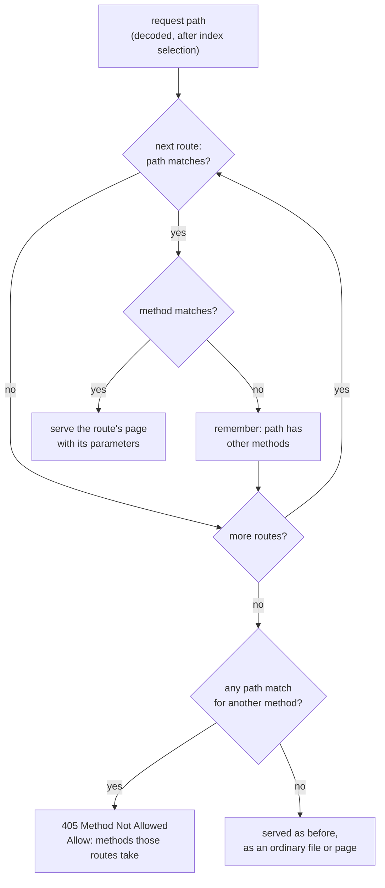
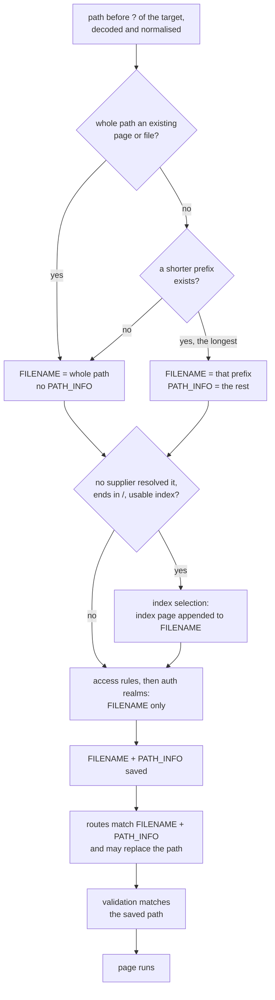

# Routes

One page should be able to answer `/api/users/42` and `/api/users/43`
alike. A `routes` block in a server or virtual host (vhost) does that: it
maps methods and path patterns to the page that serves them.

```conf
routes
{
    route
    {
        method  GET
        path    /api/users/{id}
        page    /api/user.kl1
    }
    route
    {
        method  PUT, PATCH, DELETE
        path    /api/users/{id}
        page    /api/user_edit.kl1
    }
    route
    {
        path    /files/{path*}          # any method
        page    /files.kl1
    }
}
```

## The three settings

| Setting | What it takes |
| --- | --- |
| `path` | Segments separated by `/`. A `{name}` segment matches one non-empty segment. A `{name*}` segment, which must be last, matches the rest of the path, slashes included, and may be empty. Names are letters, digits and `_`. |
| `method` | `GET`, `HEAD`, `POST`, `PUT`, `DELETE`, `PATCH` or `*`, separated by blanks or commas. None means any method. A route for `GET` also serves `HEAD`. |
| `page` | The page (or file) that serves the route, as an absolute path in the site. |

The match is exact. `/a` does not match `/a/`, and in the test suite
`/api/items/42/more`, `/api/items/` and `/api/itemsx/1` all miss a route
for `/api/items/{id}` and fall through to an ordinary 404.

## How a request is matched

A route is matched against the whole request path, PATH_INFO included,
after index selection. [Which path each check sees](#which-path-each-check-sees)
below shows those steps. Index selection runs first, so a route for
`/api/` does not see a request for `/api/` when `/api/index.kl1` exists:
by then the path is `/api/index.kl1`.

Routes are tried in the order they are written, and the first one whose
path and method both match serves the request. A path that matches only
routes for other methods is the case that surprises people:



When the path matches routes for other methods only, the answer is
**405 Method Not Allowed with an `Allow` header** listing every method the
path's routes take, in the order GET, HEAD, POST, PUT, DELETE, PATCH. With
the example above, a `POST` to `/api/users/42` gets
`Allow: GET, HEAD, PUT, DELETE, PATCH`. The 405 goes through the normal
error path, so an `error.405` page in the configuration is used if you
have one. A path that no route matches at all is served exactly as it
would be without a `routes` block.

## Reading the parameters

The page reads a parameter with `request_get_route_param(request, "id")`.
The value is already URL-decoded, so an encoded slash (`%2F`) is a plain
slash by the time matching happens. It ends a `{name}` segment rather
than becoming part of it.

## Which path each check sees

Access rules, authentication realms, routes and validation do not all
match the same path, and the difference decides what a pattern actually
protects. This section is the reference for the three terms the other
pages use: FILENAME, PATH_INFO and index selection.

Klin takes the path part of the request target (everything before `?`),
URL-decodes and normalises it, then looks for an existing page or file.
If the whole path is one, or none of its prefixes is, the whole path is
the FILENAME and there is no PATH_INFO. If only a prefix ending before a
`/` exists, the longest such prefix is the FILENAME and the rest is the
PATH_INFO. For a vhost other than the first, the split is redone against
that vhost's files once the `Host` header is known.

Index selection comes next, and only under three conditions: no page
supplier resolved the path, the FILENAME ends in `/`, and the vhost has a
usable index page (the first name in its `index` setting that exists,
otherwise the first of the built-in names such as `/index.kl1` and
`/index.html` that exists). The index page's name is then appended to the
FILENAME. Otherwise the FILENAME is left as it is.

Access rules and realms then see the FILENAME. Before routing, Klin saves
the FILENAME plus the PATH_INFO, and that saved path is what validation
matches later, even if a route has since replaced the request's path with
its page. Step by step:



Because validation uses the saved path, it matches what the client asked
for (decoded, normalised and after index selection), not the route's
page. A few requests show the difference:

| Request, and what exists in the site | FILENAME (access rules, realms) | FILENAME + PATH_INFO (routes, validation) |
| --- | --- | --- |
| `/admin/`, with `/admin/index.kl1` | `/admin/index.kl1` | `/admin/index.kl1` |
| `/status.kl1/cpu`, with `/status.kl1` | `/status.kl1` | `/status.kl1/cpu` |
| `/api/users/42`, nothing on that path | `/api/users/42` | `/api/users/42` |
| `/api/users/42`, with a file called `/api` | `/api` | `/api/users/42` |

## Protecting routes

Access rules ([ACCESS.md](ACCESS.md)) and authentication realms
([AUTH.md](AUTH.md)) run before routing and match the FILENAME. Routing
rewrites the request to the route's page only afterwards, so a realm
written for the page's own path (`/api/user.kl1`) does nothing for a
request to `/api/users/42`.

To protect a set of routes under `/api/`, give the realm or access rule
two patterns, `/api` and `/api/*`. This advice assumes two things: the
rule is in the vhost that serves the request, and it is the first rule
(or realm) whose pattern matches, because only that one is consulted.
The patterns are fnmatch(3) without special treatment of `/`, so
`/api/*` covers the FILENAME however much of the path was split off as
PATH_INFO, as long as the existing prefix is below `/api/`. `/api`
covers the last row of the table, where something called `/api` takes
the rest of the path. Keep the pages your routes point to under the same
prefix too: a client can request a page directly by its own path, and
the realm then sees that path, not the route's.

Request validation ([VALIDATE.md](VALIDATE.md)) matches the path saved
before routing, which is the same FILENAME plus PATH_INFO that routes
match. It runs after routing, so it can check the `{name}` values a route
found.

## Mistakes klind refuses

A route that cannot work stops klind at startup rather than failing on the
first request. That covers a relative path or page, a bad parameter
(including a name of 64 characters or more), a `{name*}` that is not
last, and an unknown method.

Next: [JSON.md](JSON.md) for reading request bodies and writing JSON
responses, and [VALIDATE.md](VALIDATE.md) for checking route parameters.
