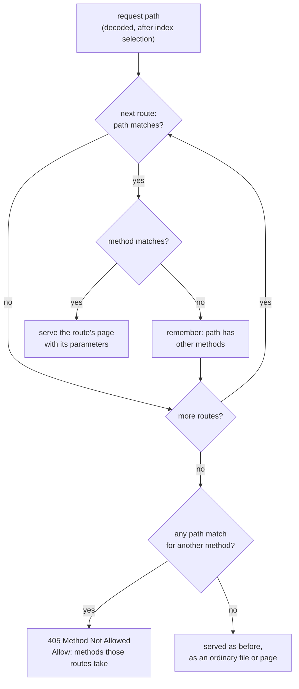

# Routes

One page should be able to answer `/api/users/42` and `/api/users/43`
alike. A `routes` block in a server or virtual host (vhost) does that: it
maps methods and path patterns to the page that serves them.

```conf
routes
{
    route
    {
        method  GET
        path    /api/users/{id}
        page    /api/user.kl1
    }
    route
    {
        method  PUT, PATCH DELETE
        path    /api/users/{id}
        page    /api/user_edit.kl1
    }
    route
    {
        path    /files/{path*}          # any method
        page    /files.kl1
    }
}
```

## The three settings

| Setting | What it takes |
| --- | --- |
| `path` | Segments separated by `/`. A `{name}` segment matches one non-empty segment. A `{name*}` segment, which must be last, matches the rest of the path, slashes included, and may be empty. Names are letters, digits and `_`. |
| `method` | `GET`, `HEAD`, `POST`, `PUT`, `DELETE`, `PATCH` or `*`, separated by blanks or commas. None means any method. A route for `GET` also serves `HEAD`. |
| `page` | The page (or file) that serves the route, as an absolute path in the site. |

The match is exact. `/a` does not match `/a/`, and in the test suite
`/api/items/42/more`, `/api/items/` and `/api/itemsx/1` all miss a route
for `/api/items/{id}` and fall through to an ordinary 404.

## How a request is matched

The path a route is matched against is the request path, URL-decoded and
normalised, after index selection, and whole: if the first part of it
names an existing page, the rest (the PATH_INFO) is still included. Index
selection means a path ending in `/` that has an index page is matched
with the index page's name appended, so a route for `/api/` never sees a
request for `/api/` if `/api/index.kl1` exists.

Routes are tried in the order they are written, and the first one whose
path and method both match serves the request. A path that matches only
routes for other methods is the case that surprises people:



When the path matches routes for other methods only, the answer is
**405 Method Not Allowed with an `Allow` header** listing every method the
path's routes take, in the order GET, HEAD, POST, PUT, DELETE, PATCH. With
the example above, a `POST` to `/api/users/42` gets
`Allow: GET, HEAD, PUT, DELETE, PATCH`. The 405 goes through the normal
error path, so an `error.405` page in the configuration is used if you
have one. A path that no route matches at all is served exactly as it
would be without a `routes` block.

## Reading the parameters

The page reads a parameter with `request_get_route_param(request, "id")`.
The value is already URL-decoded, so an encoded slash (`%2F`) is a plain
slash by the time matching happens. It ends a `{name}` segment rather
than becoming part of it.

## Routes, authentication and validation

Access rules ([ACCESS.md](ACCESS.md)) and authentication realms
([AUTH.md](AUTH.md)) run before routing and match the path the client
asked for, after index selection but without any PATH_INFO. Protect
`/api/*` and every route under it is protected, whichever page ends up
serving it. Request validation ([VALIDATE.md](VALIDATE.md)) matches the
same whole path that routes do, but runs after routing, so it can check
the `{name}` values a route found.

## Mistakes klind refuses

A route that cannot work stops klind at startup rather than failing on the
first request. That covers a relative path or page, a bad parameter
(including a name of 64 characters or more), a `{name*}` that is not
last, and an unknown method.

Next: [JSON.md](JSON.md) for reading request bodies and writing JSON
responses, and [VALIDATE.md](VALIDATE.md) for checking route parameters.
