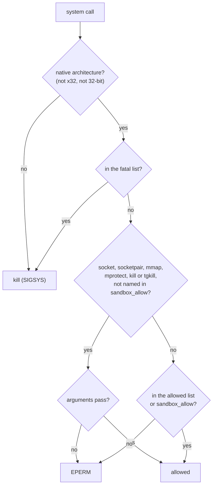

# Sandbox

klind's worker processes and the TLS key manager ([KEYMGR](KEYMGR.md)) run
in a sandbox that limits what the kernel lets them do. It is on by default
on Linux (x86-64 and ARM64) and OpenBSD, the systems that have one ([Other
systems](#other-systems)). When a page needs a system call the sandbox
refuses, you name that call in `sandbox_allow`. The idea is simple: a
worker parses untrusted input all day, so if one is compromised, the
attacker should find themselves in a process that can serve files and talk
on sockets and very little else. I would leave it on for any device that
faces a network. To turn it off for a server's workers, and its key
manager:

```conf
www
{
    type    http
    ...
    sandbox no
}
```

## Who gets what

klind itself is not sandboxed, because it forks workers, reaps them and
writes logs. Each process gets this much (Linux defaults):

| Linux defaults | klind (parent) | worker | worker that runs CGI | key manager |
|---|---|---|---|---|
| seccomp filter (Linux) | none | worker list | worker list + fork, exec, wait | short list |
| new sockets | unrestricted | UNIX, IPv4, IPv6 | UNIX, IPv4, IPv6 | none (uses its control socket) |
| W+X memory | unrestricted | refused | refused | mmap unchecked, no mprotect |
| may signal | unrestricted | itself only | anyone but klind, the key managers, klind's process group and broadcast (`-1`) | nobody |
| resource limits | its own | `worker_max_memory`, `worker_max_files`, `worker_max_procs` | the same | `RLIMIT_CORE` 0 |
| undumpable | no | no | no | yes (Linux) |

The worker limits default to 1024 MB of address space (`RLIMIT_AS`), 1024
open files (`RLIMIT_NOFILE`) and the model's maximum workers
(`prefork.max_child` or `fork.max_child`) + 64 processes of its user
(`RLIMIT_NPROC`); 0 leaves the inherited system limit unchanged. They are
set in the worker only, just before the sandbox, and are covered in
[LIMITS](LIMITS.md). Builds with AddressSanitizer get no memory limit,
because ASan reserves terabytes of address space.

## Linux (seccomp)

A worker is sandboxed after the `child_init` hook, so a web app can open
what it needs first, and before it serves anything. The sandbox is a
seccomp-bpf filter (a small BPF program the kernel runs on every system
call), set with `PR_SET_NO_NEW_PRIVS` so that a setuid
program cannot raise privileges. It sorts system calls into three
groups.

**Allowed** is what serving needs: reading and writing files (static
files, sessions, uploads), sockets (the client, klind, the key manager,
and connections a page opens, for example to a database), memory, time,
signals, the timer and randomness.

**Fatal** is what only an attacker needs: ptrace,
process_vm_readv/writev, mount, umount2 and pivot_root, chroot, the
setuid/setgid family and capset, module loading, kexec, bpf,
perf_event_open, keyctl and the other key calls, unshare and setns
(namespaces), userfaultfd, personality, reboot, swap, acct, clock and
time setting, syslog, quotactl, open_by_handle_at and name_to_handle_at,
fanotify_init, vhangup, iopl and ioperm. The process is killed with
SIGSYS. Under prefork, klind starts new workers as it needs them; under
fork, the next connection gets a new one anyway.

Anything else fails with EPERM, so code that tries something unusual
gets an error instead of dying.

A worker's filter decides each call in this order (the key manager's is
the same without the argument checks):



The filter exists for x86-64 and ARM64. On any other Linux architecture
klind warns "sandbox: no seccomp filter for this architecture" and the
workers run without one.

### Calls whose arguments are checked

Some allowed calls have their arguments checked too, and fail with EPERM
otherwise, unless you name them in `sandbox_allow` (see the table below):

- `socket` may make UNIX, IPv4 and IPv6 sockets only (not netlink, packet,
  vsock, Bluetooth and so on), and `socketpair` UNIX sockets only.
- `mmap` and `mprotect` do not get memory that is writable and executable
  at once (W^X), as with systemd's `MemoryDenyWriteExecute`. Executable
  code is still mapped from files (libraries, CGI programs).
- `kill` and `tgkill` let a worker signal itself only (a worker that
  runs CGI gets the wider rule below).

CGI needs a wider rule. A worker that runs CGI scripts kills them by
process group at their timeout, and the scripts signal their own processes, so
such a worker may signal any process except klind, the key managers, its
own process group (klind's: `kill 0` or `-pgid`) and every process
(`-1`). Without that rule, a compromised worker could kill the key
manager, which stops klind. The scripts inherit the filter, so a script
cannot use `kill 0` either, even though it has a process group of its
own; it gets EPERM. It can name the group (`kill -pgid`) or its
processes instead.

Naming one of these calls in `sandbox_allow` lifts its argument check:

| Named in `sandbox_allow` | Lifts |
|---|---|
| `socket` | any address family |
| `socketpair` | any address family |
| `mmap` or `mprotect` | W+X memory, for example for a JIT |
| `kill` or `tgkill` | any target |

Sanitiser builds do not check `kill` and `tgkill`, because LeakSanitizer
signals its threads.

### CGI

A server whose configuration has a `script_alias` or an extension's
handler ([CGI](CGI.md)) also allows fork, vfork, clone, execve, wait,
setpgid, setsid, chdir and fchdir, and on x86-64 arch_prctl, which every
new program calls at start. The CGI scripts inherit the filter.

### Allowing more calls

A page that needs a call outside the list names it:

```conf
sandbox_allow   flock, inotify_init1, inotify_add_watch
```

Only calls from a known list can be named: bind, listen, `epoll_*`,
eventfd2, `timerfd_*`, `inotify_*`, flock, fallocate, fchown(at), linkat,
symlinkat, mknodat, msync, mlock, utimensat, memfd_create, splice and a
few more, plus fork/clone/execve/wait for CGI-like uses. Any other name
stops klind at startup with "sandbox_allow: ... is not a system call that
can be allowed". Calls from the fatal group cannot be allowed at all.

### The key manager

The key manager gets a much shorter list: its socket, memory, randomness
and exit. It signs once before the filter is set, so OpenSSL has loaded
everything it needs before the door closes.

Sanitiser builds (AddressSanitizer) also allow clone and ptrace in both
filters, because LeakSanitizer uses them at exit.

## Other systems

On OpenBSD, workers call pledge(2) with "stdio rpath wpath cpath fattr
inet unix dns sendfd recvfd" (plus "proc exec" for CGI), and the key
manager with "stdio sendfd recvfd". This code is not tested, because
there is no OpenBSD machine in the test setup. macOS and other systems
have no sandbox.

## What is not sandboxed

klind itself, the single-process server of `-d`, which is meant for
development, and any server with `sandbox no`. Workers on other
architectures and systems run unfiltered too (above). CGI scripts are
filtered only as far as the worker's filter goes.

## What the server tests check

The server tests check, on Linux, that:

- every worker and the key manager have the filter (`Seccomp: 2` in
  /proc), and klind does not;
- a call outside the list fails with EPERM;
- unshare(2) kills the worker, and the server goes on serving;
- a server with `sandbox no` is unfiltered;
- a netlink socket, W+X memory and a signal to klind fail with EPERM, and
  work without the sandbox;
- an IPv6 socket and a signal to itself work;
- a worker that runs CGI scripts cannot signal klind either.

See also: [KEYMGR](KEYMGR.md), [LIMITS](LIMITS.md) for the worker resource
limits, and [CGI](CGI.md).
