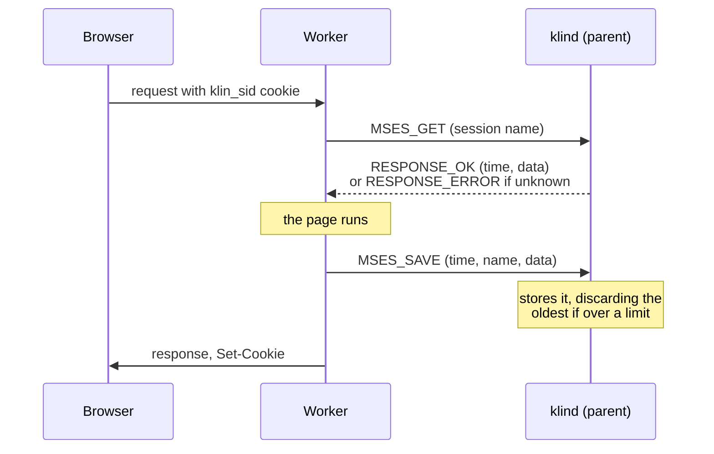
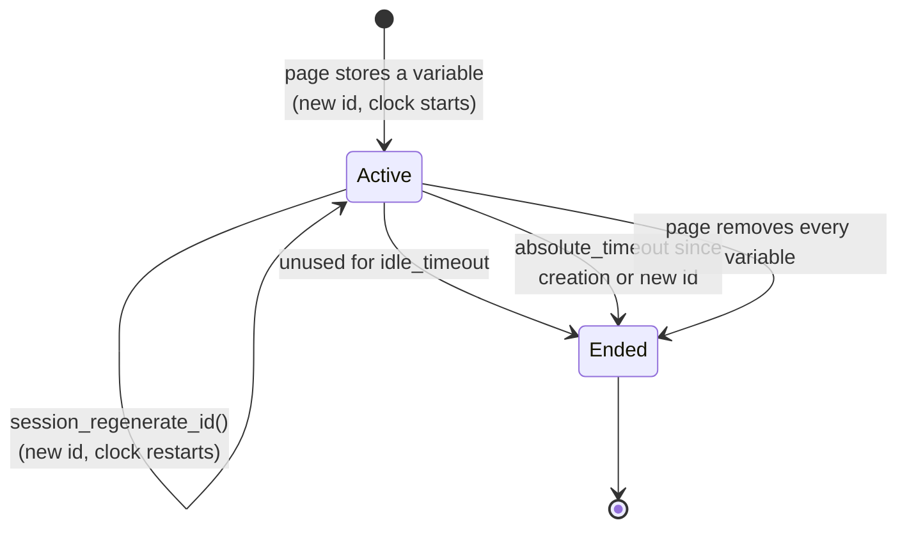

# Sessions

This page covers the `session` variable of a .kl1 page: where its data is
kept, how long it lives, and what Klin does to stop session fixation and
cross-site request forgery. Read it before you put a login on a device.

A session is kept on the server (type `file` or `memory`) or in the
client's cookies (type `client`). You choose in the server's `session`
block, described in klind.conf(5). The default is `file`.

## Choosing a store

The table below compares the three stores. On a device without writable
storage, `memory` is usually the right choice; I would only reach for
`client` when the server must keep no session state at all.

| | `memory` | `file` | `client` |
|---|---|---|---|
| Where the data lives | In klind's memory (the parent process under prefork) | One file per session in `file.path` (default `/tmp`, or the system temporary path on Windows) | In the browser's cookies |
| Size limit | `memory.limit` bytes in total and `memory.max_count` sessions (both 0, unbounded, by default); under prefork each session must also fit one PPC message, about 7.9 KB serialised | None set by Klin | The sealed data travels hex-encoded in one cookie of at most 4,096 bytes, so roughly 2 KB serialised |
| Encryption | Optional (`encrypt yes`: AES-256-CBC, key drawn at startup) | Optional, as for memory | Always: AES-256-GCM, which also authenticates the data |
| Survives a restart | No | Yes, unless `encrypt` is on (the key is new each start) | No (the keys are drawn when klind starts) |
| Works across prefork workers | Yes, through the parent | Yes, through the file system | Yes |
| Needs | Nothing extra | A writable directory | A build with OpenSSL |

When `memory.limit` or `memory.max_count` would be exceeded, the oldest
session is discarded to make room. A single save larger than
`memory.limit`, or too large for a PPC message, is refused with a warning
in the log.

### Memory sessions under prefork

A prefork worker does not keep memory sessions itself. It asks the parent
for the session when a request arrives and sends the new copy back once
the page has run. The figure below shows one request.



The catch is the message size. A PPC message carries at most 8,192 bytes,
and the session's name and time take 264 of them, so a serialised session
over about 7.9 KB cannot be stored or fetched. Keep memory sessions small:
an id and a few short strings, not a shopping cart.

Under the fork model the worker also sends each save to the parent, and
the next connection's child inherits the parent's copy when it is forked.
The iterative model keeps the sessions in its single process.

### File sessions

Each session is a file named `klin_sess_<id>_<address>` in `file.path`.
An expired file is removed when its session is next presented; Klin does
not sweep the directory, so files of sessions that are never seen again
stay until something else cleans `file.path`. On a small tmpfs, keep that
in mind.

## Cookies

The session id cookie (`klin_sid`, or the name set by `sid_name`) and the
cookies of client sessions are sent with `Path=/`, `HttpOnly` and
`SameSite=Lax`, plus `Secure` when the connection is TLS. Ids are 128
random bits.

## Session fixation

An id the client sends is accepted only if it names a stored session. For
client sessions, the cookies carrying the session must be genuine.
Otherwise the id is dropped and a new one drawn when the page stores
something. An attacker therefore cannot plant an id in a victim's browser
and then use the session the victim logs into. File sessions no longer
create a file for an unknown id.

At login, and at any change of privilege, give the session a new id:

```c
<%
    if(password_ok(user, pw))
    {
        session_regenerate_id(session);    /* before any output */
        session_set(session, "user", user);
    }
%>
```

The data is kept and the copy stored under the old id is removed (file
and memory sessions), so the old id is worth nothing. Call it before the
page prints anything, because the new id goes out in a cookie.

Client sessions have nothing stored on the server to remove. An old set of
cookies stays valid until its timeouts, as with any session kept by the
client.

## Timeouts

```conf
session
{
    type            memory
    idle_timeout    20      # minutes unused (also max_age); "90s": seconds
    absolute_timeout 480    # minutes from creation or login; 0: none
}
```

A session ends when it has not been used for `idle_timeout` (default 20
minutes), or `absolute_timeout` after it was created or given a new id,
however much it is used (default 480 minutes, 8 hours). The absolute
timeout is new in 4.0. Set it to 0 for the old behaviour.

The figure below shows the life of a session.



The creation time is kept in the session as the variable
`KLIN_SESSION_CREATED`, in whole seconds. A session saved before 4.0
starts counting when it is first loaded. When a session ends, its stored
copy and cookie go, and the same request may start a new session. Memory
sessions past the idle timeout are also swept from the store on writes, at
most once a minute.

## Client sessions

The data is sealed with AES-256-GCM (klin/crypto.h, `kc_aead_seal` and
`kc_aead_open`), with a random 96-bit nonce for each save. The tag also
covers the session id and the time of the save (the `KL1_CLISES_MTIME`
cookie), so none of the three can be changed or moved to another session.
`KL1_CLISES_DATA` holds the nonce, ciphertext and tag in hex.

Sessions in the format before 4.0 (AES-256-CBC, then an HMAC in
`KL1_CLISES_HMAC`, with the IV in `KL1_CLISES_IV`) are still read in 4.x
and rewritten in the new format. 5.0 removes that. The keys of both are
drawn when klind starts, so in practice only sessions made by the running
server can be in the old format.

## CSRF

A form, or a script that changes something, carries the session's token:

```html
<form method="post" action="/change.kl1">
  <input type="hidden" name="csrf_token"
         value="<%= session_csrf_token(session) %>">
  ...
```

It can also send the token in an `X-CSRF-Token` header field. The page
that acts on the request checks it first:

```c
<%
    if(session_csrf_check(session, request))
    {
        response_set_status(response, 403);
        return;
    }
%>
```

GET and HEAD requests pass the check, because they must not change
anything. The token is 256 random bits kept in the session
(`KLIN_CSRF_TOKEN`) and compared in constant time. `SameSite=Lax` cookies
already stop most cross-site posts in current browsers; the token covers
older browsers and same-site attackers.

## Tested

test/run_server_tests.py runs these checks on memory, file and client
sessions:

- a planted id is not kept, and creates no file;
- `session_regenerate_id()` changes the id, keeps the data and makes the
  old id worthless;
- GET passes the CSRF check, and POST passes only with the token (header
  or form value);
- a client session with a changed data, time or id cookie is refused;
- a session unused for its idle timeout ends, and one used every second
  ends at its absolute timeout.

With the fixation check removed, the planted-id check fails. test/unit
checks AES-256-GCM against the GCM specification's test cases, and that
forgeries are refused.
