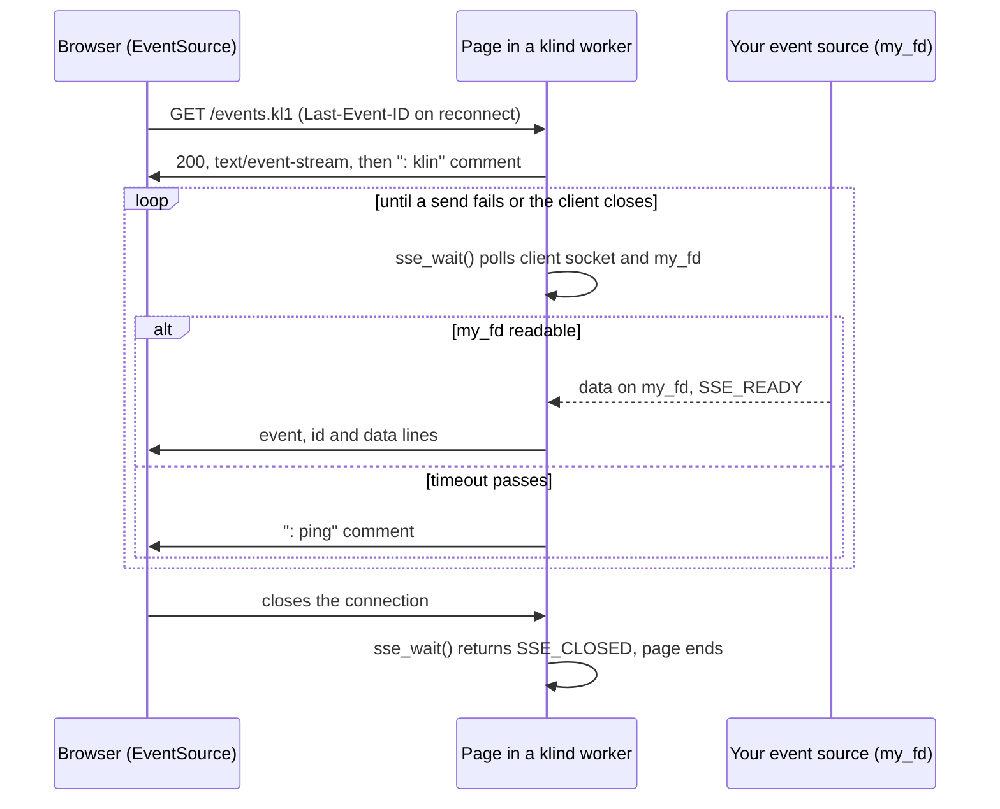

# Server-Sent Events

A page can stream events to the browser using the HTML EventSource API
(`text/event-stream`). Use it when the server has news to push and the
browser only listens; for two-way traffic, see [WEBSOCKET.md](WEBSOCKET.md).

## A streaming page

Include `<klin/sse.h>`, start the stream, then loop on `sse_wait()`:

```html
<%! #include <klin/sse.h> %><%
    if(sse_start(request, response))
        return;

    /* wait for my_fd (a pipe, a socket...) with a 15 s keep-alive */
    for(;;)
    {
        int w = sse_wait(request, my_fd, 15000);

        if(w == SSE_CLOSED)
            break;                      /* the client went away */
        if(w == SSE_TIMEOUT && sse_comment(response, "ping"))
            break;
        if(w == SSE_READY && sse_send(response, "update", id, data))
            break;
    }
%>
```

Put nothing before the code block, not even a line break. `sse_start()`
sends the response header, and from then on everything the page prints
goes to the client as it is written.

## How the stream runs

Here is a stream from the browser's first request to the moment it
closes the tab:



`sse_start()` writes a short `: klin` comment straight after the header,
so the header actually leaves the server rather than sitting in a buffer
until the first event.

## The calls

| Call | What it does |
| --- | --- |
| `sse_start(rq, rs)` | Sets `Content-Type: text/event-stream`, `Cache-Control: no-store` and `X-Accel-Buffering: no` (so proxies that buffer, such as nginx, pass events on at once), and sends the header now. |
| `sse_send(rs, event, id, data)` | Sends one event. `event` (the type; NULL means the browser's default, `message`) and `id` must each be one line, or NULL. `data` may hold line breaks: each line becomes a `data:` line and the browser gets the line breaks back. |
| `sse_comment(rs, text)` | Sends a comment line, to keep an idle stream open through proxies that close silent connections. |
| `sse_retry(rs, ms)` | Tells the browser how long to wait before reconnecting. |
| `sse_last_event_id(rq)` | The id of the last event the browser got, sent in `Last-Event-ID` when it reconnects, so the page can carry on from there. NULL on a first connection. |
| `sse_wait(rq, fd, ms)` | Waits until `fd` is readable (`SSE_READY`; pass -1 for no descriptor), `ms` milliseconds pass (`SSE_TIMEOUT`; -1 for no limit) or the client closes the connection (`SSE_CLOSED`). It waits in poll(2) on the client socket and `fd`, and runs the timer's alarms meanwhile. |

Every send returns non-zero when the client is gone. When that happens,
stop streaming. A send the client does not take within 30 s closes the
connection, so a client that stops reading cannot hold a worker forever.

On HTTP/1.1 the stream is chunked, and the connection can be reused when
the page ends. On HTTP/1.0 the end of the stream closes the connection.
TLS works the same way.

## Streams and workers

**A stream holds its connection, and so a whole worker, for as long as it
lasts.** In the prefork model the watchdog asks the parent for another
worker after a second (as it does for any slow page), and the streaming
worker exits when its stream ends. Size `prefork.max_child` for the
number of streams you expect. The single-process server (`-d`) serves
nothing else while a stream is open.

To stop streams taking every worker, `max_streams` caps the SSE and
WebSocket connections open at once across all of a server's workers
(default 100; 0 turns the cap off). Beyond it `sse_start()` sets
503 with `Retry-After: 5` and returns non-zero, so the page's
`if(sse_start(...)) return;` ends the page and that answer is sent. See
[LIMITS.md](LIMITS.md).

See also: [WEBSOCKET.md](WEBSOCKET.md) for two-way traffic, and
[LIMITS.md](LIMITS.md) for `max_streams` and the other limits.
