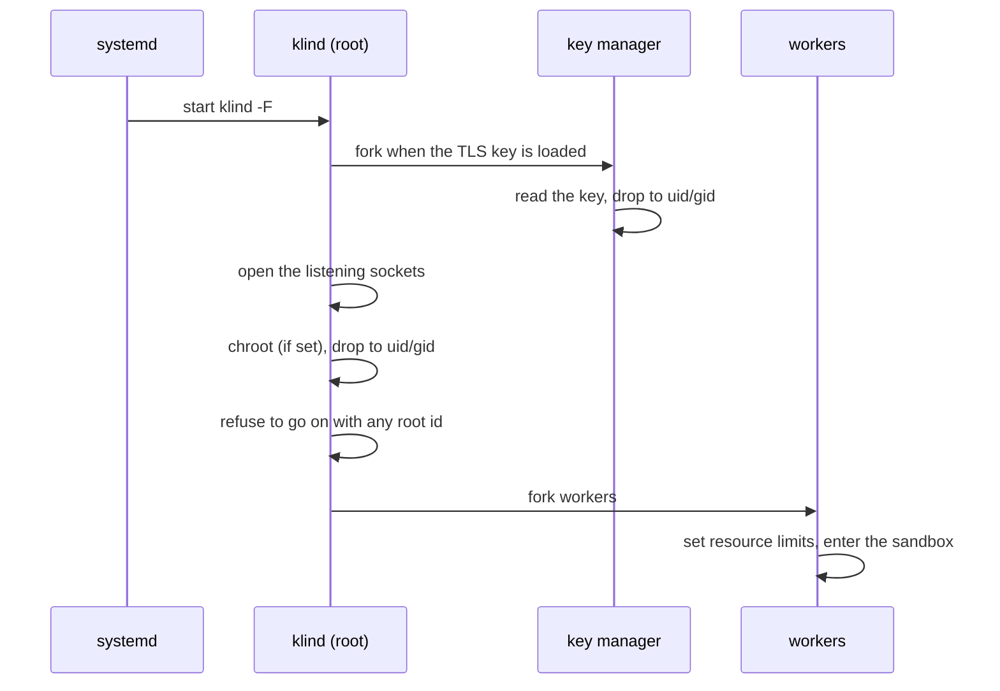

# Running klind under systemd

On a Linux host, run klind from the hardened systemd unit that ships with
Klin. The unit fences klind in, and klind gives up root as soon as its
sockets are open. Firmware with its own init doesn't need the unit,
though the rules about root below apply wherever klind runs on a
Unix-like system.

The unit is `contrib/systemd/klind.service`. Copy it to
`/etc/systemd/system/`, set the paths in `ExecStart`, then run:

```sh
systemctl daemon-reload
systemctl enable --now klind
```

The unit starts `/usr/local/sbin/klind -F -f /etc/klin/klind.conf` as
`Type=simple`: `-F` keeps klind in the foreground, so systemd tracks the
main process directly. klind does not use socket activation or
`sd_notify()`, so there is no `.socket` unit and no `Type=notify`. It
restarts on failure after 2 s, with `UMask=0027`. A clean exit is not a
failure: klind exits with status 0 when a TLS key manager dies
([KEYMGR](KEYMGR.md#when-a-key-manager-dies)), and the unit then leaves
it stopped.

## Root, then not

klind starts as root so that it can bind ports below 1024, read a TLS key
that only root can read, and chroot. Once the listening sockets are open it
chroots (if `chroot` is set) and drops to the `uid` and `gid` in
klind.conf. The TLS key manager ([KEYMGR](KEYMGR.md)) drops to the same
user and group. Start-up runs in this order:



Give klind an unprivileged account, for example:

```conf
uid 65534
gid 65534
```

**klind refuses to start if it would keep root credentials.** Started as
root, it needs both `uid` and `gid`. A `uid` alone would leave it in group
root, and a `chroot` alone is not enough, since root can leave a chroot.
To run it with root ids anyway, you have to say so explicitly:

```conf
allow_root yes
```

That is meant for tests and for containers that are already unprivileged.
I would not set it anywhere else.

## What the unit restricts

| Setting | What it does |
| --- | --- |
| `CapabilityBoundingSet` | only `CAP_NET_BIND_SERVICE`, `CAP_SETUID`, `CAP_SETGID` and `CAP_SYS_CHROOT`; all are gone once klind drops |
| `NoNewPrivileges` | no set-uid program can give privileges back |
| `ProtectSystem=strict` | the file system is read-only except `/run/klin`, `/var/lib/klin` and `/var/log/klin` (`RuntimeDirectory`, `StateDirectory`, `LogsDirectory`); add `ReadWritePaths=` for anything else the site writes |
| `ProtectHome`, `PrivateTmp`, `PrivateDevices`, `DevicePolicy=closed` | no home directories, a private `/tmp`, only pseudo-devices such as `/dev/null` |
| `ProtectKernelTunables`, `ProtectKernelModules`, `ProtectKernelLogs`, `ProtectControlGroups`, `ProtectClock`, `ProtectHostname`, `ProtectProc=invisible`, `ProcSubset=pid` | kernel and system interfaces klind does not need |
| `RestrictNamespaces`, `RestrictRealtime`, `RestrictSUIDSGID`, `LockPersonality`, `MemoryDenyWriteExecute`, `KeyringMode=private`, `RemoveIPC` | the rest of the usual hardening set |
| `RestrictAddressFamilies` | `AF_UNIX` (for the key manager), `AF_INET`, `AF_INET6` |
| `SystemCallFilter` | `@system-service` without `@privileged`, `@mount`, `@debug` and similar groups, then `@setuid` and `chroot` added back for the drop; klind adds its own, narrower filter in each worker ([SANDBOX](SANDBOX.md)) |
| `LimitNOFILE=65536`, `TasksMax=4096` | resource limits for the whole unit; klind's own worker limits apply too ([LIMITS](LIMITS.md)) |

`systemd-analyze security klind` rates the unit about 2.4 ("OK"). What is
left is the price of starting as root (`User=`, `CAP_SET*`,
`CAP_SYS_CHROOT`, `@privileged`) and of being a network server
(`PrivateNetwork=`, `AF_INET`/`AF_INET6`).

CGI scripts run inside the same unit, so they get the same restrictions. A
script that needs to write somewhere, or to compile code just in time
(which `MemoryDenyWriteExecute` blocks), needs a drop-in. Run `systemctl
edit klind` and add, for example:

```conf
[Service]
ReadWritePaths=/srv/www/uploads
```

## Without root at all

If the TLS key does not need protecting from klind's own user, and you
don't use `chroot`, systemd can start klind unprivileged instead. Add a
drop-in:

```conf
[Service]
User=klin
Group=klin
AmbientCapabilities=CAP_NET_BIND_SERVICE
CapabilityBoundingSet=CAP_NET_BIND_SERVICE
```

klind.conf then has no `uid`, `gid` or `chroot`.

The trade-off is the key. Started as root, klind can read a key file that
only root can read. Started as `klin`, the key file has to be readable by
the same user the workers run as.

## The systemd test

`test/run_systemd_test.py` must run as root (CI runs it with sudo). It
installs the unit under `/run/systemd/system`, starts klind with it and
checks that it serves. It then checks that the main process runs as 65534
with no capabilities, with `no_new_privs` set and a seccomp filter in
place, and that `systemd-analyze security` stays at 3.0 or below. The
server suite checks the root refusal when it is run as root.

See also: [LIMITS](LIMITS.md) for the per-worker limits, [SANDBOX](SANDBOX.md)
for the seccomp filter each worker enters, and [KEYMGR](KEYMGR.md) for the
key manager.
