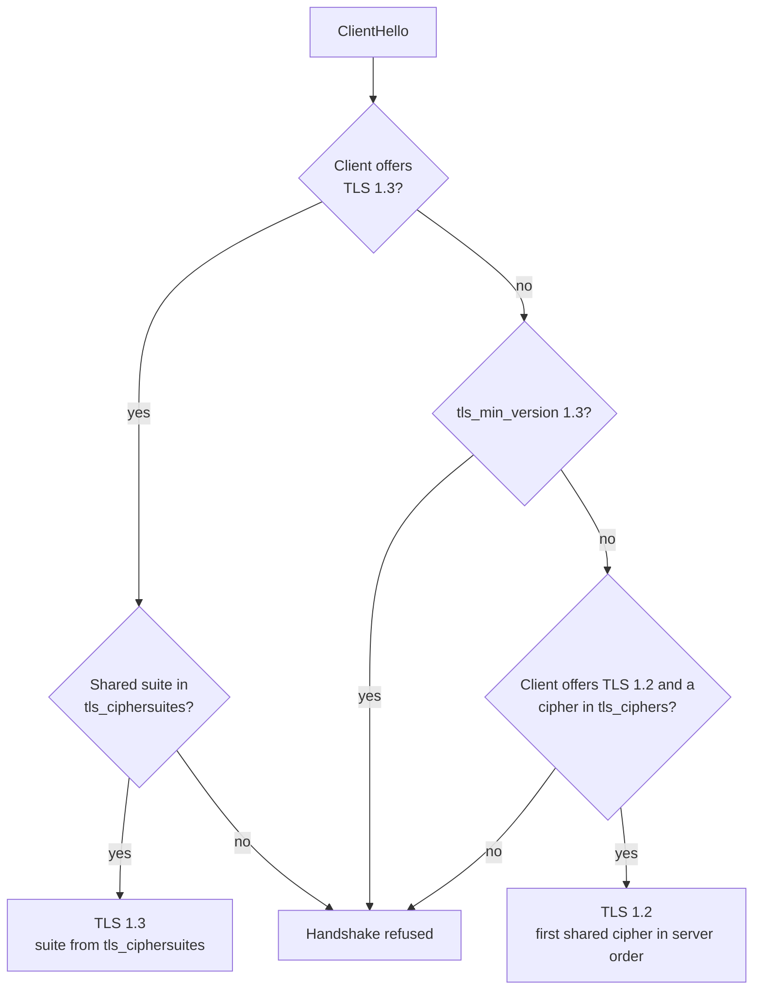

# TLS settings

An HTTPS server accepts TLS 1.2 and 1.3, nothing older, and by default
only forward-secret AEAD ciphers (authenticated encryption with associated
data). When a client cannot connect, these rules are the usual reason, and
the settings below change them.

An https server block ([klind.conf(5)](man/klind.conf.5), SSL/TLS) needs
only `cert_file`,
plus `key_file` if the private key is in a file of its own. Without
`key_file`, klind warns and looks for the key in `cert_file`. Use a
separate `key_file` that the workers' user cannot read: the key manager
keeps the key out of the workers only then ([KEYMGR](KEYMGR.md)). The
other settings have secure defaults.

## Protocols

Klin speaks TLS 1.2 and 1.3, and OpenSSL picks TLS 1.3 whenever the
client has it:

| Protocol | Default | With `tls_min_version 1.3` |
|---|---|---|
| SSL 3, TLS 1.0, TLS 1.1 | refused | refused |
| TLS 1.2 | accepted | refused |
| TLS 1.3 | accepted, preferred | accepted |

To refuse TLS 1.2 clients:

```conf
tls_min_version  1.3
```

The only values are `1.2` (the default) and `1.3`; anything else stops
klind at startup.

TLS compression and renegotiation are refused, and no setting turns them
back on. TLS 1.3 has no
renegotiation at all, and a TLS 1.2 client that asks for one gets a "no
renegotiation" alert.

## Ciphers

By default the rule is forward-secret key exchange (ECDHE or DHE,
ephemeral Diffie-Hellman) and AEAD ciphers only. For TLS 1.2 Klin uses
Mozilla's "intermediate" list unless you set `tls_ciphers`, in the
server's order, so the best cipher both sides share wins:

```text
ECDHE-ECDSA-AES128-GCM-SHA256  ECDHE-RSA-AES128-GCM-SHA256
ECDHE-ECDSA-AES256-GCM-SHA384  ECDHE-RSA-AES256-GCM-SHA384
ECDHE-ECDSA-CHACHA20-POLY1305  ECDHE-RSA-CHACHA20-POLY1305
DHE-RSA-AES128-GCM-SHA256      DHE-RSA-AES256-GCM-SHA384
DHE-RSA-CHACHA20-POLY1305
```

For TLS 1.3 it uses OpenSSL's default suites unless you set
`tls_ciphersuites`; the defaults are all AEAD.

The catch is old clients. This default list is new in 4.0, and a client
that has only CBC ciphers or RSA key exchange (very old browsers and
libraries) cannot connect to a server that keeps it. I made that trade on
purpose, but you can change
either list:

```conf
tls_ciphers       <OpenSSL cipher list>      # TLS 1.2
tls_ciphersuites  <OpenSSL suite list>       # TLS 1.3 (default: OpenSSL's)
```

A list OpenSSL cannot use stops klind at startup. With the key manager
on ([KEYMGR](KEYMGR.md), the default except on native Windows) RSA key
exchange is left out whatever `tls_ciphers` says, because the key manager
signs but does not decrypt.

This is how a handshake ends up with its protocol and cipher:



## Session resumption

Session tickets let a returning client skip the full handshake. Their
keys change every `tls_ticket_key_lifetime` (default 12 hours). A ticket
made with the previous key is still accepted, and the client gets a new
one in return, so with the default lifetime a ticket is good for between
12 and 24 hours. The session's own lifetime is three periods, so it is
the ticket's key, not the session timeout, that ends it. With tickets on, the server-side session cache is off:
the tickets themselves carry a session from one worker to another.

```conf
tls_ticket_key_lifetime  720     # minutes, or e.g. "90s"
tls_ticket_key_lifetime  0       # no tickets (TLS 1.2 session ids only)
```

The longest lifetime accepted is 31 days (44640 minutes).

### How the ticket keys are made

I wanted the workers to agree on ticket keys without a shared secret that
lives forever, and without them having to talk to each other. The scheme
is a hash chain:

- Each HTTPS server draws a random secret when klind starts, before the
  workers fork. Every period the secret is replaced by an HMAC-SHA256 of
  itself and the old one is erased. The period's keys are derived from
  its secret.
- Every process steps its own copy forward, so they all hold the same
  keys. klind steps every second. A worker steps whenever it accepts a
  connection, before it reads anything the client sent. A worker keeps
  only its own server's secret, and the key managers keep none.
- If a process's memory is read, the attacker gets the keys of the
  current and previous periods, and of later ones until a restart. They
  do not get the keys of earlier periods, so tickets issued before then
  stay closed. A restart draws a new secret.

Clock changes are handled conservatively. A clock set back leaves every
process with the keys it already has. Processes that had stepped further
than others then disagree, and their tickets mean a full handshake until
the clock catches up. A clock set far ahead is caught up at most 65536
periods per step, so klind does not stall.

## Mutual TLS

To ask clients for a certificate signed by a CA of yours:

```conf
ca_file      /etc/klin/clients-ca.pem
verify_mode  require                 # or optional (default: no)
verify_depth 1                       # CAs between the client and ca_file
crl_file     /etc/klin/clients.crl   # optional
crl_opts     CHECK_ALL               # optional: the whole chain
```

With `require`, a client without a valid certificate fails the handshake.
With `optional`, a client may leave its certificate out and still connect,
and your pages decide what to do with it. If it does present one, that
certificate must still pass verification, or the handshake fails. `ca_file`
is required for both, and klind will not start without it.

`verify_depth` is the number of intermediate CAs allowed between the
client's certificate and a CA in `ca_file`. The default of 1 allows one;
0 means the client's certificate must be signed directly by a CA in
`ca_file`. It must be a number from 0 to 100, or klind stops at startup.

A `crl_file` (certificate revocation list) on its own checks the client's
own certificate. Add
`crl_opts CHECK_ALL` to check every certificate in the chain.

## Not supported

Klin does not do OCSP stapling (attaching the CA's signed revocation
status to the handshake). Browsers do not rely on it, and
short-lived certificates are a better way to limit how long a stolen key
stays useful.

## What the server tests check

`test/run_server_tests.py` checks that:

- TLS 1.3 is chosen when the client has it;
- a TLS 1.2 client gets an ECDHE or DHE AEAD cipher, and one offering only
  RSA key exchange or CBC ciphers is refused;
- a TLS 1.2 renegotiation is refused ("no renegotiation");
- on a server with `verify_mode require` and a 2-second ticket key, a
  client without a certificate is refused and one with a certificate is
  served;
- that client's TLS 1.2 and 1.3 sessions are resumed by any worker, with a
  ticket of the previous period too, and not once the key has changed
  twice.

See also: [KEYMGR](KEYMGR.md) for where the private key lives, and
[SANDBOX](SANDBOX.md) for what a worker may do once the handshake is done.
