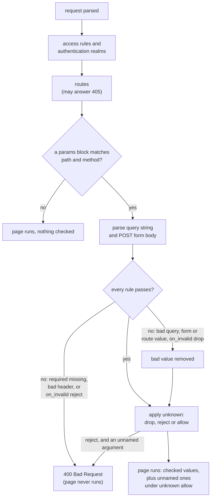

# Request validation

Klin can check request parameters before a page sees them, with the rules
written once in the configuration rather than repeated in every page.

Validation checks the parameters you name in the `params` block that
matches a request. Query and form arguments you do not name are dropped
by default, but with `unknown allow` they reach the page unchecked, and a
request that no `params` block matches is not checked at all. List every
page that takes input, and name every parameter it reads.

## The configuration

The `validators` block of a server or virtual host (vhost) defines named
checks. Its `params` blocks say, per path (and optionally
per method), which parameters the page takes, where each comes from and
which validator checks it. A validator that no `param` names checks
nothing.

```conf
validators
{
    validator
    {
        name    id
        regex   [0-9]{1,10}         # matched against the whole value
    }
    validator
    {
        name    page
        int     1 1000              # a decimal integer in this range
    }
    validator
    {
        name    title
        length  1 200               # a length in bytes
    }
    validator
    {
        name    order
        enum    asc desc            # one of these values
    }
}

params
{
    path        /api/items*         # fnmatch(3), may repeat
    method      GET POST            # none: any method
    unknown     drop                # drop (default), reject or allow
    on_invalid  reject              # reject (default) or drop

    param
    {
        name        id
        source      route           # query, form, route, header, any
        validator   id
        required    yes
    }
    param
    {
        name        page
        validator   page            # source any: query, form or route
    }
}
```

## Validator types

Each validator has a name and exactly one type.

| Type | Passes when |
| --- | --- |
| `regex` | the whole value matches a POSIX extended regular expression. Klin anchors it at both ends for you and compiles it once, at startup. |
| `int min max` | the value is a whole decimal integer (an optional `-` then digits, nothing else) within the range |
| `length min max` | the value's length in bytes is within the range |
| `enum a b ...` | the value is exactly one of the listed words (case matters) |

A `param` with no `validator` is still useful. It names the parameter, so
the parameter survives the `unknown` rule, and `required yes` still
applies to it.

## Where validation runs

Validation runs late in request handling: after access control,
authentication and routing, and just before the page. A failed check
ends in one of two ways: a 400, or the bad value is removed before the
page runs. In order:



A failure answers through klind's normal error path, so an `error.400`
page in the configuration is shown if you have one. Two body problems
are caught earlier, while the header is read, and never reach
validation: a POST without a Content-Length gets 400, and a body larger
than `post_maxsize` gets 413. If reading the form body fails during
validation, the status from that is returned instead.

## The rules in detail

### Paths

A `params` block matches the same path as routes do: the request path
the client asked for, decoded and normalised, after index selection (`/`
is matched as `/index.kl1` when that is the index page), with any
PATH_INFO included, and before routes and aliases replace it. That is
not the path access rules and realms see;
[Which path each check sees](ROUTES.md#which-path-each-check-sees) shows
both. The first block whose path and method
match applies, and a request that no block matches is not validated at
all. Methods are compared without regard to case and may be separated by
blanks or commas.

### Sources

`query` is the query string. `form` is a POST body sent as
`application/x-www-form-urlencoded` or `multipart/form-data`, or with no
`Content-Type` at all, which is read as URL-encoded. Other methods'
bodies, and POST bodies of other types, are not parsed as forms. `route` is a `{name}` found by
a route. `header` is a request header. `any`, the default, means query,
form and route, but not header.

### Repeated values

A query or form parameter given more than once has every value checked,
one by one; with `on_invalid drop` only the bad ones are removed. A
header rule reads one value, the first field of that name. A query or
form value with a NUL inside (`%00`) fails whatever validator checks it,
because whatever followed the NUL would escape the check.

### Failures

A value that fails its validator gets 400 Bad Request. With
`on_invalid drop`, a bad query, form or route value is removed instead
and the page simply does not see it. Two failures get 400 whatever
`on_invalid` says: a header that fails, since Klin cannot remove a header
from the request, and a required parameter that is missing or was
dropped.

### Unknown arguments

Query and form arguments that no `param` of the block names are dropped
before the page runs. Set `unknown allow` to keep them, or
`unknown reject` to answer 400. This applies to query and form arguments
only; route parameters and headers are left alone.

## Mistakes klind refuses

A bad rule stops klind at startup instead of letting requests through
unchecked. That covers a validator without a name or a type, a regex that
does not compile, a reversed range (or a negative `length`), a validator
defined twice or referenced but never defined, a `param` without a name,
an unknown `source`, a value other than those listed for `unknown` or
`on_invalid`, and a `params` block without a `path`.

See also: [ROUTES.md](ROUTES.md) for `{name}` parameters, and
[LIMITS.md](LIMITS.md) for the size and time limits on request bodies.
