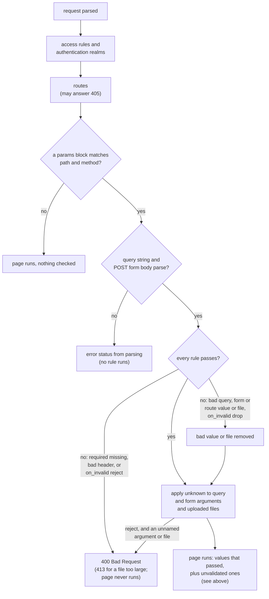

# Request validation

Klin can check request parameters before a page sees them, with the rules
written once in the configuration rather than repeated in every page.

Validation checks the values of the parameters you name, with a
validator, in the `params` block that matches a request. Anything else
reaches the page without a value check: a named parameter with no
validator (only its presence can be required), route parameters and
headers you do not name, and, under `unknown allow`, query and form
arguments and uploaded files you do not name (by default those are
dropped). Files sent in a `multipart/form-data` body are checked by
`upload` rules: size, type and count, not their contents. A request that
no `params` block matches is not checked at all. List every page that
takes input, and give every parameter it reads a validator.

## The configuration

The `validators` block of a server or virtual host (vhost) defines named
checks. Its `params` blocks say, per path (and optionally
per method), which parameters the page takes, where each comes from and
which validator checks it. A validator that no `param` names checks
nothing.

```conf
validators
{
    validator
    {
        name    id
        regex   [0-9]{1,10}         # matched against the whole value
    }
    validator
    {
        name    page
        int     1 1000              # a decimal integer in this range
    }
    validator
    {
        name    title
        length  1 200               # a length in bytes
    }
    validator
    {
        name    order
        enum    asc desc            # one of these values
    }
}

params
{
    path        /api/items*         # fnmatch(3), may repeat
    method      GET POST            # none: any method
    unknown     drop                # drop (default), reject or allow
    on_invalid  reject              # reject (default) or drop

    param
    {
        name        id
        source      route           # query, form, route, header, any
        validator   id
        required    yes
    }
    param
    {
        name        page
        validator   page            # source any: query, form or route
    }
}

params
{
    path        /photos/new
    method      POST
    unknown     reject

    param
    {
        name        title
        validator   title
    }
    upload
    {
        name        photo           # the form field the files come in
        max_size    2000000         # bytes per file
        type        image/png image/jpeg   # or image/*
        max_count   1               # files in the field (default 1)
        required    yes
    }
}
```

## Validator types

Each validator has a name and exactly one type.

| Type | Passes when |
| --- | --- |
| `regex` | the whole value matches a POSIX extended regular expression. Klin anchors it at both ends for you and compiles it once, at startup. |
| `int min max` | the value is a whole decimal integer (an optional `-` then digits, nothing else) within the range |
| `length min max` | the value's length in bytes is within the range |
| `enum a b ...` | the value is exactly one of the listed words (case matters) |

A `param` with no `validator` is still useful. It names the parameter, so
the parameter survives the `unknown` rule, and `required yes` still
applies to it. Its value, though, reaches the page unchecked.

## Where validation runs

Validation runs late in request handling: after access control,
authentication and routing, and just before the page. Once a block
matches, the query string and form body are parsed first, and a body
that cannot be read ends the request before any rule runs. A failed rule
then ends in one of two ways: a 400, or the bad value is removed before
the page runs. In order:



A failure answers through klind's normal error path, so an `error.400`
page in the configuration is shown if you have one. Two body problems
are caught earlier, while the header is read, and never reach
validation: a POST without a Content-Length gets 400, and a body larger
than `post_maxsize` gets 413. If reading the form body fails during
validation, the status from that is returned instead, and no rule runs.

## The rules in detail

### Paths

A `params` block matches the path saved just before routing: the FILENAME
plus any PATH_INFO, after index selection (`/` is matched as `/index.kl1`
when that is the index page). A route or alias that replaces the path
later does not change what validation sees. Access rules and realms see
only the FILENAME; [Which path each check
sees](ROUTES.md#which-path-each-check-sees) defines these terms and shows
both. The first block whose path and method match applies, and a request
that no block matches is not validated at all. Methods are compared
without regard to case and may be separated by blanks or commas.

### Sources

`query` is the query string. `form` is a POST body sent as
`application/x-www-form-urlencoded` or `multipart/form-data`, or with no
`Content-Type` at all, which is read as URL-encoded. Other methods'
bodies, and POST bodies of other types, are not parsed as forms. `route`
is a `{name}` found by a route. `header` is a request header. `any`, the
default, means query, form and route, but not header.

### Repeated values

A query or form parameter given more than once has every value checked,
one by one; with `on_invalid drop` only the bad ones are removed. A
header rule reads one value, the first field of that name. A query or
form value with a NUL inside (`%00`) fails whatever validator checks it,
because whatever followed the NUL would escape the check.

### Failures

A value that fails its validator gets 400 Bad Request. With
`on_invalid drop`, a bad query, form or route value is removed instead
and the page simply does not see it. Two failures get 400 whatever
`on_invalid` says: a header that fails, since Klin cannot remove a header
from the request, and a required parameter that is missing or was
dropped.

### Uploaded files

An `upload` block names a `multipart/form-data` field that carries files
and limits them:

| Key | Means |
| --- | --- |
| `max_size` | the largest file in bytes; none: only `post_maxsize` limits it |
| `type` | the Content-Types allowed, `type/subtype` or `type/*`, compared without regard to case and ignoring parameters such as `; charset=`. None: any type |
| `max_count` | how many files the field may carry (default 1) |
| `required` | `yes`: at least one file must arrive |

The type is the one the client wrote in the part's own Content-Type
header, so it says what the client claims, not what the file is. A file
sent without one fails a `type` list. Check the contents in the page if
they matter.

A file larger than `max_size` gets 413 Content Too Large, the status a
body over `post_maxsize` gets; a file of a type not listed gets 400. With
`on_invalid drop` the file is deleted instead and the page does not see
it. Too many files, or none in a required field (including when the
only ones were dropped), get 400 whatever `on_invalid` says.

The files have already been received and saved to the temporary
directory when the rules run, so `max_size` does not save the upload
time; `post_maxsize` stops a large body early. A file a rule refuses or
drops is deleted at once.

A file input left empty arrives as a plain field of that name, with no
file. The `upload` block's name covers it, so it is not an unknown
argument.

### Unknown arguments

Query and form arguments that no `param` of the block names, and files
in fields no `upload` names, are dropped before the page runs (a dropped
file is deleted). Set `unknown allow` to keep them, or `unknown reject`
to answer 400. Route parameters and headers are left alone.

## Mistakes klind refuses

A bad rule stops klind at startup instead of letting requests through
unchecked. That covers a validator without a name or a type, a regex that
does not compile, a reversed range (or a negative `length`), a validator
defined twice or referenced but never defined, a `param` without a name,
an unknown `source`, a value other than those listed for `unknown` or
`on_invalid`, and a `params` block without a `path`. For an `upload`, it
covers a missing name, a field named twice in one block, a key it does
not know, a `max_size` that is not a whole number of bytes (no `K` or
`M`), a `max_count` below 1, and a `type` entry that is not `type/subtype`
or `type/*`.

See also: [ROUTES.md](ROUTES.md) for `{name}` parameters, and
[LIMITS.md](LIMITS.md) for the size and time limits on request bodies.
