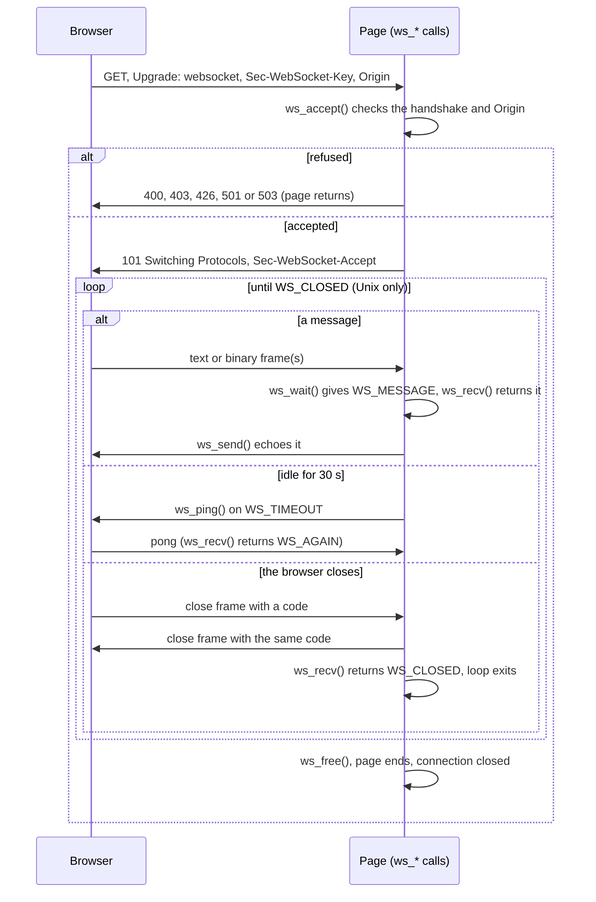

# WebSockets

A page can take over its connection as a WebSocket (RFC 6455). Use it
when the browser and the device both need to send at any time; if only
the server talks, [SSE.md](SSE.md) is simpler and needs no OpenSSL.

## An echo page

Include `<klin/ws.h>`. This page sends every message back as it came:

```html
<%! #include <klin/ws.h> %><%
    const char *data;
    size_t len;
    int type, w, rc;
    ws_t *ws;

    if(ws_accept(request, response, NULL, 0, &ws))
        return;             /* refused: the status is set (see below) */

    while((w = ws_wait(ws, -1, 30000)) != WS_CLOSED)
    {
        if(w == WS_TIMEOUT && ws_ping(ws))
            break;
        if(w != WS_MESSAGE)
            continue;
        if((rc = ws_recv(ws, &type, &data, &len)) == WS_CLOSED)
            break;
        if(rc == 0 && ws_send(ws, type, data, len))
            break;
    }
    ws_free(ws);
%>
```

Put nothing before the code block. `ws_accept()` answers the handshake
itself with 101 Switching Protocols, and from then on the connection
belongs to the page. It is closed when the page ends.

**The wait loop is Unix-only.** On a native Windows build `ws_wait()`
returns `WS_CLOSED` at once, so the echo loop ends before it reads
anything.

## The connection from start to finish

A connection to the echo page, from the handshake to its end (here a
close started by the browser):



If the page wants to end the connection itself, `ws_close(ws, code,
reason)` sends the close frame and waits for the browser's reply before
returning. Writing the close frame has the usual 30 s frame deadline.
The 2 s wait for the reply starts after that write, and it is checked
only between reads: one read can take several frames already buffered,
and each frame has its own 30 s read deadline. So 2 s is how long
`ws_close()` waits for a quiet browser, not a bound on the whole call.

## The calls

**`ws_accept(rq, rs, protocols, flags, &ws)`** checks the handshake: GET,
HTTP/1.1, `Upgrade: websocket`, `Connection: Upgrade`,
`Sec-WebSocket-Version: 13` and a 16-byte key. `protocols` lists the
subprotocols the page speaks, in order of preference, separated by blanks
or commas; the first one the client also offers is chosen, and
`ws_protocol()` tells you which. On failure the status is set and the
page should just return:

| Status | Why |
| --- | --- |
| 400 | not a WebSocket handshake |
| 426 | another protocol version (the answer carries `Sec-WebSocket-Version: 13`) |
| 403 | a page from another site (see [Origin](#origin)) |
| 503 | `max_streams` connections are already open (with `Retry-After: 5`, see [LIMITS.md](LIMITS.md)) |
| 501 | no OpenSSL in the build |

The other calls work on an accepted connection.

| Call | What it does |
| --- | --- |
| `ws_wait(ws, fd, ms)` | Waits for a message (`WS_MESSAGE`), for `fd`, a descriptor of the page's own (`WS_READY`), for `ms` milliseconds (`WS_TIMEOUT`; -1 means no limit), or for the end of the connection (`WS_CLOSED`). It waits in poll(2) and runs the timer's alarms meanwhile. |
| `ws_recv(ws, &type, &data, &len)` | Returns 0 with a whole message, `WS_TEXT` (checked to be UTF-8) or `WS_BINARY`, NUL-terminated and valid until the next call. Returns `WS_AGAIN` when only control frames or part of a message came (wait again), and `WS_CLOSED` when the connection ended. Pings are answered, and a close from the client is answered with its own code (1000 if it gave none). |
| `ws_send(ws, type, data, len)` | Sends a text or binary message. Text must be UTF-8. |
| `ws_ping(ws)` | Sends a ping, to keep an idle connection open through proxies. |
| `ws_close(ws, code, reason)` | Sends a close frame and waits for the client's: 2 s for a frame to start arriving, then up to 30 s to read it. |
| `ws_set_max_message(ws, bytes)` | The largest message accepted, 1 MB by default. A larger one closes the connection with 1009. |
| `ws_free(ws)` | Frees the connection object. The connection itself is closed when the page ends. |

## Protocol errors

Protocol errors close the connection with the RFC's code. Klin uses 1002
for an unmasked frame, a reserved bit set (no extension, such as
compression, is offered), an unknown opcode, a control frame that is
longer than 125 bytes or fragmented, and a broken fragment sequence. It
uses 1007 for text that is not valid UTF-8.

## Origin

A browser will open a WebSocket from any page it shows, and it sends the
cookies of the site it connects to. Without a check, another site's page
could open a connection to your device and use the logged-in user's
session. That is cross-site WebSocket hijacking.

So, unless the page passes `WS_ANY_ORIGIN`, `ws_accept()` refuses with 403
any handshake whose `Origin` names another host. It compares the host and
port in `Origin` (everything after the `://`) with the `Host` header,
ignoring case. The scheme is not compared. The comparison is of the text
as sent, so `Origin: https://dev:443` does not match `Host: dev`. A
handshake with no `Origin` at all, which is what clients other than
browsers normally send, is accepted. I would leave the check on for any
device that keeps a login session. If you do pass `WS_ANY_ORIGIN`, the
page must check `request_get_field_value(rq, "Origin")` itself.

## Timeouts and workers

A frame must arrive whole, and a frame sent must be taken by the client,
within 30 s; otherwise the connection is closed. That stops a client that
stalls half way through a frame from holding a worker.

**A WebSocket holds its connection, and a worker, for as long as it
lasts.** In the prefork model the watchdog asks the parent for another
worker after a second, and the worker exits after the connection. Size
`prefork.max_child` for the number of connections you expect, and use
`max_streams` (default 100) to keep long-lived connections from taking
every worker. The iterative model (`-d`, or `model iterative`) runs one
process, which serves nothing else while a WebSocket is open.

See also: [SSE.md](SSE.md) when only the server talks, and
[SESSIONS.md](SESSIONS.md) for the login sessions the Origin check protects.
